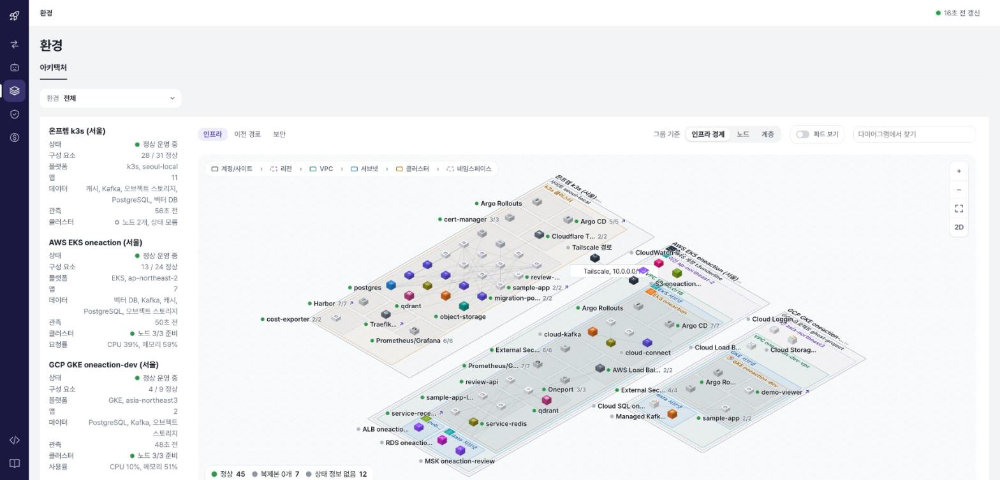
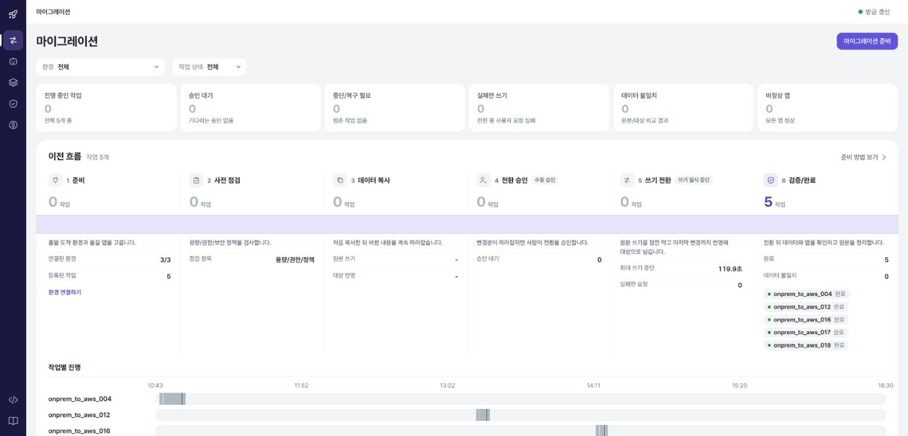
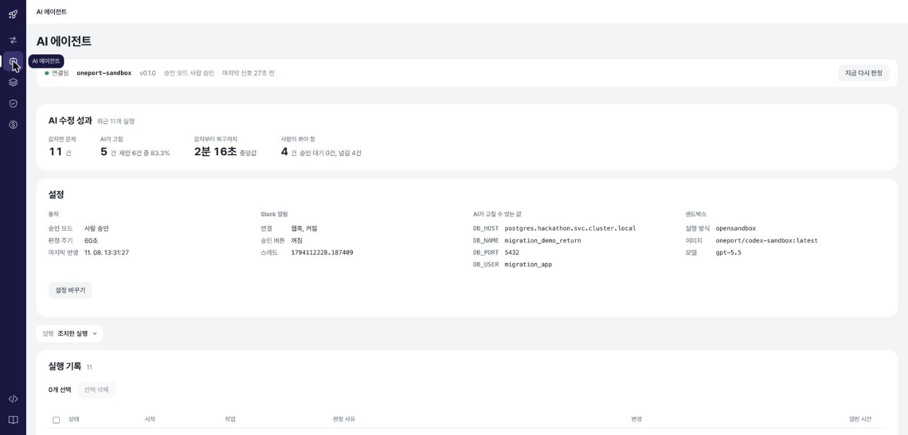
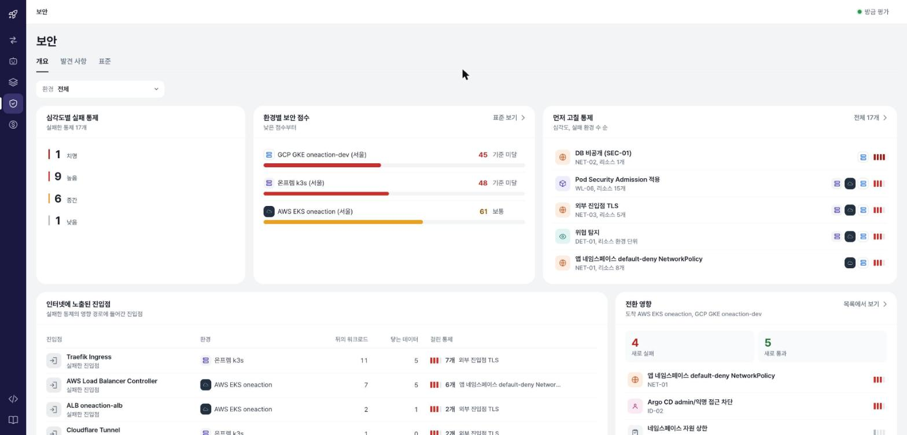
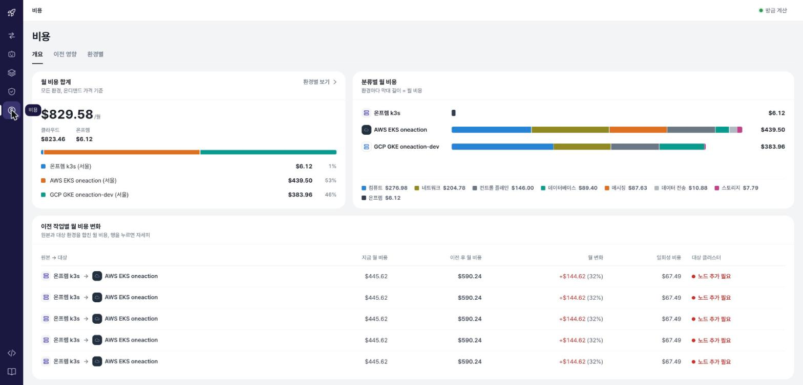
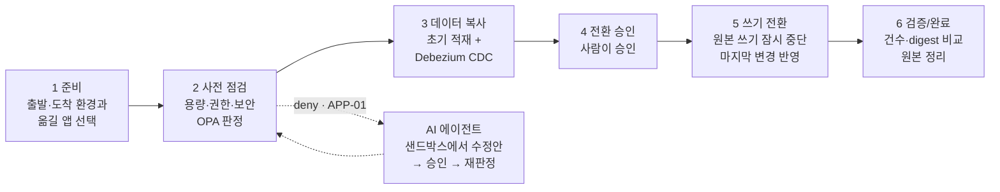

<div align="center">

# 👻 Oneport — 멈추지 않는 멀티 클라우드 이전 플랫폼

**온프렘 ↔ AWS ↔ GCP 사이에서 앱과 DB를 쓰기 유실 없이 옮기고, 정책·보안·AI 수정·비용까지 한 화면에서 다룬다.**

SoftBank Hackathon 2026 · Team Ghost

[](https://platform.yubin.dev/#environments)
[](https://github.com/SoftBankHackathon2026/Hackathon/actions/workflows/platform-ci.yml)
[](https://github.com/SoftBankHackathon2026/Hackathon/actions/workflows/policies.yml)
[](https://github.com/SoftBankHackathon2026/Hackathon/actions/workflows/migration-images.yml)
[](https://github.com/SoftBankHackathon2026/Hackathon/actions/workflows/crosscloud.yml)

[**플랫폼 열기**](https://platform.yubin.dev/#environments) · [이전 도구](migration/) · [정책](policies/) · [AI 에이전트](agent/) · [클라우드 간 이전](crosscloud/) · [관리 플랫폼](platform/)



</div>

---

## 왜 만들었나

프로덕션에서 멀티 클라우드를 운영하면 환경을 옮기는 일이 가장 무섭다. 복제가 끝났는지, 대상 앱이 DB에 붙는지, 보안 기준을 넘는지, 비용이 얼마나 늘지, 그리고 중간에 장애가 나면 누가 고치는지를 각각 다른 도구로 확인해야 한다.

Oneport는 **무중단으로 환경과 애플리케이션을 함께 이관**하는 데 집중한다. 그 과정에 필요한 판단(정책), 근거(보안 검사), 수정(AI 에이전트), 비용 추산을 하나의 플랫폼으로 묶었다.

## 무엇을 하나

| | 기능 | 한 줄 요약 |
|---|---|---|
| 🔀 | **마이그레이션** | 온프렘 PostgreSQL → RDS를 Debezium CDC로 복제하고, 쓰기를 잠깐 멈춘 뒤 마지막 변경까지 반영해 대상으로 넘긴다. 앱·접수 큐·Redis 원장도 같이 옮긴다 |
| 🗺️ | **환경** | 연결된 모든 환경(온프렘 k3s · AWS EKS · GCP GKE)의 아키텍처를 2D/3D 캔버스로 본다. 리소스를 클릭하면 계층·파드 상태·연결된 앱·보안·비용이 나온다 |
| 🤖 | **AI 에이전트** | OPA가 `APP-01`(대상 앱 DB 연결 실패)로 전환을 막으면 Codex가 샌드박스에서 원인을 추측하고 설정값을 고친다. 프로덕션에 반영하는 건 **반드시 사람 승인** 뒤 |
| 🛡️ | **보안** | 환경별 보안 점수, 먼저 고칠 통제, 인터넷에 노출된 진입점, 전환이 만드는 새 실패/통과. CIS Benchmark · CSP 권장 가이드 · ISMS · ISMAP 기준별 준수 현황 |
| 💰 | **비용** | 모든 환경의 월 비용 합계와 분류별 비용. 클라우드는 실제 API, 온프렘은 홈랩 전기 요금·VM 수·CPU 사용률로 추정. 이전 전후 비용 변화도 작업별로 본다 |

<table>
<tr>
<td width="50%"></td>
<td width="50%"></td>
</tr>
<tr>
<td align="center"><sub>마이그레이션 — 준비 → 사전 점검 → 데이터 복사 → 전환 승인 → 쓰기 전환 → 검증/완료</sub></td>
<td align="center"><sub>AI 에이전트 — 고칠 수 있는 키는 코드가 정하고, 적용은 사람이 승인한다</sub></td>
</tr>
<tr>
<td width="50%"></td>
<td width="50%"></td>
</tr>
<tr>
<td align="center"><sub>보안 — 지금 집중해야 할 대상이 먼저 보인다</sub></td>
<td align="center"><sub>비용 — 어떤 자원이 어떻게 바뀌어 얼마가 늘고 주는지</sub></td>
</tr>
</table>

## 한 번의 이전이 지나가는 길



- **쓰기는 한쪽만 받는다.** 전환 전에는 온프렘 앱만, 전환 후에는 AWS 앱만 사용자 쓰기를 받는다. 대상 DB에는 CDC 계정만 데이터를 넣는다.
- **접수 큐가 요청을 잃지 않는다.** 쓰기를 멈춘 구간의 요청은 durable-ingress가 보관했다가 전환 뒤 대상으로 보낸다.
- **정책이 단계를 연다.** `plan` · `pre_start` · `pre_cutover` · `final_verify` 단계마다 OPA가 allow / hold / deny를 낸다. 수치(대기 상한·증거 유효기간·승인 위치)는 정책이 아니라 계획(`input.plan`)이 가진다.
- **AI는 정해진 범위만 고친다.** 허용 키는 `DB_HOST` · `DB_PORT`뿐이고, 값은 계획의 대상 DB와 같아야 한다. 비밀값 키는 정적 검사에서 거절된다. 성공은 재판정이 `allow`일 때만이다.

## 저장소 구성

```
Hackathon/
├── platform/     관리 플랫폼. FastAPI 백엔드 + React 프론트. 세 환경을 읽기 전용으로 수집해 화면에 보여준다
├── migration/    온프렘 → AWS 이전 러너. seed · Debezium CDC · 전환 상태 머신 · verify · 계정/권한 이관
├── policies/     OPA/Rego 정책 5개와 입력 계약. 단계별 allow / hold / deny 판정
├── agent/        OPA 보류 사유를 고치는 AI 에이전트. Codex 를 OpenSandbox(gVisor)/사이드카에서 격리 실행
├── crosscloud/   AWS ↔ GCP 컨테이너 서비스 이전. 구성 파악 · 대응 서비스 판정 · 비밀값/감사 기록 이관
├── demo/         시연용 트래픽 제어판 (traffic-bot 켜고 끄기)
└── infra/        온프렘 k3s 부트스트랩 (Argo CD · Rollouts · 읽기 계정)
```

| 디렉터리 | 더 읽기 | 스택 |
|---|---|---|
| [`platform/`](platform/) | [화면과 데이터 출처](platform/docs/MIGRATION-DASHBOARD.md) · [비용 추산](platform/docs/COST-ESTIMATION.md) · [아키텍처](platform/docs/ARCHITECTURE.md) | Python 3.12 · FastAPI · uv · React 19 · Vite 7 |
| [`migration/`](migration/) | [전체 이전(DB+앱+접수)](migration/docs/full-service-migration.md) · [전환 정책](migration/CUTOVER_POLICY.md) · [원본 정리](migration/SOURCE_CLEANUP.md) | Python 3.12 · psycopg 3 · Debezium · Kafka Connect |
| [`policies/`](policies/) | [개념](policies/개념.md) → [사용법](policies/사용법.md) | OPA 1.22 · Rego |
| [`agent/`](agent/) | [README](agent/README.md) | Python · Codex CLI · OpenSandbox · OpenBao |
| [`crosscloud/`](crosscloud/) | [README](crosscloud/README.md) · [AWS 이전 자원](crosscloud/terraform/aws/README.md) | Python · Terraform |

## 함께 쓰는 저장소

코드 → 이미지(GHCR) → 선언(gitops) → 적용(Argo CD → 클러스터) 순서로 흐른다. 클러스터는 손으로 고치지 않는다.

| 저장소 | 역할 |
|---|---|
| [gitops](https://github.com/SoftBankHackathon2026/gitops) | Kustomize 매니페스트와 Argo CD Application. 온프렘 k3s · AWS EKS · GCP GKE 상태의 유일한 원본 |
| [oneaction-infra](https://github.com/SoftBankHackathon2026/oneaction-infra) | AWS Terraform 스택 (VPC · EKS · RDS · MSK · ALB · ESO) |
| [sample-app](https://github.com/SoftBankHackathon2026/sample-app) | 이전 대상 데모 앱. 어느 환경이 응답했는지 보여준다 |
| [review-service](https://github.com/SoftBankHackathon2026/review-service) | 배포 명세를 검토하는 AI 리뷰 서비스 (Review API · Kafka · LangGraph) |

## 빠르게 돌려보기

**플랫폼을 시뮬레이션 데이터로 띄우기** — DB도 클라우드도 필요 없다.

```sh
cd platform/backend
uv sync --frozen --extra aws
ONEPORT_AUTH_MODE=demo uv run --frozen --extra aws uvicorn controlplane.main:app --host 127.0.0.1 --port 8320
```

```sh
cd platform/frontend
npm ci && npm run dev        # http://127.0.0.1:4320
```

**정책 판정 확인**

```sh
cd policies
brew install opa
opa test --ignore examples --ignore schema . -v
opa eval -d migration.rego -i examples/pre_cutover_app_db_unreachable_deny.json 'data.ghost.migration.decision' --format pretty
```

**이전 도구 단위 테스트**

```sh
cd migration
pip install -e '.[dev]' && pytest
```

실제 클러스터에 연결하는 방법은 [platform/README.md](platform/README.md#2-실제-환경에-연결하기-aws에-띄우고-온프렘awsgcp-연결)와 [migration/README.md](migration/README.md)에 있다.

## 설계 원칙

- **플랫폼은 읽기만 한다.** 클러스터와 DB에 쓰는 건 러너·Argo CD뿐이다.
- **비밀값은 저장소에 없다.** 비밀번호·토큰·kubeconfig는 환경변수와 Secret 참조로만 다룬다. 로그·보고서·정책 입력에도 적지 않는다.
- **수치는 팀이 정한다.** 쓰기 대기 상한, 증거 유효기간, 승인 위치는 정책 코드가 아니라 계획 입력에 둔다.
- **AI의 권한은 코드가 정한다.** 무엇을 고칠 수 있는지는 `agent/agent/scope.py`가, 적용 여부는 사람이 결정한다.

## 기여

- 모든 변경은 feature 브랜치 → PR. 본문은 [`.github/PULL_REQUEST_TEMPLATE/`](.github/PULL_REQUEST_TEMPLATE/)의 유형별 템플릿(🐛 bugfix · 🆕 feature · 🔧 improvement · 📝 design · ⚙️ infra · 🔒 security)을 따른다.
- 제목은 `영역: 무엇을 한다` 한 줄. 예: `migration: 초기화 중 대기 명령을 거절해 재시도 교착 방지`.
- CI는 디렉터리별 워크플로([`.github/workflows/`](.github/workflows/))가 돈다. 이미지는 GHCR로 올라가고, 배포는 gitops의 태그 교체로만 한다.

## 팀

**Team Ghost** — 원가연 · 김태윤 · 화균 · 유빈 · 혜연

기획·회의록·작업 보드는 Notion `final_team_ghost`에 있다.
