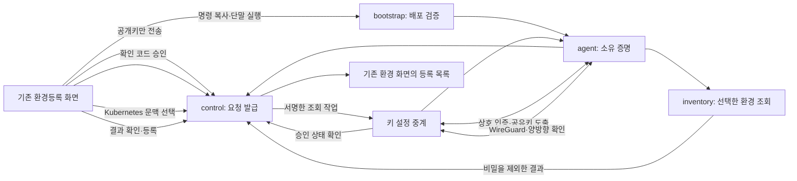

# 온프레미스 환경 연결

기존 환경등록 화면에서 발급한 명령으로 단말을 승인하고, 제한된 보안 터널을 통해 **사용자가 선택한 Kubernetes 환경정보를 조회·등록**하는 모듈입니다. 기존 `migration/migration/` 데이터 이전 코드와 플랫폼 준비 스크립트는 이동하거나 호출하지 않습니다.

이번 범위는 환경 연결과 조회까지입니다. Keycloak·OpenBao 구축/병합, Ansible 실행, 고객 권한 변경, 애플리케이션 설치, 데이터 이전, 운영 배포는 후속 작업입니다. 등록된 환경은 배포 가능한 실행 대상으로 자동 전환되지 않습니다.

## 디렉터리와 책임

| 경로 | 담당 기능 | 사용자 흐름에서 사용되는 시점 |
| --- | --- | --- |
| `contracts/` | 서명 자료의 정규화, 목적별 접두부, 해시·확인 코드 | 등록·상태 조회·수집 작업 검증 |
| `control/` | 요청/단말/터널/수집 상태, 승인, 만료, 폐기, PostgreSQL·Redis | 명령 복사부터 등록·해제까지 |
| `platform_bridge/` | 기존 서버에 기능을 선택적으로 연결하는 설정과 별도 이미지 | 연결 기능을 활성화한 배포 |
| `bootstrap/` | 고정 해시로 초기 실행 파일 검증, 등록 입력 전달 | 복사한 명령을 단말에서 실행 |
| `agent/` | 단말 프로그램, 키 설정 중계 프로그램, 제한된 관리자 보조 프로그램 | 소유 증명·터널·재접속·키 교체 |
| `inventory/` | 선택한 Kubernetes 문맥의 정보 조회와 엄격한 결과 형식 | 사용자가 환경 후보를 선택한 뒤 |
| `releases/` | 배포 묶음과 초기 스크립트 제작·검증 도구 | 관리자가 실행 파일을 배포하기 전 |
| `tests/` | 상태·권한·동시성·수집·배포 검증 | 개발 및 변경 검증 |
| `docs/` | 통신 계약과 운영·검증 기록 | 구현 추적 및 배포 준비 |

Rust 프로그램은 같은 암호·통신 계약을 공유하는 세 실행 파일로 나뉩니다. `migration-connector`는 사용자 단말에서 실행하고, `migration-key-broker`는 격리된 게이트웨이에서 키 설정과 작업 전달을 담당합니다. `migration-net-helper`만 정해진 네트워크 설정을 관리자 권한으로 수행합니다.

## 사용자 흐름과 의존 관계

1. 로그인한 사용자가 명령을 복사합니다. 브라우저에서 등록용 생성값을 만들고 서버에는 공개키만 보냅니다. 유효한 배포 설정과 중계 서비스 상태가 없으면 요청을 발급하지 않습니다.
2. 단말은 배포 검증 후 두 키의 소유를 증명합니다. 등록 요청은 60초 동안 유효하며, 성공한 요청과 확인값은 한 번만 소비됩니다.
3. 사용자가 단말에 표시된 8자리 코드를 웹에 입력합니다. 승인 기한은 5분이고 잘못된 입력은 5회까지입니다.
4. 승인된 단말과 중계 서비스가 새 키를 도출해 제한된 WireGuard 연결을 만듭니다. 실제 접속과 양방향 확인이 성공해야 조회 작업을 전달합니다.
5. 단말의 로컬 Kubernetes 설정에서 후보를 표시합니다. 사용자가 하나를 선택한 후에만 해당 클러스터를 조회합니다. 조회 권한이 없는 선택 항목은 `0`으로 꾸미지 않고 미확인으로 표시합니다.
6. 사용자가 수집 결과와 등록 위치를 확인하면 해당 결과의 해시·키 세대를 다시 검증하여 저장합니다. 환경 화면에 직접 등록한 환경으로 표시합니다.
7. 재접속은 새 키 세대를 사용합니다. 폐기는 서버 차단, 게이트웨이 정리, 단말 정리 확인을 별도로 기록합니다.

## 기존 코드의 변경 경계

- 서버: 연결 전용 경로 등록, 선택적 서비스 구성, `014_connections.sql`, 환경 목록에 등록 정보 추가. 단말 요청은 자체 서명, 중계 요청은 별도 서비스 인증을 사용하므로 해당 경로만 기존 화면 접속 PIN 검사에서 제외합니다.
- 화면: 기존 상태 표시 계약을 유지하면서 실제 서버 호출 모듈을 연결합니다. 복사 명령은 서버가 발급한 배포 정보를 사용하며, 기존 미리보기 기능은 시험용으로 유지합니다.
- 환경 목록: 기존 배포 현황과 구분되는 작은 등록 목록을 추가합니다. 실제 연결에서 기존 예시 애플리케이션 설치 단계로 넘어가는 버튼은 활성화하지 않습니다.
- 기존 마이그레이션 실행 코드, 인프라 구축 스크립트, 기존 서버 Dockerfile은 변경하지 않습니다.

## 활성화와 운영 전제

기본 배포는 연결 기능을 활성화하지 않습니다. [서버 계약과 설정](docs/control-api.md)을 따라 별도 패키지·데이터베이스 변경·Redis·서명키·배포 URL·초기 스크립트 해시를 준비해야 합니다. [배포 도구](releases/README.md)로 서명된 실행 묶음을 제작하고 실제 파일을 게시한 뒤, 동일 버전과 해시를 보고하는 중계 서비스가 실행되어야 합니다. 임의의 예시 URL이나 시험키로 기능을 활성화하지 마십시오.

게이트웨이는 [실행 프로그램 설정](agent/README.md)에 따라 관리자 소유의 네트워크 보조 프로그램과 제한된 정책이 준비되어 있어야 합니다. 고객 단말에 해당 구성요소가 없으면 단말 증명·웹 승인 후 터미널의 설치 동의와 관리자 인증을 받아 같은 요청으로 설치·연결을 계속합니다. 배포자는 보조 프로그램과 고객용 정책을 이중서명 묶음에 포함해야 합니다. 첫 대상 운영체제는 Ubuntu 24.04의 amd64/arm64입니다. Kubernetes 접속 설정과 기존 조회 권한은 고객이 제공하며 이 모듈이 계정·권한·클러스터를 만들지 않습니다. 한 중계 프로그램은 한 연결을 처리하며, 고객별 네트워크 공간을 분리해야 합니다. [관리자 설치 검사 결과](docs/admin-install-acceptance.md)는 기존 전체 연결 검사와 별도로 기록합니다.

현재 플랫폼에는 별도 프로젝트 권한 모델이 없습니다. 조직 권한은 로그인 세션에서 검증하고, 등록 폼의 프로젝트 값은 조직 안의 분류 정보로 저장합니다. 프로젝트별 접근 제어가 생기면 서버의 등록 경계에서 추가 검증해야 합니다.

## 검증 해석

화면의 모의 서버 시험, 암호 상호 운용 시험, 데이터베이스 통합 시험, 실제 터널 시험은 서로 다른 검증입니다. 화면 시험 통과만으로 고객 환경 연결이나 운영 배포 완료를 주장하지 않습니다. [검증 기록](docs/validation.md)과 [실제 K3s 연결 검사](docs/live-acceptance.md)에 결과와 한계를 구분했습니다. 최종 검사에서는 실제 Chrome 복사·붙여넣기부터 단말 증명·승인·양자내성 터널·수집·등록까지 같은 요청으로 확인했습니다. 별도 요청에서는 장애 후 새 키 재접속과 철회·정리를 검증했습니다. 운영 인증서·배포 서명키 발급, 공개 다운로드 게시, 실제 배포 네트워크 검증은 별도 작업입니다.

용어: API는 프로그램 간 요청 규약, TLS는 통신 상대 인증과 전송 보호 규약, PIN은 화면 접속용 숫자 비밀번호입니다. WireGuard는 암호화 네트워크 연결 도구이며, ML-DSA는 전자서명, ML-KEM은 공유 비밀 수립에 사용하는 알고리즘입니다.
