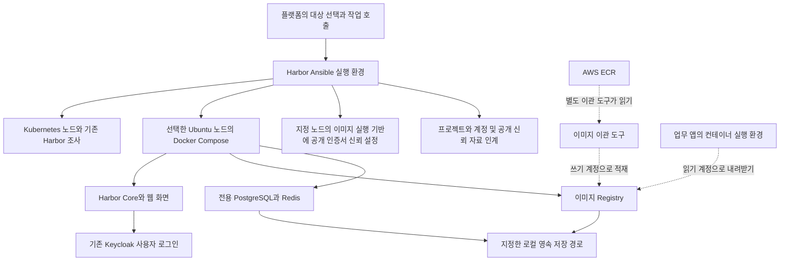

# Harbor 온프레미스 설치와 접근권한 설정 Ansible 구현계획

기준일: 2026년 11월 7일
상태: 인터뷰에서 확정한 설계 기준입니다. 실제 구현 범위와 검증 상태는 README.md와 VALIDATION.md를 확인하십시오. 이 계획의 파일 배치 예시와 선택 기능 모두가 구현되었다는 의미는 아닙니다.

**기존 Harbor를 탐색하거나 주소를 직접 입력해 재사용하고, 신규 환경은 사용자가 선택한 Ubuntu 노드 한 대에 Docker Compose로 설치합니다.** Keycloak 사용자 로그인, 비공개 프로젝트, 이미지 이관용 쓰기 계정과 앱용 읽기 계정을 준비하고, 지정한 노드에 Harbor 인증서 신뢰 설정을 적용합니다. 연결 자료는 플랫폼과 별도 이관 도구에 인계합니다. 실제 AWS ECR 이미지 복사는 별도 도구가 담당하며 GCP Artifact Registry 지원은 후속 작업입니다.

## 1 인터뷰에서 정한 범위

| 항목 | 확정한 요구사항 |
| --- | --- |
| 원본 레지스트리 | AWS ECR 우선, GCP Artifact Registry 후속입니다. |
| 스크립트 책임 | Harbor 탐색·설치·인증·프로젝트·접근권한 준비입니다. 실제 업무 이미지 복사·동기화는 별도 도구가 담당합니다. |
| 기존 환경 | 후보 탐색·사용자 선택, 주소 직접 입력, 신규 설치 선택을 모두 지원합니다. |
| 신규 설치 | 기존 Kubernetes에 속한 Ubuntu 노드 한 대를 선택하여 Docker Compose로 설치합니다. |
| 첫 지원 환경 | Ubuntu 24.04, amd64입니다. 설치물은 인터넷에서 받습니다. |
| 실행 기반 준비 | Docker·Compose가 없으면 설치합니다. 기존 Kubernetes 실행 기반과 충돌하면 중단합니다. |
| 사용자 인증 | 기존 Keycloak과 사용자 로그인 연동을 구성합니다. |
| 자동화 인증 | 이미지 이관 도구의 쓰기 계정과 앱의 읽기 계정을 분리합니다. |
| 인증서 | 기존 인증서 입력 또는 자체 생성을 지원합니다. |
| 영속 저장 | 플랫폼이 지정한 로컬 디스크 경로를 사용합니다. |
| 프로젝트 | 플랫폼이 전달한 비공개 프로젝트 목록을 준비합니다. |
| 노드 측 설정 | 플랫폼이 지정한 이미지 실행 노드에 Harbor 인증서 신뢰 설정을 적용합니다. |
| 앱 측 설정 | 읽기 계정과 연결 자료를 인계합니다. 앱의 이미지 주소 교체와 Kubernetes 읽기 자격증명 연결은 별도 플랫폼 연계 작업입니다. |

실행 시 필요한 도메인·포트·노드·데이터 경로·프로젝트명·Keycloak 주소·자격증명 참조는 플랫폼 입력으로 받습니다. 이 계획 단계에서 실제 운영 주소나 비밀값을 수집하지 않습니다.

## 2 기존 구현과 연계 원칙

기존 [Keycloak 구현](https://github.com/SoftBankHackathon2026/Hackathon/pull/27)과 [OpenBao 구현](https://github.com/SoftBankHackathon2026/Hackathon/pull/28)의 독립 명령, 입력 검증, Ansible 호출, 구조화된 결과 반환 방식을 따릅니다. Python은 호출과 결과 처리를 담당하고 서버 설치·제품 설정은 Ansible이 담당합니다.

확인한 자료는 서로 다른 작업 브랜치에 있습니다. 구현 착수 시 최신 통합 브랜치의 반영 상태와 개발 지침을 확인하고, 별도 작업 브랜치에서 Harbor 모듈을 추가합니다. 다른 세션의 작업 중 파일을 수정하거나 공통 모듈을 재구성하는 변경은 이 범위에 포함하지 않습니다.

기존 [Harbor 기록](https://github.com/SoftBankHackathon2026/Hackathon/blob/e5bb2e5/infra/install/onprem-k8s/admin/harbor/README.md)은 공개 이미지 캐시와 k3s 노드 미러 설정에 관한 자료입니다. 이를 클라우드 이미지 이관용 저장소가 준비된 증거로 사용하지 않습니다. 캐시 프로젝트에는 이미지를 직접 쓸 수 없으므로, 이번 목적지는 **일반 비공개 프로젝트**로 생성하거나 명시적으로 연결합니다. 기존 캐시 프로젝트·미러 설정은 자동 전환하지 않습니다. [Harbor 캐시 동작](https://goharbor.io/docs/main/administration/configure-proxy-cache/)

해당 기록의 접속 방식은 HTTP입니다. 실제 운영 상태는 다시 조사해야 하며, HTTPS가 없는 기존 환경은 후보로 반환하되 이번 기준의 재사용 준비 완료로 판정하지 않습니다. 기존 환경의 HTTPS 전환은 영향과 변경 내용을 확인한 별도 작업으로 다룹니다.

온프레미스 연결 작업의 환경 수집·작업 승인 결과를 입력으로 사용할 수 있도록 규약을 제공합니다. 확인한 연결 모듈은 환경 조사와 연결 제어를 구현 중이며, Harbor 설치 작업의 전달·실행까지 연결되어 있다고 가정하지 않습니다.

## 3 설치 후 구성과 역할



Harbor 설치 대상은 한 노드이며 인증서 신뢰 설정 대상은 플랫폼이 별도로 지정한 노드 목록입니다. 점선은 별도 이미지 이관·앱 적용 작업입니다. Harbor와 내부 PostgreSQL·Redis는 공식 설치 묶음의 컨테이너로 실행합니다. Keycloak·OpenBao의 데이터베이스를 공유하거나 별도 호스트용 데이터베이스 서비스를 추가하지 않습니다. Harbor 구성은 공식 설치기의 `harbor.yml`과 생성된 Compose 자원을 사용합니다. [Harbor 설치 설정](https://goharbor.io/docs/main/install-config/configure-yml-file/)

신규 설치는 단일 노드 구성입니다. 노드 장애 시 자동 전환, 외부 객체 저장소, 외부 백업 서비스, 취약점 검사기 추가, 자동 이미지 삭제·보존 정책은 첫 범위에 포함하지 않습니다. 기존 인프라를 변경해야 하는 경우 필요한 변경과 이유를 먼저 반환합니다.

## 4 코드 배치와 실행 명령

저장소 기준 다음 배치를 제안합니다. 아래 파일과 명령은 인터뷰 당시의 구현 제안입니다. 최종 배치와 호출은 README.md를 따릅니다.

```text
migration/
  migration/harbor_infra/
    __main__.py
    config.py
    runner.py
    discovery.py
    handoff.py
    ansible/
      ansible.cfg
      requirements.yml
      releases.json
      playbooks/{discover,inspect,preflight,install,configure,trust,verify,handoff}.yml
      roles/{discovery,preflight,runtime,install,tls,configure,trust,verify}/
      library/
      module_utils/
      callback_plugins/
      templates/
  config.harbor-infra.example.yaml
  docs/harbor-infra/{README.md,input.schema.json,result.schema.json,VALIDATION.md}
  tests/harbor_infra/
```

호출 규약은 `python -m migration.harbor_infra <operation> --config <보호된 설정 파일>`로 제안합니다. 아직 실행 가능한 설치 명령은 아닙니다. 표준 출력에는 최종 결과 하나를 내보내고, 진행 상황은 허용된 항목만 별도 경로로 전달합니다.

| 작업 | 실행 내용 | 변경 범위 |
| --- | --- | --- |
| `discover` | 지정한 클러스터와 접속 가능한 노드에서 기존 Harbor 후보 조사 | 읽기 전용 |
| `inspect` | 선택 후보 또는 직접 입력한 주소의 제품·통신·인증 상태 점검 | 읽기 전용 |
| `preflight` | 설치·재사용·노드 신뢰 설정의 조건을 검사하고 변경 계획 반환 | 읽기 전용 |
| `install` | 계획과 실제 상태를 재확인하고 신규 Harbor 설치 | 선택한 설치 노드의 실행 기반과 전용 자원 |
| `configure` | Keycloak 로그인·프로젝트·용도별 계정 구성 또는 대조 | 명시한 제품 설정과 자원 |
| `trust` | 지정 노드의 실행 기반을 확인하고 Harbor 공개 인증서 신뢰 설정 | 해당 레지스트리의 신뢰 설정 |
| `verify` | 통신·인증·허용과 거부·노드 신뢰·영속성 검증 | 지정한 시험 자원. 재시작은 별도 명시한 경우만 수행 |
| `handoff prepare/ack/cleanup` | 보호 자료 준비, 수령 확인, 임시 사본 정리 | 보호된 인계 자료와 수령 기록 |

기존 주소의 점검과 제품 설정에는 클러스터·노드 원격 접속을 필수로 요구하지 않습니다. 신규 설치와 노드 신뢰 설정에는 해당 노드 접속 정보가 필요합니다. 임의 네트워크 전체를 조사하지 않고 플랫폼이 지정한 대상만 처리합니다.

## 5 기존 Harbor 탐색과 재사용

Kubernetes에서는 허용 범위의 노드·파드·서비스·상위 배포 자원·외부 접속 자원을 읽습니다. Harbor 이미지·이름·라벨과 소유 관계를 근거로 같은 설치의 구성요소를 묶어 후보로 반환합니다. 이미지 이름이나 서비스 이름만으로 제품 확인을 완료하지 않습니다.

원격 접속이 가능한 노드에서는 알려진 서비스, Compose 관리 라벨, 컨테이너 실행 상태, 공개 포트, 설치 관리 표식을 조사합니다. 컨테이너 환경변수·Compose 설정 전체·Kubernetes의 비밀 객체 원문은 결과에 포함하지 않습니다. 접속 정보나 조회 권한이 없는 노드는 미조사로 표시합니다.

후보에는 설치 형태·노드·구성요소·주소 후보·확인 근거·조사 범위를 포함합니다. `inspect`는 인증서를 검증하고 Harbor 제품 응답, 구성요소 건강 상태, 이미지 Registry의 응답을 확인합니다. 일반 Registry의 인증 요구 응답만으로 Harbor라고 확정하지 않습니다. 제품 상세 조회에 인증이 필요한 경우에는 권한 부족을 반환합니다.

기존 Kubernetes 설치 환경도 관리 인터페이스를 통해 재사용할 수 있습니다. 기존 설치 형태 변경·제품 업그레이드·인증서 교체·데이터 이동·인증 방식 전환은 자동 실행하지 않습니다. 같은 이름의 기존 프로젝트는 용도·공개 범위·소유자를 확인하며, 명시적 재사용 지정 없이 관리 대상으로 편입하지 않습니다.

## 6 Ubuntu 노드 사전점검과 설치

플랫폼이 선택한 Node 이름·고유 식별자와 원격 호스트의 machine-id를 대조합니다. 변경 직전과 처리 후에도 노드 소속·정상 상태를 확인합니다. 제어 노드도 사용자가 선택할 수 있으나, 자원 여유와 핵심 서비스에 대한 영향을 추가 검사하고 변경 계획에 표시합니다.

첫 지원 환경은 Ubuntu 24.04·amd64입니다. 원격 접속·관리자 권한, 메모리·디스크·파일 관리 공간, 마운트 상태, 시각, 이름 해석, 포트, 기존 설치 흔적, 패키지 의존성을 점검합니다. Harbor의 공식 최소 자원은 처리 코어 2개·메모리 4 GB·디스크 40 GB입니다. 공유 노드에서는 기존 서비스 사용량을 제외한 여유를 확인하고, 실제 이미지 예상 용량·작업 중 임시 공간·Docker 저장 영역까지 별도로 계산합니다. 예상 적재량이 없으면 수용 용량 미확정으로 반환합니다. [공식 자원 요건](https://goharbor.io/docs/main/install-config/installation-prereqs/)

Docker 설치는 다음 원칙을 따릅니다.

1. 호환되는 Docker·Compose가 있으면 재사용하고 자동 업데이트하지 않습니다.
2. 없으면 설치할 패키지와 의존 관계를 사전점검해 변경 계획에 포함합니다.
3. 기존 Kubernetes가 사용하는 `containerd`·`runc`의 삭제·교체·재시작이 필요하면 차단합니다. 공식 설치 안내의 충돌 패키지 삭제 명령을 기존 클러스터에 그대로 적용하지 않습니다.
4. Docker의 네트워크 생성과 포트 공개가 기존 방화벽·패킷 전달 정책에 미치는 영향을 검사합니다. 기존 정책으로 통제가 불가능하면 필요한 조치를 반환하고 중단합니다.

Docker는 공개 포트가 기존 호스트 방화벽 규칙을 우회할 수 있고, 공식 패키지가 기존 컨테이너 실행 패키지와 충돌할 수 있으므로 두 항목을 설치 전 필수 검사로 둡니다. [Docker Ubuntu 설치 요건](https://docs.docker.com/engine/install/ubuntu/)

Harbor·Docker·Compose·Ansible 의존성의 정확한 버전, 공식 배포 주소와 검증값은 첫 구현 단계에서 고정합니다. 실행할 때 최신 버전을 자동 선택하지 않습니다. 공식 설치기를 사용하고 설치에 필요한 다운로드 주소를 배포물 목록으로 관리합니다. [공식 Harbor 설치기](https://goharbor.io/docs/main/install-config/download-installer/)

설치 관리 자료는 `/var/lib/harbor-infra/<installation_id>/`, 설정·인증서는 전용 디렉터리, 영속 데이터는 플랫폼이 지정한 전용 경로에 둡니다. 기존 `/data`의 내용이나 소유 불명 데이터를 자동 편입하지 않습니다. 데이터용 마운트가 빠진 상태에서 루트 디스크에 쓰는 일을 방지하도록 장치·마운트 대응을 기록하고 기동 시에도 검사합니다. Compose의 컨테이너 재시작 정책과 서비스 기동 순서를 함께 구성해 이 검사를 우회하는 자동 기동이 없도록 검증합니다.

공개 암호화 접속 포트는 입력값으로 받으며 기본 제안은 8444입니다. 실제로는 기존 443·Keycloak의 8443 등과 충돌하는지 검사합니다. 내부 PostgreSQL·Redis는 외부 공개하지 않습니다. Compose의 프로젝트·네트워크·서비스는 설치 식별자와 연결합니다. 관리하는 Harbor의 기동·재기동 정책과 로그 한도를 구성하되 Docker 전체를 재시작하는 방식으로 복구하지 않습니다.

## 7 인증서와 Keycloak 로그인

인증서는 `provided` 또는 `self_signed` 모드로 받습니다. 기존 인증서는 신뢰 체인·유효기간·주소와 개인키 일치를 검사합니다. 자체 생성 시에는 설치 전용 발급자와 서버 인증서를 만들고 도메인·IP를 올바른 주소 항목에 넣습니다. 공개 신뢰 자료와 지문을 반환하며 개인키는 서버의 보호 파일에 둡니다. 재실행으로 키를 다시 만들지 않습니다. [Harbor 암호화 접속 설정](https://goharbor.io/docs/main/install-config/configure-https/)

Ansible 실행 환경과 Harbor에서 Keycloak으로 접속하는 경로에도 각각 필요한 신뢰 자료를 제공합니다. 검증을 생략하거나 평문 통신으로 바꾸지 않습니다. 이미지 실행 노드의 신뢰 적용은 다음 절의 `trust` 작업이 담당합니다. 서버의 인증서 개인키를 실행 노드에 배포하지 않습니다.

사용자 로그인은 기존 Keycloak 관리 영역을 사용합니다. Harbor의 OIDC 설정, 전용 client 식별자·공유 비밀, 정확한 로그인 반환 주소, 사용자명·그룹 항목을 대응시킵니다. 기존 client 정보를 받는 방식을 기본으로 하며, 신규 등록·대조 모드는 해당 전용 client와 관리 권한이 명시된 경우에만 사용합니다. Keycloak 서버·관리 영역·사용자·다른 client는 변경하지 않습니다.

Harbor는 일반 로컬 사용자가 있으면 데이터베이스 인증에서 OIDC로 전환할 수 없습니다. 신규 환경은 일반 사용자 생성 전에 OIDC를 설정하고, 기존 환경이 제약에 해당하면 기존 사용자를 삭제하지 않고 차단 사유를 반환합니다. Keycloak의 역할이 Harbor 권한으로 자동 변환된다고 가정하지 않고 프로젝트별 그룹·역할을 명시합니다. 전체 관리자 그룹은 지정한 경우에만 설정합니다. [Harbor OIDC 설정과 제한](https://goharbor.io/docs/main/administration/configure-authentication/oidc-auth/)

초기 `admin`에는 기본 비밀번호를 쓰지 않습니다. 관리 주체가 보호 참조로 제공한 비밀번호를 사용하고, OIDC 구성 후에도 복구·관리용 로컬 관리자는 별도로 보관합니다. OpenBao의 초기 관리자 토큰과 같은 방식으로 폐기하지 않습니다. 실제 브라우저 로그인은 별도의 수용 시험 항목이며 설정 저장만으로 로그인 검증 완료라고 표시하지 않습니다.

## 8 이미지 실행 노드의 인증서 신뢰 설정

**Harbor 설치 노드와 이미지 실행 노드 목록을 분리합니다.** `trust.targets`에 지정된 각 노드의 클러스터 소속·고유 식별자·원격 호스트를 확인합니다. 사용자가 선택하지 않은 모든 노드나 모든 운영체제의 신뢰 저장소로 배포하지 않습니다.

먼저 노드에서 실제 사용하는 실행 기반과 버전·설정 경로를 조사합니다. 기존 자료의 k3s를 첫 실환경 검증 대상으로 삼고, 일반 containerd와 Docker는 아래 방식별 검증을 통과한 조합만 지원 목록에 넣습니다. 식별할 수 없는 실행 기반이나 검증하지 않은 구성은 지원 완료로 표시하지 않고 필요한 조건을 반환합니다.

| 실행 기반 | 적용 계획 | 반영 확인 |
| --- | --- | --- |
| k3s 내장 containerd | 관리하는 공개 인증서를 배치하고 `/etc/rancher/k3s/registries.yaml`의 해당 Harbor 주소에 `tls.ca_file`을 추가·대조 | k3s는 시작 시 설정을 읽으므로 재시작 필요 여부와 실행 결과를 별도 기록 |
| 일반 containerd | 이미 활성화된 `config_path` 아래의 해당 레지스트리 설정·인증서에 필요한 항목만 적용 | 해당 경로의 변경은 재시작 없이 읽을 수 있지만 실제 이미지 실행 경로에서 검사 |
| Linux Docker Engine | `/etc/docker/certs.d/<호스트와 포트>/`의 해당 발급자 공개 인증서 적용 | 실제 Docker가 사용하는 설정 경로와 접속 결과 확인 |

설정 방식과 반영 조건은 [k3s 공식 안내](https://docs.k3s.io/installation/private-registry), [containerd 호스트 설정](https://github.com/containerd/containerd/blob/main/docs/hosts.md), [Docker 인증서 안내](https://docs.docker.com/engine/security/certificates/)에 따릅니다. 표는 구현·검증할 지원 계획이며 현재 동작 확인을 마친 목록이 아닙니다.

기존 미러·주소 변환·인증·다른 레지스트리의 설정은 보존합니다. 해당 Harbor 주소에 기존 설정이 있으면 내용을 대조하고 소유권이나 목적이 다르면 중단합니다. 설정의 원본과 권한을 보호된 백업으로 보관하고, 원자적 파일 교체와 문법 검사를 적용합니다. 백업에 기존 자격증명이 포함될 수 있으므로 일반 작업 자료로 반환하지 않습니다. 검증 생략 설정, 전체 주소에 적용하는 와일드카드, 이미지 미러 전환은 추가하지 않습니다.

k3s·기존 컨테이너 실행 서비스의 재시작은 앱 가용성에 영향을 줄 수 있습니다. `preflight`에서 노드별 필요 작업을 반환하고, **대상과 재시작을 명시적으로 승인한 작업**에서만 순차 적용합니다. 승인되지 않았으면 파일 준비 상태와 `restart_required`를 반환하고 완료로 표시하지 않습니다. 재시작이 승인되어도 노드 정상 상태와 실행 환경을 확인하며 하나가 실패하면 다음 노드로 진행하지 않습니다. 제어 노드 재시작이나 앱 퇴거가 필요하면 영향과 별도 운영 절차를 먼저 제시합니다.

일반 containerd의 전역 `config_path` 신설이나 기존 실행 기반 교체가 필요하면 별도 변경으로 반환합니다. 인증서 검증을 끈 일회성 명령이나 `curl` 성공만으로 실제 컨테이너 실행 경로의 신뢰 설정을 확인했다고 표시하지 않습니다. 인증서를 명령마다 따로 지정하는 시험과 노드에 적용된 설정을 쓰는 시험도 구분합니다.

이 작업은 공개 인증서 신뢰 설정까지 담당합니다. 읽기 계정을 호스트 전체의 공통 인증으로 저장하거나 앱의 Kubernetes 자격증명 객체·배포 설정을 변경하지 않습니다. 해당 앱의 읽기 자격증명 연결과 이미지 주소 전환은 플랫폼 연계 작업입니다.

## 9 프로젝트와 자동화 계정

플랫폼이 전달한 프로젝트 목록마다 일반 비공개 프로젝트인지, 동일 이름의 기존 자원이 누구의 소유인지 확인합니다. 원본 저장소와 Harbor의 `<project>/<repository>` 대응은 플랫폼·별도 이관 도구가 정하고 이번 설치기는 전달된 목적지를 준비합니다. 자동 이미지 삭제·태그 정리·덮어쓰기를 허용하는 정책은 임의로 활성화하지 않습니다.

| 용도 | 준비할 권한 | 부여하지 않을 권한 |
| --- | --- | --- |
| 이미지 이관 도구 | 지정 프로젝트의 이미지 읽기·쓰기 | 다른 프로젝트, 이미지 삭제, 사용자·전체 설정 관리 |
| 업무 앱 실행 환경 | 지정 프로젝트의 이미지 읽기 | 쓰기·삭제·프로젝트 관리 |
| 운영자 | 지정 Keycloak 그룹과 Harbor의 프로젝트별 역할 연결 | 지정하지 않은 전체 관리자 권한 |

자동화에는 프로젝트별 robot account를 사용합니다. Harbor의 쓰기 권한은 읽기 권한과 함께 부여해야 합니다. 따라서 이관용은 읽기·쓰기를 조합하고 앱용은 읽기만 제공합니다. 프로젝트 안의 저장소 전체가 권한 범위이므로 저장소별 격리가 필요하면 프로젝트를 나눕니다. [자동화 계정의 권한과 비밀 관리](https://goharbor.io/docs/main/working-with-projects/project-configuration/create-robot-accounts/)

계정의 이름·소유 표식·권한·기한을 기록해 재실행 시 대조합니다. 기한은 입력받고 무기한을 기본으로 삼지 않습니다. 이관 후 쓰기 계정의 회수와 앱용 계정의 기한·교체 책임을 인계합니다. 정기 갱신 작업을 새로 구축하는 것은 후속 범위입니다.

Harbor에 AWS 원본 연결·접근키·복제 규칙을 등록하지 않습니다. 별도 이관 도구가 AWS 인증으로 ECR을 읽고 Harbor 쓰기 계정으로 적재합니다. GCP 확장 때도 목적지의 프로젝트·권한·신뢰 자료 규약을 재사용합니다.

## 10 자격증명 인계와 비밀 관리 연계

robot account의 비밀은 생성 후 Harbor에서 다시 조회할 수 없습니다. 생성 응답을 받은 즉시 최종 결과 반환 전에 보호된 인계 영역에 저장하고 결과에는 참조만 넣습니다. 생성 직후 중단되어 비밀을 확보하지 못했다면 미준비 상태로 반환합니다. 재실행으로 비밀을 임의 교체하지 않습니다.

인계 자료는 조직·요청자·설치 대상·프로젝트·용도·기한에 연결합니다. 디렉터리0700·파일0600, 소유자·파일 참조 검증, 인계 자료 기한, 수령 확인 후 임시 사본 정리를 적용합니다. 비밀은 일반 출력·실행 인자·차이 출력·디버그·정보 캐시에 넣지 않으며 Ansible 민감 작업의 `no_log`와 허용 항목만 수집하는 결과 처리를 함께 사용합니다.

Harbor 모듈은 보호 파일 참조와 대상·용도·기한을 인계합니다. 플랫폼은 기존 비밀 관리 연계 작업에서 해당 자료를 OpenBao의 지정 경로에 보관하고 소비자에게 전달할 수 있습니다. OpenBao 저장·조회 연결 자체를 Harbor 모듈에 이중 구현하지 않습니다. 비밀 관리 저장소에 보관하는 절차가 필수라면 플랫폼은 보관 확인을 받은 뒤 인계 완료를 전달해야 하며, 확인 전에는 해당 단계가 미완료로 남습니다.

정리 대상은 실행 환경·다운로드용 임시 사본입니다. OpenBao의 운영용 비밀, 앱이 계속 사용할 자격증명, 서버의 인증서 개인키는 삭제하지 않습니다. 전송 성공과 이용자의 수령·보관 확인을 구분합니다. 관리자 비밀번호·로그인 연동 비밀·서버 개인키·기계 계정의 비밀은 각각 다른 자료로 관리합니다.

## 11 플랫폼 입출력과 준비 상태

입력에는 형식 버전, 요청·조직·환경 식별자, 작업, 탐색 범위, 선택 대상, 설치 식별자, 공개 주소, 저장 경로, 인증서, Keycloak, 프로젝트·계정, 신뢰 설정 노드, 재시작 허용 범위, 검증·인계 조건을 둡니다. 원격 접속의 호스트 키·개인키·관리 권한은 보호 참조로 받습니다. 임의 셸이나 임의 Ansible 작업을 실행하는 입력은 제공하지 않습니다.

결과는 Harbor 전용 형식으로 정의합니다. 기존 모듈의 형식을 참고하되, 차이가 있는 Keycloak·OpenBao 결과 형식을 이번 작업에서 변경하지 않습니다. 공통 플랫폼과의 대응은 별도 연결 부분에서 처리합니다.

| 결과 | 주요 내용 |
| --- | --- |
| 기본 | `schema_version`, `request_id`, `operation`, 대상 식별자, 시작·종료 시각 |
| 상태 | `status`, 고정된 `reason_codes`, 다음 작업 |
| 탐색 | `candidates`, 조사 범위 `coverage`, 미조사·권한 부족 정보 |
| 변경 | 계획 식별자·설정 요약, 예정·적용 변경, 변경 여부가 미확정인 항목 |
| 검사 | `checks`의 성공·실패·미실행·대상외와 검사한 위치 |
| 연결 | 확인한 Harbor 주소·버전·프로젝트·계정 식별자·기한, 공개 신뢰 자료 참조·지문 |
| 노드 신뢰 | 노드별 실행 기반, 파일 준비·활성화·실제 검사 상태, `restart_required` |
| 비밀 인계 | `credential_refs`, 수령·정리 상태. 비밀 원문 제외 |
| 책임 범위 | `scope: infrastructure_only`, `workload_image_transfer_performed: false`, 별도 시험 이미지 작업 내역, 앱 적용 상태 |

`status`는 `discovered`, `inspected`, `preflight_passed`, `installed`, `configured`, `partially_ready`, `ready`, `blocked`, `failed`를 기본안으로 합니다. 설치 성공과 인증 준비·업무 이미지 이관 성공을 구분합니다. `ready`는 이번 요청에서 필수인 제품 설정·인계·지정 노드의 신뢰 검사가 모두 통과한 경우에만 사용합니다. 신뢰 파일만 작성하고 적용·검증을 못 했다면 `partially_ready`입니다.

브라우저 로그인·업무 앱 배포·실제 ECR 이관은 각각 별도 상태로 반환하며, 수행하지 않은 항목은 미실행으로 표시합니다. 노드의 실제 실행 경로 검증에 시험 이미지·임시 인증이 필요한데 제공되지 않으면 해당 검사를 통과 처리하지 않습니다.

플랫폼은 후보 표시·사용자 선택·계획 확인, 허용된 작업 호출, 실행 기록·결과 표시, 다운로드·비밀 관리를 담당합니다. 이번에는 호출 규약·입출력 예제를 제공하며 플랫폼 화면·연결 제어 기능 자체의 수정은 별도 연계 작업으로 둡니다.

## 12 반복 실행과 중단 후 재개

설치 노드와 신뢰 설정 노드의 변경은 호스트별 잠금과 설치 관리 표식으로 보호합니다. 변경 직전에 대상 식별·설정 요약·승인한 계획을 다시 확인합니다. 기존 Harbor의 제품 설정은 같은 대상에 대한 변경을 실행 계층에서 직렬화하는 조건을 둡니다. 잠금을 확인할 수 없으면 변경을 강행하지 않습니다.

같은 입력의 재실행은 프로젝트·계정·데이터·인증서·다른 레지스트리 설정을 보존합니다. 기존 자원의 소유 표식과 실제 설정을 대조하고 비밀번호·기계 계정 비밀을 자동 갱신하지 않습니다. 설정이 달라지거나 다른 관리자가 변경했으면 충돌 내용을 반환합니다.

중단 시 적용한 변경과 남은 작업을 기록하고, 재개 전에 실제 상태를 확인합니다. 데이터 삭제·볼륨 삭제·기존 프로젝트 삭제·Docker 전체 재시작으로 자동 복구하지 않습니다. 접속 끊김 뒤에는 미변경으로 단정하지 않습니다. 남은 잠금은 소유자·실행 상태를 확인하며 기한만 보고 처리 중인 작업의 잠금을 빼앗지 않습니다.

## 13 구현 순서와 수용 기준

| 단계 | 구현 내용 | 수용 기준 |
| --- | --- | --- |
| 1 | 최신 통합 상태 확인, 입력·결과 형식, 독립 명령, 의존성·배포 자료 고정 | 입력 예제·검증, 설치한 패키지의 자원 접근이 동작하고 비밀을 결과에 노출하지 않습니다. |
| 2 | Kubernetes·Compose 탐색, 주소 직접 점검, 조사 범위 보고 | 후보 없음·권한 부족·제품 미확정·인증서 오류를 구분하고 읽기 전용으로 동작합니다. |
| 3 | 노드·자원·실행 기반·저장소·통신 사전검사 | 기존 실행 기반 삭제, 잘못된 저장 위치, 포트 충돌을 변경 전에 차단합니다. |
| 4 | Docker·Compose·Harbor 설치, 인증서·영속 저장·기동 설정 | Ubuntu 24.04에서 실제 설치, 재실행·중단 후 재개와 기존 클러스터 정상 상태를 확인합니다. |
| 5 | Keycloak·프로젝트·용도별 계정·인계 | 권한 허용·거부, 비밀 인계·수령·기한 정리를 확인합니다. |
| 6 | 노드별 공개 인증서 신뢰 설정과 검증 | 기존 설정을 보존하고, 반영에 필요한 재시작·미검증 노드를 구분합니다. |
| 7 | 통합 검증·플랫폼 호출 예제·검증 기록 | 결과 형식에 맞게 실제 수행 항목과 남은 작업을 보고합니다. |

자동 시험은 입력 오류·비밀 출력 방지·부분 조사, 노드 바뀜·패키지 충돌·기존 소유권 충돌, 중복 실행·계정 생성 응답 유실·인계 실패, 기존 신뢰 설정 보존·잘못된 인증서 거부·재시작 미승인 상태를 중심으로 구성합니다. Ansible 문법과 배포 자료 포함, 기존 계정·비밀·데이터베이스 이관 모듈에 대한 관련 회귀 검사도 수행합니다.

실제 Harbor에서는 전용의 작은 시험 이미지로 쓰기·읽기·내용 일치, 읽기 계정의 쓰기 거부, 다른 프로젝트 접근 거부를 검사합니다. 시험 자원의 위치를 지정하고 해당 실행이 만든 자원만 정리합니다. 시험 허용 범위가 없으면 미실행으로 반환합니다. 이 시험과 AWS에서 실제 업무 이미지를 복사하는 검증은 별개입니다.

노드 검증은 실제 사용하는 실행 기반의 이미지 다운로드 경로로 수행하고, 인증서 검증을 끄거나 명령에 별도 신뢰 파일을 강제한 성공을 적용 완료의 근거로 쓰지 않습니다. 임시 읽기 자격증명을 쓰는 검증은 시험용 경로에서만 처리하고 앱 배포 설정으로 남기지 않습니다.

Harbor 재시작 시험은 이 모듈이 신규 설치한 환경에서 명시적으로 지정할 때 수행합니다. 노드 실행 기반 재시작은 8절의 승인 범위를 따르고 호스트 전체 재부팅과 구분합니다. 기존 Harbor 재시작, 앱 퇴거, 호스트 재부팅은 별도 운영 작업으로 둡니다.

완료 보고는 코드·로컬 시험, 실제 Ubuntu 설치, Keycloak 로그인, 노드 신뢰 반영, 플랫폼 연결, 실제 이미지 이관의 검증 여부를 나누어 작성합니다. 이 문서는 구현 전 설계 기준을 기록합니다. 실제 구현 및 검증 상태는 README.md와 VALIDATION.md를 따릅니다.

## 14 용어

Ansible은 서버 구성을 자동화하는 도구, Docker Compose는 여러 컨테이너의 구성·기동을 관리하는 도구입니다. AWS ECR과 GCP Artifact Registry는 각각 Amazon Web Services와 Google Cloud Platform의 이미지 보관 서비스입니다. amd64는 64비트 x86 계열 프로세서 형식이며 GB는 용량 단위입니다.

HTTPS·TLS는 서버 신원 확인과 통신 암호화, OIDC는 사용자 로그인 연동 표준입니다. realm은 Keycloak 인증 관리 영역, client는 로그인 연동 등록 단위, robot account는 Harbor의 기계용 계정입니다. Registry는 컨테이너 이미지 보관·배포 기능입니다. Pod는 Kubernetes의 컨테이너 실행 단위, Service·Ingress는 접속을 제공하는 자원입니다. k3s는 Kubernetes 배포 형태이며 containerd·runc는 컨테이너 실행 기반입니다.

machine-id는 Linux 호스트 식별 정보, IP는 네트워크 주소입니다. JSON·YAML은 구조화된 자료 형식이며 schema는 입력·결과 형식 정의입니다. digest·hash는 내용 일치를 확인하는 요약값입니다. `no_log`는 Ansible 작업 인자의 일반 출력 방지 설정, `config_path`는 containerd가 레지스트리별 설정을 읽는 경로, `restart_required`는 재시작 필요 상태입니다.
