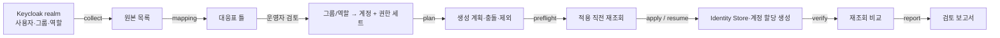

# Keycloak → IAM Identity Center 계정·권한 이관

**`python -m migration.identity_export`는 온프레미스 Keycloak의 사용자·그룹·역할을 읽어 AWS IAM Identity Center의 사용자·그룹·구성원과 계정별 권한 세트 할당으로 옮기는 독립 Python 도구입니다.** `migration.identity`(AWS → Keycloak)의 반대 방향이며 같은 명령 형태·단일 JSON 응답·종료 코드·상태 기록 방식을 사용합니다. 플랫폼의 "계정·권한 이관" 단계를 온프레미스 → AWS 방향으로 지원하기 위한 도구입니다.

Keycloak 권한을 AWS 권한으로 자동 변환하지 않습니다. 운영자가 작성한 대응표에 있는 그룹·역할만 AWS 계정과 권한 세트에 연결합니다. 대응표에 없는 항목은 추측하지 않고 제외 목록에 남깁니다. 실제 AWS·Keycloak 환경 검증을 수행하지 않았으므로 운영 이관 완료로 간주하면 안 됩니다.

## 처리 흐름



| 단계 | 동작 | AWS·Keycloak 변경 |
|---|---|---|
| `collect` | Keycloak 관리 인터페이스에서 사용자(이름·이메일·이름/성·활성 여부), 중첩 경로를 포함한 그룹과 구성원, 그룹의 realm/client 역할 연결을 페이지 단위로 조회 | 없음 |
| `mapping` | 수집한 모든 그룹·역할을 할당이 비어 있는 대응표 틀로 출력. 종료 코드 3은 검토 필요를 뜻함 | 없음 |
| `plan` | 대응표 검증, 권한 세트 이름 → ARN 확인, 생성할 사용자·그룹·구성원·할당과 기존 객체 충돌·제외 목록 계산 | 없음(조회만) |
| `preflight` | 계획에 묶인 대상 상태를 다시 읽어 충돌이 생겼는지 확인 | 없음(조회만) |
| `apply` / `resume` | 고유 속성으로 먼저 찾고 없을 때만 생성. 계정 할당은 비동기 생성 상태를 완료될 때까지 조회 | 생성만 |
| `verify` | Identity Store와 계정 할당을 다시 읽어 계획과 비교 | 없음(조회만) |
| `status` / `export` / `report` | 상태 기록 조회, 등록 절차·제외 목록 내보내기, Markdown 보고서 | 없음 |

## 대응 규칙

- 대응표의 `bindings[]`마다 원본(`group` 경로, `realm_role`, `client_role`)과 대상 Identity Store 그룹 이름(`target_group`), `review_ref`, `assignments[]`(계정 ID + 권한 세트 이름 또는 ARN)를 지정합니다.
- `assignments`가 비어 있거나 대응표에 없는 그룹·역할은 `UNMAPPED`로 제외합니다. 해당 그룹은 AWS에 만들지 않고 할당도 하지 않습니다.
- Identity Store 그룹은 중첩되지 않으므로, 그룹 원본의 구성원은 그 그룹과 모든 하위 그룹의 직접 구성원을 합친 것입니다. Keycloak에서 하위 그룹 구성원이 상위 그룹의 역할을 상속받는 방식과 같습니다.
- 역할 원본의 구성원은 그 역할이 직접 연결된 그룹(및 하위 그룹)의 구성원입니다. 복합 역할은 펼치지 않습니다. 사용자에게 직접 연결된 역할은 `USER_DIRECT_ROLE_MAPPING_NOT_MIGRATED`로 제외합니다.
- 비활성 사용자는 기본으로 제외합니다(`DISABLED_USER`). `options.include_disabled_users`를 켜면 포함하지만 Identity Store에는 활성 상태로 만들어지므로 주의해야 합니다. `service-account-` 사용자는 항상 제외합니다.
- `options.user_scope`의 기본값 `mapped_members`는 대응된 그룹·역할에 속한 사용자만 만듭니다. `all_enabled`는 활성 사용자 전체를 만듭니다.
- 이 도구가 만든 그룹의 설명에는 `identity-export:<이관 ID>`를 기록합니다. 같은 이름의 기존 그룹이 다른 설명을 가지면 남의 그룹으로 보고 차단합니다.
- 같은 사용자 이름의 기존 사용자가 다른 이메일을 가지거나(`EXISTING_USER_EMAIL_MISMATCH`), 이메일이 다른 사용자에게 이미 쓰이면(`EMAIL_USED_BY_ANOTHER_USER`) 차단합니다. 이름·이메일이 모두 같으면 기존 사용자를 그대로 사용하고 생성 소유권을 주장하지 않습니다.
- 이메일·이름·성이 없는 사용자는 Identity Center 등록 절차를 진행할 수 없으므로 `USER_ATTRIBUTE_REQUIRED`로 차단합니다.

## 이관하지 않는 항목

**비밀번호·다중 인증(MFA) 장치·Keycloak 자격증명은 옮기지 않습니다.** 새로 만든 사용자는 모두 IAM Identity Center의 등록 절차(이메일 확인 초대 발송, 비밀번호 설정, MFA 등록)를 마쳐야 로그인할 수 있습니다. 보고서와 `export` 결과의 `identity_center_onboarding` 항목, `verify`의 `pending_onboarding` 목록이 대상 사용자를 알려 줍니다.

다음 Keycloak 전용 기능도 `feature` 제외 항목으로 보고합니다.

| 항목 | 이유 |
|---|---|
| client scope·protocol mapper | Identity Center에 대응 개념이 없음 |
| 세분화 권한(Authorization Services) | 정책·자원·권한 평가 모델이 다름 |
| 외부 IdP 연결·사용자 연동 출처 | 외부 IdP를 Identity Center 원본으로 쓰려면 별도 설정 필요 |
| 사용자 속성·필수 동작 | 표준 속성(이름·이메일)만 옮김 |
| 세션·오프라인 토큰 | 이관 대상 아님 |
| 복합 역할 펼치기 | 필요한 역할은 대응표에 직접 지정 |

## 필요한 권한

AWS 실행 주체(Identity Center 위임 관리자 또는 관리 계정)에 다음 작업이 필요합니다. 실제 인스턴스와 대상 계정 범위로 제한해 부여하십시오.

| 서비스 | 작업 |
|---|---|
| Identity Store | `identitystore:GetUserId`, `identitystore:GetGroupId`, `identitystore:GetGroupMembershipId`, `identitystore:DescribeUser`, `identitystore:DescribeGroup`, `identitystore:List*`, `identitystore:CreateUser`, `identitystore:CreateGroup`, `identitystore:CreateGroupMembership` |
| IAM Identity Center | `sso:ListInstances`, `sso:ListPermissionSets`, `sso:DescribePermissionSet`, `sso:ListAccountAssignments`, `sso:CreateAccountAssignment`, `sso:DescribeAccountAssignmentCreationStatus` |

`collect`·`plan`·`preflight`·`verify`에는 조회 작업만 필요합니다. 생성 작업은 `apply`/`resume`에서만 사용합니다. 계정 할당을 만들면 AWS가 대상 계정에 권한 세트 역할을 준비하므로, 실행 전에 AWS 문서의 `CreateAccountAssignment` 추가 요구 권한을 확인하십시오.

Keycloak은 이관할 realm 안에 client credentials 방식의 서비스 계정 client를 만들고, `realm-management`의 `view-users`, `query-groups`, `view-realm` 역할만 부여합니다. client 비밀값은 설정에 직접 넣지 않고 소유자만 읽을 수 있는(권한 0600) 파일 경로로 지정합니다. 권한이 넓은 파일은 `PRIVATE_FILE_REQUIRED`로 거절합니다.

## 실행

`migration[identity]`를 별도 가상환경에 설치합니다. [설정 예제](../../identity-examples/identity-export-config.example.json)와 [대응표 예제](../../identity-examples/identity-export-mapping.example.json)의 `<...>` 자리를 비공개 작업 경로의 사본에서 실제 값으로 바꿉니다.

```bash
python -m migration.identity_export collect --config /run/platform/identity-export.local.json --out <결과 경로>/inventory.json
python -m migration.identity_export mapping --inventory <결과 경로>/inventory.json --out <결과 경로>/mapping.json
python -m migration.identity_export plan --config /run/platform/identity-export.local.json --inventory <결과 경로>/inventory.json --mapping <결과 경로>/mapping.json --out <결과 경로>/plan.json
python -m migration.identity_export report --config /run/platform/identity-export.local.json --plan <결과 경로>/plan.json --out <결과 경로>/review.md
python -m migration.identity_export preflight --config /run/platform/identity-export.local.json --plan <결과 경로>/plan.json --out <결과 경로>/preflight.json
python -m migration.identity_export apply --config /run/platform/identity-export.local.json --plan <결과 경로>/plan.json --preflight <결과 경로>/preflight.json --state-dir <상태 경로> --confirm-plan '<검토한 plan_hash>' --out <결과 경로>/apply.json
python -m migration.identity_export verify --config /run/platform/identity-export.local.json --plan <결과 경로>/plan.json --out <결과 경로>/verification.json
```

중단되면 같은 인자로 `resume`을 실행합니다. 쓰기 전에 `applying`을 기록하고, 응답이 유실되면 `unknown`으로 남깁니다. 재개할 때는 바로 다시 만들지 않고 먼저 사용자 이름·그룹 이름·구성원·할당을 다시 조회합니다. 계정 할당이 제한 시간 안에 끝나지 않으면 `ACCOUNT_ASSIGNMENT_PENDING`, 실패하면 `ACCOUNT_ASSIGNMENT_FAILED`로 멈춥니다. AWS의 실패 사유 원문은 결과에 넣지 않습니다.

모든 산출물은 권한 0600으로 원자적으로 저장합니다. 표준 출력은 비밀값이 없는 JSON 한 줄입니다. 종료 코드는 완료 0, 실행 오류 1, 차단 2, 검토 필요·부분 완료 3입니다. `verify`는 구성이 모두 일치해도 사용자 등록 절차가 남아 있으므로 `partial`(3)을 반환합니다.

## 제한

- 생성만 지원합니다. 기존 사용자·그룹의 속성 갱신, Keycloak에서 빠진 구성원·할당의 회수, 자동 되돌리기는 하지 않습니다. 잘못 만든 객체는 상태 기록의 `created` 값을 확인한 뒤 운영자가 직접 정리합니다.
- 권한 세트는 미리 존재해야 합니다. 권한 세트 생성·정책 작성·계정의 권한 세트 프로비저닝은 범위 밖입니다.
- Identity Center 자체 디렉터리를 원본으로 쓰는 인스턴스를 대상으로 합니다. 외부 IdP·Active Directory를 원본으로 쓰는 인스턴스는 사용자·그룹이 SCIM·동기화로 관리되므로 대상으로 하지 않습니다.
- 계정 할당은 그룹 주체로만 만듭니다. 사용자 직접 할당은 만들지 않습니다.
- 한 번 실행하는 이관 도구이며 지속 동기화(SCIM)를 대체하지 않습니다.

## 검증 기록

- Keycloak HTTP와 Identity Store·SSO 관리 클라이언트의 모형으로 단위 검사를 수행했습니다. 실제 네트워크에 접속하지 않습니다.
- 서비스 계정 토큰 요청, 비밀 파일 권한, 중첩 그룹 탐색(하위 그룹 별도 조회 방식 포함), 페이지 처리, 대응되지 않은 그룹·비활성 사용자 제외, 충돌 차단, 조회 후 생성, 응답 유실 후 중복 없는 재개, 계정 할당 상태 조회·실패·지연, 재조회 검증, CLI 단일 JSON·종료 코드·산출물 권한·비밀값 미출력을 확인했습니다.

**실제 AWS·Keycloak 접속, 사용자 등록 절차, 할당된 권한으로의 실제 로그인은 미검증입니다.**
