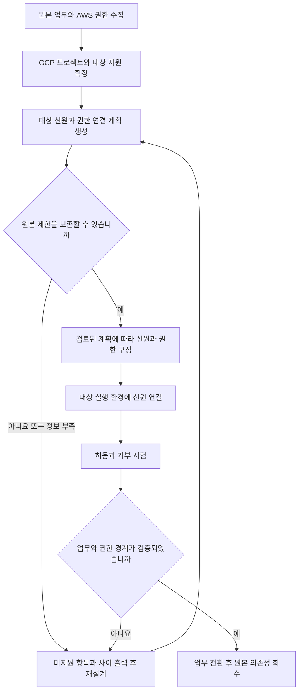
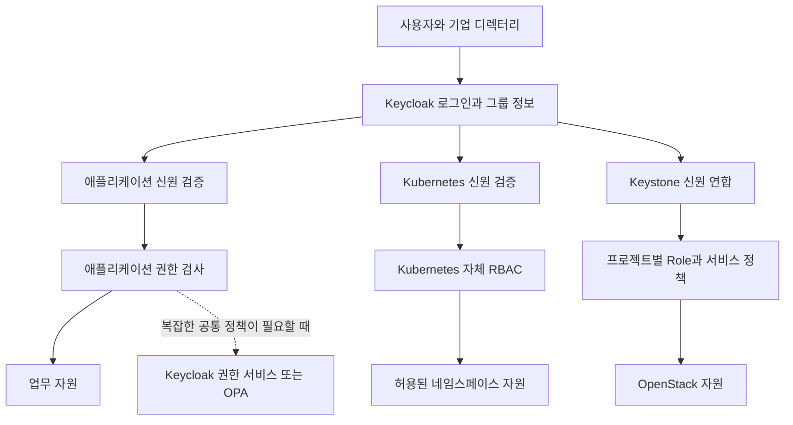
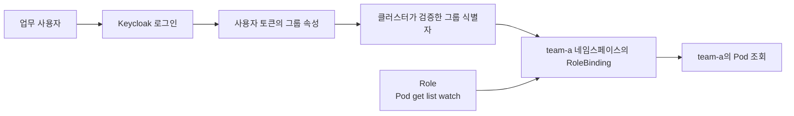
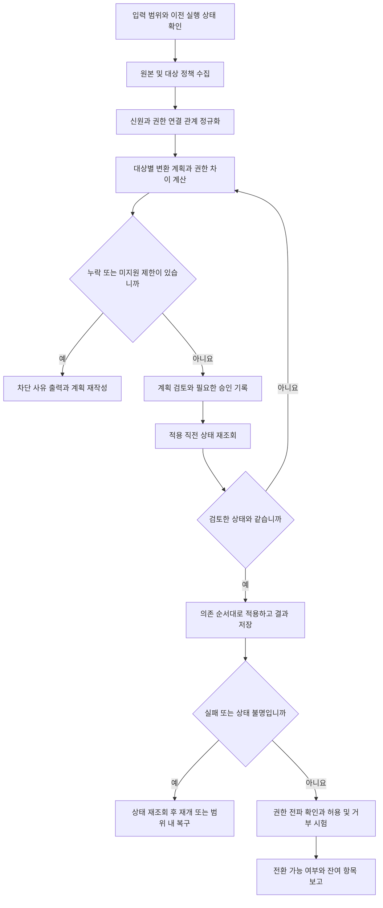
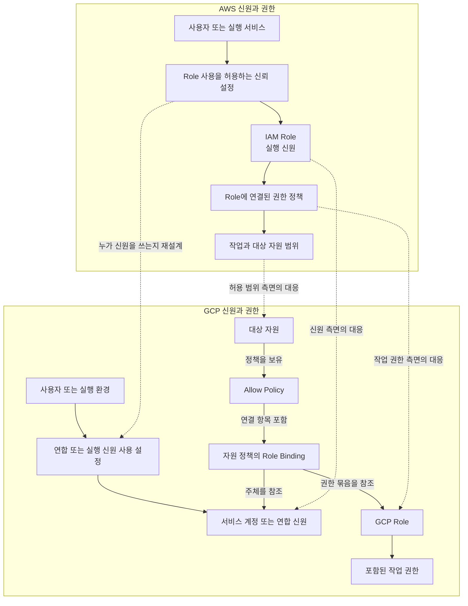
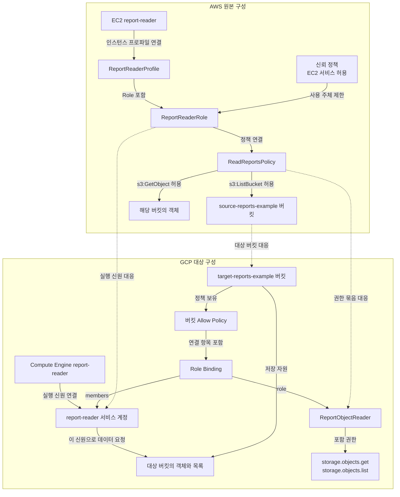
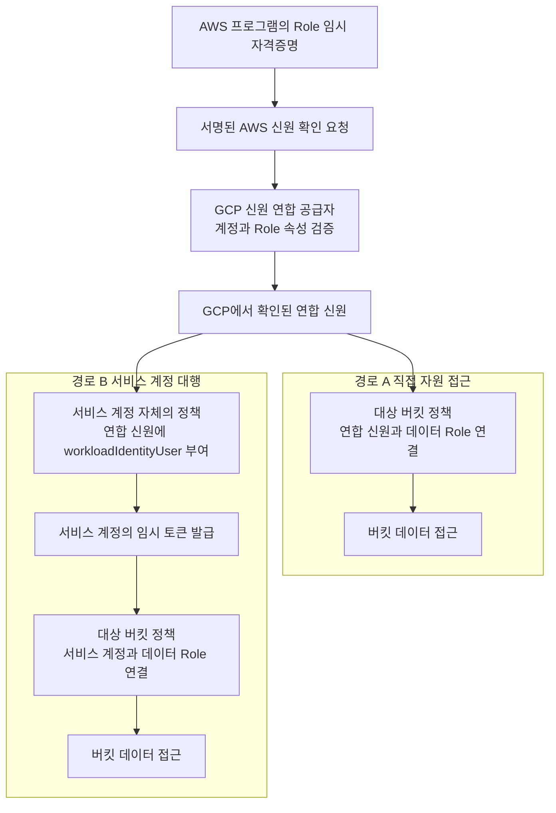
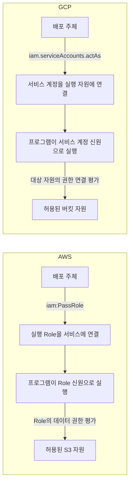

# 계정과 권한 마이그레이션 스크립트 작성 흐름

검토 기준일: 2026년 11월 4일

문서 성격: 환경 구성과 마이그레이션 스크립트의 설계 및 작성 절차

이 문서는 두 질문을 독립적으로 다룹니다. **질문 1은 AWS와 GCP 사이에서 계정·역할·권한 연결을 어떻게 재구성할지**, **질문 2는 클라우드와 온프레미스 사이에서 Keycloak 및 대상 시스템의 접근 제어를 어떻게 구성할지**입니다. 각 질문의 절차를 먼저 설명하고, 두 절차를 구현하는 공통 스크립트 흐름과 하단의 AWS–GCP 관계도를 이어서 제시합니다.

아래 설정과 이름은 설계 예시입니다. 실제 계정·정책을 조사하거나 스크립트·클라우드 설정을 구현한 결과가 아닙니다. 자원 생성·데이터 복사·애플리케이션 배포 자체는 별도 작업이며, 여기서는 그 작업에 필요한 신원 및 접근 관리(IAM)의 준비·연결·검증을 다룹니다.

## 목차

1. [질문 1 AWS와 GCP 간 계정 및 권한 마이그레이션](#1-질문-1-aws와-gcp-간-계정-및-권한-마이그레이션)
   - 계정 이관 범위와 Role 대응
   - AWS→GCP 환경 구성 및 전환 절차
   - GCP→AWS 환경 구성 및 역방향 전환 절차
   - 임시 공존과 완료 조건
2. [질문 2 클라우드와 온프레미스 간 권한 구성 및 마이그레이션](#2-질문-2-클라우드와-온프레미스-간-권한-구성-및-마이그레이션)
   - Keycloak의 범위와 추가 도구 선택
   - 공통 인증 환경 구성
   - Kubernetes 및 OpenStack 대상별 구성과 전환
   - 온프레미스→클라우드 절차와 완료 조건
3. [공통 마이그레이션 스크립트 작성 절차](#3-공통-마이그레이션-스크립트-작성-절차)
   - 단계별 모듈·입출력·상태 전이
   - 수집·변환·적용·복구·검증 규칙
4. [AWS와 GCP 권한 연결 관계도와 이관 예시](#4-aws와-gcp-권한-연결-관계도와-이관-예시)
   - AWS Role과 GCP의 신원·Role·권한 연결 비교
   - EC2 객체 읽기 프로그램을 Compute Engine으로 옮기는 예시
   - AWS에서 계속 실행하며 GCP에 접근하는 공존 예시
   - 실행 신원 연결 권한과 실행 중 자원 접근 권한의 구분
5. [용어 풀이](#5-용어-풀이)

## 1 질문 1 AWS와 GCP 간 계정 및 권한 마이그레이션

**이관은 가능하지만 Role 이름을 일대일로 바꾸는 방식으로는 권한을 보존할 수 없습니다.** AWS Role은 임시로 사용할 수 있는 신원이며, GCP Role은 권한 묶음입니다. 따라서 스크립트는 원본 Role을 대상의 신원·권한 묶음·자원별 권한 연결·신뢰 설정으로 나누어 처리해야 합니다. [AWS Role](https://docs.aws.amazon.com/IAM/latest/UserGuide/id_roles.html), [GCP IAM](https://cloud.google.com/iam/docs/overview)

### 계정 이관의 범위

계정이라는 표현을 다음 네 가지로 나누어야 스크립트 범위가 분명해집니다.

| 구분 | 이관 대상 | 권장 처리 |
| --- | --- | --- |
| 클라우드 자원 경계 | AWS Account, GCP Organization·Folder·Project | 대상 경계를 새로 설계하고 식별자 대응표를 만듭니다. 청구·소유권 설정도 별도로 처리합니다. |
| 사람의 신원 | IAM 사용자, 기업 디렉터리 사용자, 외부 연합 사용자 | 공통 신원 공급자와 그룹을 기준으로 다시 연결합니다. 이메일만으로 동일인이라고 판단하지 않습니다. |
| 프로그램의 신원 | AWS 실행 Role, GCP 서비스 계정, Kubernetes 서비스 계정 | 프로그램별 대상 신원을 만들고 필요한 신뢰 관계를 구성합니다. |
| 접근 권한 | 정책, Role, 그룹 소속, 자원별 연결, 상위 조직 제한 | 실제 작업·대상 자원·조건·거부 규칙을 기준으로 변환하고 검증합니다. |

AWS Account와 GCP Project를 같은 업무 경계로 대응시키는 설계는 가능하지만, 두 제품의 조직·상속 구조가 같다는 의미는 아닙니다. GCP에서는 상위 조직과 폴더의 정책도 하위 자원에 영향을 줍니다. 원본과 대상 모두 상위 정책을 포함해야 합니다. [GCP 자원 계층](https://cloud.google.com/resource-manager/docs/cloud-platform-resource-hierarchy)

AWS 비밀번호·접근 키를 GCP나 Keycloak의 자격증명으로 바꾸는 일반적인 변환은 없습니다. 대상에서 새 자격증명을 발급하거나 신원 연합으로 전환하는 것을 설계 원칙으로 삼습니다. 이미 공통 신원 공급자를 사용하고 있다면 비밀번호를 옮기는 대신 그 신뢰 연결을 재구성합니다.

### 모델별 대응표

아래의 대응은 구성 요소의 유사성을 뜻합니다. 동일한 권한이 자동으로 보장된다는 뜻은 아닙니다.

| AWS 구성 | GCP에서 검토할 구성 | 판정 및 처리 |
| --- | --- | --- |
| 사람이 전환해 사용하는 IAM Role | 사람의 연합 신원에 Role 부여 또는 명시적으로 필요한 서비스 계정 대행 | 재설계가 필요합니다. 사람의 접근을 모두 서비스 계정으로 바꿀 필요는 없습니다. |
| 프로그램 실행용 IAM Role | 서비스 계정 또는 Workload Identity Federation의 연합 신원 | 신원과 권한을 분리하여 재구성합니다. |
| Role에 붙인 권한 정책 | 사전 정의 Role 또는 사용자 정의 Role | 작업별 권한을 대조해야 합니다. 정책 이름으로 대응시키면 안 됩니다. |
| Role의 신뢰 정책 | 연합 공급자 설정·속성 제한·서비스 계정 사용 권한 | 누가 해당 신원을 사용할 수 있는지 별도로 재구성합니다. |
| 자원 기반 정책 | 대상 자원의 IAM 정책과 서비스별 접근 제어 | 자원별 정책 지원 여부와 허용·거부 의미를 다시 확인합니다. |
| `sts:AssumeRole`을 통한 신원 전환 | 서비스 계정 대행 또는 연합 신원 접근 | 임시 자격증명을 사용한다는 공통점이 있지만 호출·조건·위임 경로는 다릅니다. |
| `iam:PassRole` | `iam.serviceAccounts.actAs`가 가까운 대응 | 서비스에 실행 신원을 붙이는 권한입니다. 임시 토큰 발급 권한과 구분합니다. |
| IAM Group | Google 그룹 또는 연합 그룹 속성 | 구성원·그룹 정책·자원 권한 연결을 분리하여 처리합니다. |
| 권한 경계·세션 정책 | 최소 권한 Role·신원 분리·조건·Principal Access Boundary 등 | 직접 대응하지 않습니다. 특히 세션마다 권한을 줄이는 요구는 별도 설계가 필요합니다. |
| 조직 차원의 SCP·RCP | IAM Deny·Organization Policy 등 목적별 통제 | 제한 목적을 다시 구현합니다. 문법이나 적용 범위의 등가 관계는 없습니다. |
| 서비스 연결 Role | 대상 서비스가 요구하는 서비스 신원과 권한 | 서비스별로 다시 구성합니다. 원본 Role을 그대로 복제하지 않습니다. |

Role·권한 연결의 구분은 [AWS Role](https://docs.aws.amazon.com/IAM/latest/UserGuide/id_roles.html)과 [GCP IAM 개요](https://cloud.google.com/iam/docs/overview), 서비스에 실행 신원을 붙이는 권한은 [AWS PassRole](https://docs.aws.amazon.com/IAM/latest/UserGuide/id_roles_use_passrole.html)과 [GCP 서비스 계정 권한](https://cloud.google.com/iam/docs/service-account-permissions)을 근거로 정리했습니다. 조직·경계 통제는 아래의 추가 제약을 함께 적용해야 합니다.

GCP의 `roles/iam.serviceAccountUser`는 서비스 계정을 자원에 붙이는 용도이며, 이것만으로 해당 서비스 계정의 임시 접근 토큰을 만들 수는 없습니다. 일반적인 대행에는 `roles/iam.serviceAccountTokenCreator` 등이 사용되고, 외부 프로그램의 신원 연합을 통한 대행은 해당 연합 절차에서 요구하는 권한을 따릅니다. 이들을 하나의 권한으로 합치면 권한 상승 경로가 생길 수 있습니다. [GCP 서비스 계정 권한 구분](https://cloud.google.com/iam/docs/service-account-permissions), [외부 프로그램의 접근 구성](https://cloud.google.com/iam/docs/workload-identity-federation-with-other-clouds)

### 자동 변환이 어려운 지점

| 항목 | 어려운 이유 | 스크립트의 권장 동작 |
| --- | --- | --- |
| 명시적 거부 | AWS에서는 적용 가능한 명시적 거부가 허용보다 우선합니다. GCP Deny는 지원 권한과 조건에 제약이 있습니다. | 거부를 버리지 않습니다. 대상에서 같은 제한을 구현하지 못하면 적용을 중단합니다. |
| 조건식 | AWS 조건 키와 GCP 조건의 제공 속성·지원 자원이 다릅니다. | 시간·자원·태그·접속 조건 등을 각각 대조하고 미지원 조건은 검토 대상으로 남깁니다. |
| `NotAction`, `NotResource`, 와일드카드 | 제외 방식과 권한 확장 의미를 이름 치환으로 보존할 수 없습니다. | 초기 버전에서는 자동 변환을 차단하고 원문과 판단 근거를 출력합니다. |
| 권한 경계와 세션 제한 | 원본의 최대 권한 또는 세션별 축소를 단순 Role 부여로 대체하면 권한이 넓어질 수 있습니다. | 권한을 분리하거나 대상의 제한 기능으로 재설계한 후 재검증합니다. |
| 자원 범위와 상속 | 특정 버킷 권한을 프로젝트 전체에 부여하면 다른 버킷까지 접근할 수 있습니다. | 대상에서 가능한 좁은 범위에 연결하고 상위 권한까지 합산해 확인합니다. |
| 사용자 정의 Role | 모든 GCP 권한을 사용자 정의 Role에 넣을 수 있는 것은 아닙니다. | 대상 자원에서 지원되는 권한인지 조회하고 생성 불가 시 중단합니다. |
| 서비스 전용 동작 | 데이터 암호화, 객체 버전, 실행 신원 연결 등은 별도의 종속 권한을 요구할 수 있습니다. | 업무 흐름 단위로 필수 권한을 확인하고 검증합니다. |

이 제약은 [AWS 정책 평가](https://docs.aws.amazon.com/IAM/latest/UserGuide/reference_policies_evaluation-logic_policy-eval-denyallow.html), [AWS NotAction](https://docs.aws.amazon.com/IAM/latest/UserGuide/reference_policies_elements_notaction.html), [GCP IAM Deny](https://cloud.google.com/iam/docs/deny-overview), [GCP 조건](https://cloud.google.com/iam/docs/conditions-overview), [사용자 정의 Role 지원 권한](https://cloud.google.com/iam/docs/creating-custom-roles)에 근거합니다.

GCP의 Principal Access Boundary는 주체가 접근 대상이 될 수 있는 자원 범위를 제한하는 기능입니다. AWS 권한 경계처럼 같은 작업 집합을 그대로 제한하는 대체물로 보면 안 됩니다. 제한할 수 있는 권한은 적용 버전에 따라 달라지고, 여러 경계가 적용될 때 허용 대상 자원은 합쳐집니다. 이 기능을 사용하는 경우에도 다른 권한·거부 정책을 함께 평가해야 합니다. [GCP Principal Access Boundary](https://cloud.google.com/iam/docs/principal-access-boundary-policies)

### 객체 읽기 권한의 대응 예시

가정: 원본 프로그램은 일반 S3 버킷 하나에서 현재 객체를 읽고 목록을 조회합니다. 특정 접두사 제한, 버전 조회, 별도의 암호화 키 권한은 없는 예시입니다.

| 원본 작업 | 대상 후보 | 검증 사항 |
| --- | --- | --- |
| `s3:GetObject` | `storage.objects.get` | 같은 업무 데이터에만 접근하는지 확인합니다. |
| `s3:ListBucket` | `storage.objects.list` | 목록 조회 범위가 넓어지지 않는지 확인합니다. |
| 특정 S3 버킷에 대한 허용 | 대응 GCP 버킷에 권한 연결 | 프로젝트 전체에 부여하지 않습니다. |
| 프로그램의 실행 Role | 대상 서비스 계정 또는 연합 신원 | 해당 프로그램만 신원을 사용할 수 있도록 제한합니다. |

`roles/storage.objectViewer`는 후보가 될 수 있지만 `storage.objects.get`·`list` 외에도 권한을 포함합니다. 따라서 원본에 `GetObject`만 있는 경우 이 Role을 부여하면 목록 조회 등 추가 접근이 생길 수 있습니다. 추가 권한을 허용하지 않는다면 지원 여부를 확인한 사용자 정의 Role을 검토합니다. `GetObjectVersion`이나 암호화 키 사용 요구가 있으면 별도 항목으로 분석합니다. [AWS GetObject 권한](https://docs.aws.amazon.com/AmazonS3/latest/API/API_GetObject.html), [GCP Storage Role의 포함 권한](https://cloud.google.com/iam/docs/roles-permissions/storage)

이 예시는 **부분적인 기능 대응**입니다. 위 두 작업의 이름이 대응된다는 사실만으로 원본과 대상의 모든 접근 판단이 같다고 결론 내릴 수는 없습니다.

### 양방향 신원 연합과 임시 공존

AWS에서 실행 중인 프로그램이 GCP 자원을 사용해야 하는 공존 단계에서는 Workload Identity Federation을 사용할 수 있습니다. AWS 신원을 GCP에서 검증한 뒤 대상 자원에 직접 권한을 부여하거나, 필요한 경우 서비스 계정 대행을 구성합니다. 신원 검증이 연결되어도 원본 AWS 권한이 GCP에 자동으로 복사되지는 않습니다. AWS 계정과 Role을 충분히 제한하고 세션 이름만으로 신뢰하지 않도록 설계해야 합니다. [AWS와 GCP 신원 연합](https://cloud.google.com/iam/docs/workload-identity-federation-with-other-clouds)

GCP에서 AWS 방향으로는 적절한 OIDC 신원 토큰과 AWS의 웹 신원 연합을 이용하는 구성을 검토할 수 있습니다. 발급자·수신 대상·주체 식별자와 AWS Role 신뢰 조건을 다시 구성해야 하며, AWS→GCP 설정을 뒤집어 재사용할 수는 없습니다. GCP Role의 권한 집합도 AWS 정책으로 별도 분석해야 합니다. [AWS OIDC 신뢰 구성](https://docs.aws.amazon.com/IAM/latest/UserGuide/id_roles_create_for-idp_oidc.html)

마이그레이션 후 원본 AWS 실행 환경을 종료할 계획이라면, AWS 신원에 계속 의존하는 연합은 최종 구성이 될 수 없습니다. 공존용 신뢰와 최종 실행 환경의 신뢰를 분리하고, 마지막에 원본 신원 의존성이 사라졌는지 확인하는 절차를 권장합니다.

### AWS에서 GCP로 옮기는 환경 구성과 절차

먼저 “AWS에서 하던 어떤 업무를 GCP의 어떤 프로그램이 이어받는가”를 정합니다. 아래 절차는 실행 프로그램까지 GCP로 이동하는 경우입니다. AWS에서 계속 실행하면서 GCP를 호출하는 임시 공존 절차는 별도로 구분합니다.



1. **원본을 수집하고 실제 업무를 고정합니다.** AWS Account, 실행 환경, Role·신뢰 정책, 연결·인라인 정책, 대상 자원 정책과 상위 제한을 수집합니다. 예를 들어 객체 읽기 업무라면 읽는 버킷과 객체 범위, 목록 조회 여부, 암호화 키 사용, 버전 조회를 명시합니다. 수집 결과에는 조회 실패와 미수집 범위를 함께 기록합니다.
2. **GCP의 자원 경계를 준비합니다.** Organization·Folder·Project와 대응 자원을 결정하고 원본 자원 식별자에 대상 식별자를 연결합니다. 필요한 서비스와 관리 기능을 활성화할 수 있는지 확인합니다. 프로젝트 생성과 실제 데이터 이관은 별도 작업으로 연결하며, 해당 자원이 준비되기 전에는 권한 이관 완료로 처리하지 않습니다.
3. **프로그램 신원과 권한 묶음을 분리해 계획합니다.** GCP에서 실행할 프로그램에는 전용 서비스 계정 등을 지정합니다. 원본 정책의 작업별로 대상 권한을 정하고, 사전 정의 Role에 추가 권한이 포함되면 사용자 정의 Role을 검토합니다. 사람의 접근은 연합 사용자·그룹에 직접 권한을 부여할 수 있으므로 사람을 모두 서비스 계정으로 변환하지 않습니다.
4. **권한 연결 위치와 신뢰 관계를 결정합니다.** 버킷 하나에 필요한 권한은 해당 버킷의 정책에 연결합니다. 서비스 계정을 자원에 붙일 배포 주체와 실제 업무를 수행할 실행 신원을 구분하고, 원본 조건·거부·경계가 대상에서 집행되는지 확인합니다. 보존하지 못하는 제한은 적용을 차단하거나 명시적으로 승인받은 대체 설계로 분류합니다.
5. **대상 신원과 권한을 의존 순서대로 구성합니다.** 대상 자원의 존재 확인 → 서비스 계정 준비 → Role 준비 → 자원의 정책에 주체와 Role 연결 → 필요한 신뢰 설정 순서로 계획합니다. 독립된 항목은 따로 처리할 수 있지만, 참조할 대상이 만들어지기 전에는 다음 연결을 생성하지 않습니다.
6. **실행 환경을 연결하고 인증 경로를 전환합니다.** Compute Engine이라면 프로그램용 서비스 계정을 가상 서버에 연결하고, 프로그램이 대상 환경의 인증 정보를 사용하도록 수정합니다. 가상 서버의 접근 범위 설정도 확인합니다. Google은 `cloud-platform` 접근 범위를 설정하고 실제 권한은 IAM으로 제한하는 구성을 권장합니다. 이 범위 자체가 자원 권한을 부여하지는 않습니다. [Compute Engine 서비스 계정과 접근 범위](https://cloud.google.com/compute/docs/access/service-accounts)
7. **대상 신원으로 업무와 거부 경계를 시험합니다.** 지정 객체 읽기·목록 조회 성공뿐 아니라 다른 버킷 읽기, 쓰기·삭제, 허용하지 않은 서비스 계정 대행이 거부되는지 확인합니다. 상위 조직·프로젝트에서 이미 받은 권한도 포함해 추가 접근을 확인합니다.
8. **업무 전환 후 원본 의존성을 회수합니다.** 일정 기간의 업무 동작과 실패 기록을 확인한 뒤 원본 프로그램의 실행과 신뢰 연결을 단계적으로 종료합니다. 다른 프로그램이 같은 Role을 사용하는지 확인하고, Role 삭제·키 폐기는 별도 승인된 정리 작업으로 수행합니다.

| 단계에서 남기는 자료 | 내용 | 다음 단계로 넘어가는 조건 |
| --- | --- | --- |
| 원본 목록과 수집 범위 | 주체·정책·자원·상위 제한·미수집 항목 | 이번 업무의 필수 권한 맥락을 확인했습니다. |
| 신원·권한 대응표 | 원본 Role과 대상 신원, 원본 정책과 대상 Role, 자원 연결 위치 | 미지원·추가·축소 접근을 분류했습니다. |
| 대상 구성 계획 | 생성·변경할 항목과 순서, 기존 상태와 차이 | 검토한 범위와 실제 적용 범위가 일치합니다. |
| 검증 및 전환 기록 | 허용·거부 시험, 원본 의존성, 복구 절차 | 업무가 동작하고 필요한 제한을 보존했습니다. |

자원 정책에 권한을 연결하는 구조는 [GCP Allow Policy](https://cloud.google.com/iam/docs/allow-policies), 서비스 계정을 실행 자원에 붙이는 권한은 [서비스 계정 권한](https://cloud.google.com/iam/docs/service-account-permissions)을 기준으로 합니다. 구체적인 연결 관계는 4장의 예시에서 다시 보여드립니다.

### GCP에서 AWS로 옮기는 환경 구성과 절차

역방향에서도 신원과 권한을 분리하지만, GCP의 자원별 연결을 AWS의 실행 Role·권한 정책·자원 정책으로 다시 구성해야 합니다. AWS→GCP 대응표를 단순히 뒤집으면 하나의 서비스 계정에 여러 자원에서 부여된 권한이나 상위 상속을 빠뜨릴 수 있습니다.

1. **GCP 신원 기준으로 모든 권한 연결을 모읍니다.** 서비스 계정 또는 사용자·그룹이 각 자원과 상위 계층에서 받은 Role, 조건, Deny와 접근 경계를 수집합니다. 서비스 계정 자체의 정책에서 누가 그 계정을 사용할 수 있는지도 별도로 모읍니다.
2. **대상 AWS Account와 실행 환경을 준비합니다.** EC2·컨테이너·서버리스 등 실행 방식을 정하고 대상 자원, 조직 제한과 사용할 서비스 기능을 확인합니다.
3. **신뢰 정책과 업무 권한 정책을 따로 만듭니다.** 실행 서비스가 Role을 사용할 수 있는 신뢰 정책을 정하고, 데이터 자원에 수행할 작업은 별도의 권한 정책으로 구성합니다. 암호화 키나 자원 정책에서 추가 허용이 필요한지도 함께 확인합니다.
4. **실행 신원을 배포 경로에 연결합니다.** EC2에서는 Role을 담은 인스턴스 프로파일을 가상 서버에 연결합니다. 배포 주체의 `iam:PassRole`과 실행 서비스의 신뢰 조건을 확인하고, 프로그램이 실행 Role의 임시 자격증명을 사용하게 합니다. [AWS 인스턴스 프로파일](https://docs.aws.amazon.com/IAM/latest/UserGuide/id_roles_use_switch-role-ec2_instance-profiles.html), [AWS PassRole](https://docs.aws.amazon.com/IAM/latest/UserGuide/id_roles_use_passrole.html)
5. **동일한 업무 시험 후 전환합니다.** 필요한 작업의 성공, 범위 밖 접근과 신원 전환의 거부를 확인하고 프로그램을 옮깁니다. GCP 신원·권한 제거는 다른 사용처를 확인한 후 별도로 처리합니다.

사람의 접근을 옮기는 경우에는 프로그램 실행용 신뢰 설정 대신 사용자 신원 연합과 역할 선택 경로를 구성합니다. 비밀번호나 장기 키를 복사하는 절차로 대체하지 않습니다.

### 질문 1의 완료 조건

원본 Role과 대상 Role의 이름이 같거나 토큰을 받았다는 사실은 완료 조건이 아닙니다. **대상 프로그램이 필요한 작업을 수행하고, 원본에서 요구한 자원 범위·신뢰·거부 조건이 유지되며, 최종 구성의 원본 의존성이 정리된 상태**를 이관 완료로 정의합니다. 미지원 항목이나 미실행 시험이 남으면 해당 범위를 명시하고 부분 완료 또는 차단으로 기록합니다.

## 2 질문 2 클라우드와 온프레미스 간 권한 구성 및 마이그레이션

**Keycloak을 공통 인증의 중심에 두고, 자원 권한은 대상 플랫폼에서 연결·집행하는 구성을 우선 권장합니다.** Keycloak의 세부 권한 서비스도 선택할 수 있으므로 추가 정책 도구가 항상 필요한 것은 아닙니다. 아래에서는 공통 인증 준비 후 대상별 권한 구성, 업무 전환 순서로 설명합니다.

### 인증과 권한 집행의 분리

인증은 “누구인지 확인하는 일”이며, 권한 판단은 “그 주체가 이 자원에 이 작업을 해도 되는지 확인하는 일”입니다. 다음 구조를 권장합니다.



이 그림은 사용자 접근 경로입니다. 프로그램의 신원은 별도로 관리하며, Keycloak 토큰 하나가 모든 기반 시스템에서 그대로 통용되는 구조를 가정하지 않습니다. Kubernetes와 Keystone의 신원 연동 뒤에도 각 플랫폼의 권한 설정이 필요합니다. [Kubernetes 인증](https://kubernetes.io/docs/reference/access-authn-authz/authentication/), [Kubernetes RBAC](https://kubernetes.io/docs/reference/access-authn-authz/rbac/), [Keystone 신원 연합](https://docs.openstack.org/keystone/latest/admin/federation/introduction.html)

### Keycloak으로 가능한 범위

| 요구 | Keycloak의 역할 | 함께 필요한 작업 |
| --- | --- | --- |
| 통합 로그인과 다중 요소 인증 | 로그인 절차와 토큰 발급을 관리합니다. | 대상 애플리케이션의 표준 인증 연동이 필요합니다. |
| 기존 기업 사용자 연결 | LDAP·Active Directory 등 외부 디렉터리를 연결할 수 있습니다. | 어느 디렉터리가 사용자와 그룹의 기준인지 정해야 합니다. |
| 사용자·그룹·애플리케이션별 Role | 그룹과 Role을 관리하고 토큰에 필요한 정보를 전달할 수 있습니다. | 애플리케이션이 토큰을 검증하고 해당 Role을 실제 권한 검사에 사용해야 합니다. |
| 자원·작업 단위 세부 권한 | Authorization Services에서 정책을 관리하고 판단할 수 있습니다. | 애플리케이션이 권한 판단 결과를 집행하도록 연동해야 합니다. |
| Kubernetes·OpenStack 접근 | 신원 공급자로 사용할 수 있습니다. | Kubernetes의 권한 연결, Keystone의 그룹·프로젝트·Role 매핑과 서비스 정책이 필요합니다. |
| AWS/GCP 권한의 자동 복제 | 별도의 변환·검증 로직이 필요합니다. | AWS/GCP 정책 의미를 해석하는 마이그레이션 도구가 담당해야 합니다. |

Keycloak의 인증·디렉터리 기능은 [관리자 가이드](https://www.keycloak.org/docs/latest/server_admin/index.html), 표준 연동은 [애플리케이션 보안 가이드](https://www.keycloak.org/securing-apps/overview), 세부 권한 기능은 [Authorization Services](https://www.keycloak.org/docs/latest/authorization_services/index.html)를 기준으로 정리했습니다. 따라서 “Keycloak은 인증만 가능하다”는 판단도 정확하지 않습니다. 다만 그 권한 서비스가 외부 시스템의 접근 제어를 자동으로 대체하지는 않습니다.

초기 설정은 다음 원칙을 권장합니다.

1. 독립된 인증·관리 경계에 따라 realm을 나누고, 애플리케이션별 client를 등록합니다. 클라우드가 다르다는 이유만으로 realm을 나누지는 않습니다.
2. 사용자 식별자는 발급자와 변경되지 않는 주체 식별자의 조합으로 관리합니다. 같은 이메일 주소라는 이유만으로 계정을 자동 병합하지 않습니다.
3. 업무 역할은 애플리케이션별로 정의하고, 그룹에서 대상의 프로젝트·네임스페이스 권한으로 연결하는 대응표를 따로 관리합니다.
4. Keycloak 관리자, 업무 애플리케이션 관리자, 기반 시스템 관리자를 구분합니다. 이름이 `admin`이라는 이유로 클라우드 전체 관리자나 Kubernetes 전체 관리자 권한을 부여하지 않습니다.
5. 토큰 서명·발급자·수신 대상·만료를 검증하고, 허용 가능한 권한 회수 시간에 맞추어 토큰과 권한 정보의 저장 기간을 정합니다. 중앙 로그인 장애 시의 제한된 비상 접근도 별도로 설계합니다.

### 추가 도구의 선택 기준

다음은 기능을 바탕으로 한 도입 제안입니다. 초기부터 모든 도구를 운영할 필요는 없습니다.

| 요구 상황 | 권장 구성 | 도입 판단 |
| --- | --- | --- |
| 소수 업무 애플리케이션의 단순 Role 검사 | Keycloak + 애플리케이션의 권한 검사 | 우선 적용할 최소 구성입니다. |
| Kubernetes 자원 접근 | Keycloak + Kubernetes 자체 RBAC | Kubernetes를 사용한다면 플랫폼 권한 설정은 필요합니다. |
| OpenStack 기반 사설 클라우드 | Keycloak + Keystone 연합 + 서비스 정책 | OpenStack을 사용한다면 플랫폼 권한 설정은 필요합니다. |
| 기존 Keycloak 운영 안에서 자원·작업별 정책 관리 | Keycloak Authorization Services | 연동 방식과 운영 부담이 적절하면 별도 정책 도구 없이 확장할 수 있습니다. |
| 여러 서비스의 조건부 정책을 공통 코드로 관리 | Keycloak + OPA | 조직·환경·자원 속성을 조합하는 정책이 많아질 때 검토합니다. |
| 프로젝트 소속·문서 공유·소유 관계의 복잡한 권한 | Keycloak + OpenFGA | 사용자와 자원 사이의 관계 기반 접근이 핵심일 때 검토합니다. |
| 비밀번호·인증서 등 비밀 값 관리 | 기존 비밀 저장소 또는 Vault | 권한 판단 도구와 별도 영역으로 검토합니다. |
| 여러 실행 환경에서 프로그램끼리 신원 확인 | SPIFFE/SPIRE 등 프로그램 신원 체계 | 단순 서비스 계정 운영으로 해결하기 어려워질 때 검토합니다. |

OPA는 외부에서 받은 데이터와 정책으로 판단하고 호출 측이 결과를 집행하는 정책 엔진입니다. OpenFGA는 관계 기반 권한을 중심으로 구성할 수 있습니다. Vault는 비밀 관리, SPIFFE는 프로그램의 신원 증명에 초점이 있습니다. 서로 같은 용도의 대체재가 아닙니다. [OPA](https://www.openpolicyagent.org/docs), [OpenFGA](https://openfga.dev/docs/fga), [Vault](https://developer.hashicorp.com/vault/docs/about-vault/what-is-vault), [SPIFFE](https://spiffe.io/docs/latest/spiffe-about/overview/)

### 온프레미스가 클라우드를 계속 사용하는 경우의 방식 선택

| 접근 주체와 대상 | 검토할 방식 | 남는 권한 관리 |
| --- | --- | --- |
| 온프레미스 프로그램 → AWS | OIDC 기반 Role 연합 또는 X.509 인증서를 사용하는 IAM Roles Anywhere | AWS Role의 신뢰와 권한 정책을 유지합니다. |
| 온프레미스 프로그램 → GCP | 외부 OIDC/SAML 공급자 기반 Workload Identity Federation | GCP 자원 권한과 필요한 대행 설정을 유지합니다. |
| 기업 사용자 → GCP | Workforce Identity Federation | 사람의 그룹과 GCP 권한을 연결합니다. |
| 사용자·프로그램 → 온프레미스 자원 | Keycloak 연동 또는 대상이 지원하는 프로그램 신원 | 대상 시스템의 자체 접근 제어를 구성합니다. |

사람을 위한 Workforce와 프로그램을 위한 Workload 연합을 구분해야 합니다. 온프레미스로 실행 위치를 옮겨도 AWS/GCP 자원에 계속 접근한다면 해당 클라우드의 권한 관리는 계속 필요합니다. [AWS OIDC 연합](https://docs.aws.amazon.com/IAM/latest/UserGuide/id_roles_create_for-idp_oidc.html), [AWS Roles Anywhere](https://docs.aws.amazon.com/rolesanywhere/latest/userguide/introduction.html), [GCP 외부 신원 연합](https://cloud.google.com/iam/docs/workload-identity-federation-with-other-providers), [GCP 사용자 신원 연합](https://cloud.google.com/iam/docs/workforce-identity-federation)

### 공통 Keycloak 환경 구성 절차

먼저 온프레미스가 일반 서버인지, Kubernetes인지, OpenStack인지 확정합니다. Keycloak은 신원을 제공하고, 대상은 받은 신원을 자원 권한에 연결합니다. 따라서 Keycloak 준비와 대상 플랫폼 권한 준비를 한 작업으로 묶되, 결과는 별도로 검증합니다.

1. **신원의 기준을 정합니다.** 기존 기업 디렉터리가 있다면 사용자·그룹의 기준으로 유지할지 정하고 Keycloak의 연결 방식과 동기화 범위를 구성합니다. 클라우드 사용자 목록만 있는 경우 새 사용자 생성·초대·비밀번호 재설정 등의 등록 절차를 정합니다. AWS 접근 키를 Keycloak 로그인 정보로 변환하지 않습니다.
2. **Keycloak 운영 기반을 준비합니다.** 인증 주소·인증서·이름 해석·접근 경로·데이터베이스·백업·관리자 접근을 구성합니다. 필요한 가용성과 복구 목표에 맞추어 배포하고, 외부 인증 또는 공개 키 조회가 필요한 시스템에서 연결 가능한지 확인합니다. 연결이 차단된 환경에서는 필요한 신뢰 정보와 갱신 방식을 별도로 설계합니다. 외부 GCP 프로그램 신원 연합에는 공개 키를 별도로 등록하는 방식도 있지만, 그 경우 키 교체 절차가 필요합니다. [GCP 외부 신원 공급자의 연결 요건](https://cloud.google.com/iam/docs/workload-identity-federation-with-other-providers)
3. **관리 영역과 애플리케이션 등록을 구성합니다.** 인증 경계에 따라 realm을 만들고 대상 애플리케이션별 client, 로그인 복귀 주소, 필요한 토큰 수신 대상과 인증 방식을 정합니다. 기업 그룹·업무 역할을 만들고, 대상에 전달할 사용자·그룹 속성을 명시합니다.
4. **클라우드 권한을 업무 역할로 해석합니다.** 원본의 서비스별 작업을 온프레미스의 대응 작업으로 분해합니다. 예를 들어 클라우드 저장소 읽기 권한은 온프레미스 저장소 정책으로, 가상 서버 제어 권한은 OpenStack 프로젝트 정책으로 옮겨야 합니다. Keycloak 그룹 생성만으로 이 단계가 끝나지 않습니다.
5. **대상에서 신원과 권한을 연결합니다.** 아래 Kubernetes·OpenStack 절차 또는 애플리케이션별 권한 검사를 구성합니다. 복잡한 공통 조건이 필요하면 Keycloak 권한 서비스나 OPA를 선택하고, 어떤 요청 경로에서 결과를 집행할지도 정합니다.
6. **전환과 권한 회수를 시험합니다.** 정상 로그인·정상 업무·다른 조직 접근 거부를 확인하고 그룹 탈퇴 이후 기존 토큰과 새 토큰의 동작을 모두 시험합니다. 회수 시간을 확인한 뒤 업무 접근 경로를 전환합니다.

공통 인증 구성은 [Keycloak 관리자 가이드](https://www.keycloak.org/docs/latest/server_admin/index.html)와 [표준 연동 방식](https://www.keycloak.org/securing-apps/overview)을 참고합니다. 운영 기반의 규모와 구성은 대상 환경에 맞춰 결정하는 제안입니다.

### Kubernetes 환경 구성과 마이그레이션 절차

예시 요구는 “기존 클라우드 운영자 중 일부가 온프레미스의 `team-a` 네임스페이스에서 프로그램 상태만 조회한다”입니다. 클라우드 저장소 권한을 Kubernetes 조회 권한으로 직접 바꾸는 예시가 아닙니다. **원본에서 실제로 수행하던 컨테이너 운영 업무가 있는 경우** 그 업무의 대응 권한을 정하는 예시입니다.

1. 대상 클러스터 버전과 인증 설정 방법을 확인하고 Keycloak의 발급자·수신 대상·사용자·그룹 속성을 신뢰하도록 구성합니다. 그룹 이름의 접두사를 포함한 최종 식별 형식을 고정합니다.
2. Keycloak에 `team-a-readers` 업무 그룹을 준비하고 필요한 사용자만 연결합니다. 애플리케이션 등록과 그룹 속성 전달을 확인합니다.
3. `team-a` 네임스페이스에 대상 자원과 작업을 명시한 `Role`을 준비합니다. 예를 들어 Pod의 `get`·`list`·`watch`만 허용하고, 비밀 값 조회나 컨테이너 내부 명령 실행은 별도 요구 없이는 넣지 않습니다.
4. `RoleBinding`에서 서버가 실제로 인식한 그룹 이름을 주체로, 앞서 만든 Role을 권한으로 연결합니다. 상위 `ClusterRoleBinding` 등에서 이미 받은 권한이 있는지도 확인합니다.
5. 사용자용 인증 도구로 로그인하여 실제 신원이 맞는지 확인한 다음, 조회 성공과 다른 네임스페이스·쓰기·비밀 값 접근 거부를 시험합니다. 권한 대행 시험 기능만 사용한 결과와 실제 사용자 토큰으로 시험한 결과를 구분합니다.
6. 프로그램 접근은 사용자 그룹과 분리한 Kubernetes 서비스 계정으로 구성하고, 해당 프로그램이 호출하는 저장소·데이터베이스의 권한도 별도로 구성합니다. 기존 클라우드 신원을 회수하기 전에 이 종속 접근을 확인합니다.

[Kubernetes 인증 구성](https://kubernetes.io/docs/reference/access-authn-authz/authentication/), [Role과 RoleBinding](https://kubernetes.io/docs/reference/access-authn-authz/rbac/)



그룹 식별자는 이름이 같아 보이는지 대신, 인증 후 클러스터가 인식한 전체 값으로 대응시켜야 합니다. 또한 Kubernetes RBAC에는 명시적 거부가 없으므로 원본의 거부 제한을 보존할 수 없다면 적용을 중단하거나 별도 집행 방식을 설계합니다. 자원 생성 시점의 정책 검사만으로 조회·실행 등 모든 접근을 통제한다고 판단하지 않습니다.

### OpenStack 환경 구성과 마이그레이션 절차

예시 요구는 “공통 로그인 사용자가 지정 프로젝트의 가상 서버를 조회한다”입니다. 사용자가 Keycloak에서 인증되어도 Keystone 프로젝트의 Role 할당과 대상 서비스 정책이 준비되지 않으면 이 업무를 수행할 수 없습니다.

1. Keystone 배포 방식·버전과 신원 연합 지원을 확인하고, 앞단 웹 서버의 표준 인증 연동 및 Keystone에 속성을 전달하는 경로를 구성합니다. 로그인 응답의 속성을 일반 요청자가 위조하여 전달할 수 없게 신뢰 경계를 정합니다.
2. Keycloak에 대상 client를 등록하고, Keystone에 해당 발급자를 나타내는 Identity Provider, 외부 속성을 내부 그룹으로 변환하는 Mapping, 이를 연결하는 Protocol을 구성합니다.
3. 대상 도메인·프로젝트·Keystone 그룹을 준비하고 외부 그룹을 대응시킵니다. 프로젝트 범위에서 필요한 Role을 그 그룹에 할당합니다.
4. 해당 Role이 Nova 등 실제 서비스에서 어떤 작업을 허용하는지 확인합니다. 같은 `reader` 또는 `member` 이름이어도 설치 버전과 서비스 정책에 따라 범위가 다를 수 있으므로 이름만으로 매핑하지 않습니다.
5. 연합 로그인 후 프로젝트 범위의 Keystone 토큰을 받아 실제 조회를 시험합니다. 다른 프로젝트 접근, 생성·삭제, 프로젝트 범위를 넘어선 관리 작업이 거부되는지 함께 확인합니다.
6. 자동화 프로그램에는 필요한 프로젝트·역할·만료를 명시한 Application Credential 등 별도 인증 경로를 구성합니다. 해당 배포의 연합 사용자와 인증 도구가 이 방식을 지원하는지 확인하고 비밀 저장소에 보관합니다.
7. 운영 접근을 전환하고, 기존 로컬 사용자·비밀번호 기반 접근은 의존성을 확인한 뒤 회수합니다. 공통 인증 장애 때 사용할 제한된 복구 경로를 유지합니다.

발급받은 Keystone 토큰의 만료 시간과, 그 토큰을 발급받는 Application Credential 자체의 만료는 별개로 관리해야 합니다. 아래 절차는 OpenStack을 선택한 경우의 구성안이며, 현재 운영 환경이 이 구성이라고 확정한 결과는 아닙니다.

[Keystone 연합 구성](https://docs.openstack.org/keystone/latest/admin/federation/configure_federation.html), [서비스 정책과 Role](https://docs.openstack.org/keystone/latest/admin/service-api-protection.html), [Application Credential](https://docs.openstack.org/keystone/latest/user/application_credentials.html)


### 애플리케이션과 일반 서버의 권한 전환

업무 애플리케이션은 Keycloak 토큰을 검증한 다음 사용자·그룹·업무 역할과 자원 소유 관계를 확인하도록 수정합니다. Keycloak 권한 서비스나 OPA를 선택했다면 권한 판단 호출, 실패 시 동작, 결과의 저장 기간과 실제 집행 위치까지 구현 범위에 포함합니다. 로그인 성공만 검사하는 공통 앞단으로는 자원별 권한 이관을 완료할 수 없습니다.

운영체제 로그인·관리자 명령, 데이터베이스 계정·권한, 객체 저장소 정책은 각각 대상 제품의 지원 방식으로 구성합니다. 원본 서비스와 대상 서비스가 다르면 해당 서비스의 작업 대응표를 별도로 만들고, Keycloak은 지원되는 신원 연동에 사용합니다.

### 온프레미스에서 클라우드로 옮기는 절차

온프레미스의 프로그램도 클라우드로 옮길 수 있지만, Keycloak 그룹이나 Kubernetes Role을 클라우드 Role로 그대로 복사하지는 않습니다. 먼저 프로그램의 현재 자원 접근과 사용자 업무를 분리해 수집하고, 대상 클라우드에서 이어갈 작업과 자원을 정합니다.

1. **사람의 접근을 구성합니다.** Keycloak을 계속 사용할지 정하고 AWS의 사용자 신원 연합 또는 GCP Workforce Identity Federation을 연결합니다. 그 후 연합 사용자·그룹을 대상 Role 및 자원 권한에 연결합니다.
2. **프로그램의 최종 실행 신원을 구성합니다.** AWS 안에서 실행하면 실행 서비스용 Role, GCP 안에서 실행하면 서비스 계정 등 해당 실행 환경의 신원을 준비합니다. Keycloak의 프로그램용 client 비밀 값을 클라우드의 접근 키로 변환하지 않습니다.
3. **남아 있는 온프레미스 접근 경로를 구성합니다.** 프로그램 일부가 온프레미스에 남아 클라우드를 호출한다면 아래 연합 방식 또는 Roles Anywhere를 검토합니다. 반대로 클라우드 프로그램이 온프레미스 자원을 계속 호출한다면 그 자원까지의 연결과 대상 인증·권한도 유지합니다.
4. **동일한 업무와 거부 시험을 거쳐 전환합니다.** 최종 실행 신원으로 업무가 성공하고 범위 밖 접근이 거부되는지 확인합니다. 공존 기간이 끝나면 필요 없어진 신뢰와 자격증명을 별도로 회수합니다.

### 질문 2의 완료 조건

**사용자가 인증되고, 대상 시스템이 그 신원을 정확한 그룹·프로젝트·네임스페이스 권한으로 해석하며, 실제 업무와 거부 경계 및 권한 회수 시간이 검증된 상태**를 완료로 정의합니다. 프로그램은 사용자 로그인과 별도로 실행 신원 및 종속 자원 접근을 검증합니다. Keycloak 설정 성공과 대상 플랫폼 권한 구성 성공은 각각 기록해야 합니다.

## 3 공통 마이그레이션 스크립트 작성 절차

### 스크립트 모듈을 작성하는 순서

질문 1과 질문 2는 같은 처리 단계를 사용할 수 있지만 대상별 변환 규칙과 적용 모듈은 나눕니다. 먼저 읽기 전용 수집·계획 생성을 구현하고, 그 결과를 사람이 검토할 수 있게 만든 뒤 적용 기능을 연결하는 순서를 권장합니다.



다음 이름은 **제안하는 모듈 및 산출물 규약**이며 현재 존재하는 프로그램이나 파일 목록은 아닙니다.

| 작성 순서 | 모듈의 책임 | 주요 입력 | 주요 산출물과 종료 조건 |
| --- | --- | --- | --- |
| 1 범위 확인 | 이관 방향·계정·자원·업무와 변경 허용 범위를 검증합니다. | 작업 명세와 접속 설정 참조 | `migration-spec.yaml`에 원본·대상 범위가 고정됩니다. |
| 2 원본과 대상 수집 | 페이지 끝까지 조회하고 조회 오류와 기존 상태를 기록합니다. | 확정된 범위 | `inventory.json`에 정책 원문·연결·수집 누락이 남습니다. |
| 3 정규화 | 신원·역할·권한 정책·자원 연결·신뢰의 관계를 공통 표현으로 만듭니다. | 수집 자료 | `relationships.json`에서 각 원본 항목을 추적할 수 있습니다. |
| 4 대상 계획 생성 | 대상별 지원 규칙으로 항목과 의존 순서를 만들고 추가·축소 접근을 분석합니다. | 공통 표현과 변환 규칙 | `plan.json`과 검토 문서에 생성·변경·차단이 드러납니다. |
| 5 사전 검사 | 누락·미지원·정책 문법·대상 지원 기능과 검토 범위를 검사합니다. | 계획과 지원 기능 정보 | `preflight.json`에 적용 가능 또는 차단 근거가 남습니다. |
| 6 적용 | 정책을 재조회하고 계획과 동일한 상태에서 필요한 변경만 수행합니다. | 검토된 계획과 승인 정보 | `state.json`에 항목별 결과와 변경 전후 상태가 남습니다. |
| 7 접근 검증 | 실제 주체로 허용·거부 시험과 전파·회수 시간을 확인합니다. | 시험 명세와 적용 상태 | `verification.json`에 실제 결과와 미실행 범위가 남습니다. |
| 8 전환 보고와 정리 | 업무 전환 가능 여부와 원본 의존성을 보고합니다. | 적용·시험 기록 | 정리 계획을 분리하고 완료·부분 완료·차단을 판정합니다. |

수집 모듈에는 AWS·GCP·Keycloak·Kubernetes·OpenStack별 조회 기능을 둡니다. 계획 모듈에는 AWS→GCP, GCP→AWS, 클라우드→온프레미스, 온프레미스→클라우드별 규칙을 두고, 적용 모듈에는 대상 제품별 변경 기능을 둡니다. 인증 설정 자체와 업무 권한의 연결을 별도 항목으로 기록해야 부분 실패를 구분할 수 있습니다.

예를 들어 4장의 AWS 객체 읽기 이관은 `AWS Role 수집 → 신뢰·작업·자원 범위 분해 → GCP 서비스 계정 및 Role 및 버킷 연결 계획 → 적용 → 실제 읽기와 쓰기 거부 시험`으로 구현합니다. 2장의 Kubernetes 이관은 `원본 업무 수집 → 그룹·조회 작업·네임스페이스 대응 → Keycloak 속성 및 Kubernetes RoleBinding 계획 → 적용 → 사용자 토큰으로 접근 시험`으로 구현합니다.

정상 상태는 `수집됨 → 계획됨 → 검토됨 → 적용됨 → 검증됨 → 전환됨`으로 구분합니다. 어느 단계든 정보가 부족하면 `차단`, 일부 항목만 적용되면 `부분 적용`, 요청 결과를 알 수 없으면 `상태 불명`을 남깁니다. 재시도는 저장한 상태만 믿지 말고 실제 대상을 다시 조회한 뒤 결정합니다.

### 공통 자료와 업무 권한 표현

스크립트는 `원본 수집 → 공통 표현 → 대상 계획 생성 → 검증 → 승인된 계획 적용 → 사후 검증`으로 나누는 구성을 권장합니다. 공통 표현은 원본의 의미를 보존하는 중간 자료입니다. 클라우드 고유 조건을 표현하지 못하면 원문과 미지원 항목을 남겨야 합니다.

| 필드 | 담아야 할 내용 |
| --- | --- |
| 주체 | 사람·프로그램·그룹 구분, 원본의 변경되지 않는 식별자, 대상 식별자 |
| 신뢰 | 누가 어떤 신원을 사용할 수 있는지, 발급자·수신 대상·주체 제한 |
| 작업 | 원본 작업, 업무상 의미, 대상 작업 후보 및 종속 권한 |
| 자원 | 원본·대상 자원 식별자, 프로젝트·네임스페이스 등 범위 |
| 조건과 거부 | 원본 조건·명시적 거부·경계·조직 제한 및 대상 집행 방식 |
| 정책 근거 | 원본 정책 위치·버전·수집 시점, 사용한 변환 규칙 버전 |
| 판정 | 자동 변환 후보·수동 검토·대체 설계·차단 및 근거 |
| 검증 | 허용 및 거부 시험의 예상 결과·실제 결과·미실행 여부 |

다음은 도구 설계를 위한 예시 자료이며 실행 가능한 클라우드 설정이나 실제 계정 조사 결과가 아닙니다.

```yaml
schema_version: 1
identity:
  kind: workload
  source_ref: aws-role-example
  target_ref: gcp-service-account-example
capability:
  name: read-current-object
  source_action: s3:GetObject
  target_permission: storage.objects.get
  source_resource_ref: source-bucket-example
  target_resource_ref: target-bucket-example
assessment:
  status: review_required
  source_context_complete: false
  target_context_complete: false
  trust_review: pending
  deny_and_boundary_review: pending
  added_access: unknown
  lost_access: unknown
validation:
  status: not_run
  positive_cases: [read-mapped-object]
  negative_cases: [list-objects, write-object, read-other-bucket]
```

### 초기 구현의 수집 범위

| 대상 | 필수 수집 항목 |
| --- | --- |
| AWS | 사용자·그룹·구성원, Role과 신뢰 정책, 연결 및 인라인 정책과 정책 버전, 권한 경계, 상위 SCP·RCP, 대상 서비스의 자원 정책·접근 제어, 사용되는 세션 제한과 실행 신원 연결 |
| GCP | 조직·폴더·프로젝트 계층, 각 단계와 대상 자원의 권한 연결 및 조건, 사용자 정의 Role의 포함 권한, Deny, Principal Access Boundary, 서비스 계정·사용 권한, 연합 공급자와 속성 매핑 |
| Keycloak | 사용할 realm과 client, 사용자·그룹 식별자, 그룹 및 Role 매핑, 토큰 속성, 외부 디렉터리 연결과 기존 권한 기준 |
| 온프레미스 | 실제 사용하는 플랫폼·버전, 프로젝트·네임스페이스, 현재 사용자·프로그램 신원, 자체 역할·정책, 관리자 및 자동화 접근 경로 |

수집은 비밀 값이 아닌 정책과 자격증명 메타데이터를 중심으로 해야 합니다. 페이지가 있는 조회는 마지막까지 수행하고, 조회 권한 부족·누락된 계정·미수집 서비스·세션 정보의 불완전성을 결과에 기록합니다. Role 목록만 수집해 전체 실효 권한을 수집했다고 판단하면 안 됩니다.

AWS의 상세 평가에는 신원·자원 정책, 조직 제한, 권한 경계, 세션 정책과 주체 유형에 따른 차이가 포함됩니다. GCP에서는 상위 자원에서 상속된 접근과 별도 정책도 확인해야 합니다. 스크립트가 이를 모두 관측하지 못하면 판정은 미완료로 남기는 것이 적절합니다. [AWS 상세 평가 규칙](https://docs.aws.amazon.com/IAM/latest/UserGuide/reference_policies_evaluation-logic_policy-eval-denyallow.html), [GCP IAM 접근 제어](https://cloud.google.com/iam/docs/overview)

### 변환 판정과 적용 조건

| 판정 | 의미 | 적용 조건 |
| --- | --- | --- |
| 자동 변환 후보 | 지원되는 작업·범위·신뢰를 정해진 규칙으로 표현할 수 있습니다. | 사전 검증과 실제 접근 시험 전에는 동등성 확정으로 표시하지 않습니다. |
| 수동 검토 | 대응 후보가 있으나 추가 권한·조건 해석 등 판단이 필요합니다. | 차이를 구체적으로 검토하고 필요하면 재설계합니다. |
| 대체 설계 | 원본 기능을 같은 방식으로 보존할 수 없습니다. | 다른 집행 방식과 업무 요구 변경을 명시적으로 승인받아야 합니다. |
| 차단 | 정책 누락·미지원 거부·알 수 없는 신뢰 등으로 판단할 수 없습니다. | 차단 사유를 해결하기 전에는 적용하지 않습니다. |

처음 구현할 명령은 **읽기 전용 수집과 계획 생성**을 우선 권장합니다. 이후 적용 기능에는 다음 규칙을 둡니다.

1. 적용 대상과 정책 차이, 추가·축소되는 접근을 먼저 출력합니다. `unknown`은 차이가 없다는 뜻으로 처리하지 않습니다.
2. 정책 내용과 수집 시점에 대한 식별값을 계획에 묶고, 검토 후 원본·대상 상태가 달라지면 다시 계획합니다.
3. 기존 정책을 읽은 후 필요한 연결만 추가·수정합니다. 조건과 동시 변경 식별값을 보존하고, 이관과 관계없는 다른 정책을 통째로 덮어쓰지 않습니다.
4. 반복 실행해도 중복 연결이 생기지 않도록 대상 식별자와 도구가 관리하는 항목을 기록합니다.
5. 부분 실패 시 완료·실패·상태 불명 항목을 구분하고 재조회합니다. 되돌리기는 도구가 변경한 범위만 다룹니다.
6. 관리자 전체 권한 부여, 원본 Role 삭제, 기존 키 폐기는 별도 작업으로 분리합니다. 업무상 권한 범위를 넓히거나 대체하는 변경에는 명시적 승인이 필요합니다.
7. 정책 적용과 신원 연합 설정의 전파를 기다린 후 사후 검증합니다. 생성 요청 성공만으로 이관 완료를 선언하지 않습니다.

여기서 제안한 명령 단계와 필드는 설계안이며 현재 구현된 명령은 아닙니다.

### 검증 기준

허용되어야 하는 작업과 거부되어야 하는 작업을 함께 시험해야 합니다. 정책 문법 검사나 토큰 발급 성공만으로는 권한 이관을 검증할 수 없습니다.

| 시험 | 예시 | 기대 결과 |
| --- | --- | --- |
| 필수 업무 | 이관된 프로그램이 지정 객체 읽기 | 성공 |
| 범위 밖 접근 | 다른 버킷·프로젝트·네임스페이스 조회 | 거부 |
| 미부여 작업 | 읽기 전용 주체의 쓰기·삭제 | 거부 |
| 신뢰 경계 | 다른 프로그램 또는 다른 발급자의 토큰 사용 | 거부 |
| 권한 상승 | 허용하지 않은 실행 신원 연결·대행·정책 변경 | 거부 |
| 조건 | 만료 이후 또는 필요한 속성이 없는 요청 | 원래 요구에 맞게 거부 |
| 그룹 변경 | 그룹 탈퇴 후 재인증 및 기존 토큰·세션 사용 | 정의한 회수 시간 안에 권한 제거 |
| 운영 복구 | 중앙 인증 장애와 정책 도구 장애 | 정해진 장애 동작과 비상 접근 절차 확인 |

토큰·세션·권한 정보의 저장 기간 때문에 그룹 변경이 모든 자원에 즉시 반영된다고 가정하면 안 됩니다. 허용 가능한 권한 회수 시간을 정하고 실제로 측정해야 합니다. 비상 접근은 통상 사용자 접근과 분리하여 제한·기록하는 운영 설계를 권장합니다.

검증 결과는 다음처럼 나누어 보고합니다.

- 수집 범위: 대상 계정·프로젝트·서비스 중 조사 완료 및 미완료 항목
- 변환 범위: 업무 권한 단위의 전체·후보·수동 검토·대체 설계·차단 건수
- 권한 차이: 추가 접근·접근 축소·원본 제한을 보존하지 못한 항목
- 시험 결과: 실행한 사례의 성공·실패·미실행과 재현 조건

어떤 시뮬레이터나 시험 사례도 두 클라우드의 모든 미래 요청에 대한 등가성을 자동으로 증명하지는 않습니다. 따라서 “전체 이관 성공률” 대신 확인한 범위와 남은 차이를 보고하는 편이 적절합니다.

## 4 AWS와 GCP 권한 연결 관계도와 이관 예시

이 장은 질문 1의 권한 연결을 눈으로 확인하기 위한 신규 장입니다. 실선은 설정 연결 또는 요청 경로이며, 점선은 이관 시 의미상 대응 관계입니다. **점선이 있다고 신뢰나 권한이 자동으로 전달되지는 않습니다.** 아래 그림은 허용 연결을 설명하며, 최종 판단에는 적용 가능한 거부·조건·상위 제한도 반영해야 합니다.

### AWS Role 하나가 GCP에서 여러 구성으로 나뉘는 관계

AWS에서는 실행 신원인 Role에 권한 정책을 붙이고, 신뢰 정책으로 누가 그 Role을 사용할 수 있는지 제한합니다. GCP에서는 신원을 서비스 계정 등으로 표현하고, 권한 묶음인 Role을 자원의 정책 안에서 그 신원과 연결합니다. 이를 권한 연결 항목인 **Role Binding**이라고 부릅니다.



핵심 연결은 **GCP 자원 → 그 자원의 정책 → 주체와 Role의 연결 → Role에 포함된 권한**입니다. 따라서 “서비스 계정을 생성하고 Role을 정의했다”만으로는 접근 권한이 생기지 않습니다. 어떤 자원의 정책에서 누구에게 그 Role을 부여했는지까지 있어야 합니다. [AWS Role](https://docs.aws.amazon.com/IAM/latest/UserGuide/id_roles.html), [GCP 권한 연결 구조](https://cloud.google.com/iam/docs/allow-policies)

서비스 계정도 GCP에서 하나의 자원입니다. **서비스 계정 자체의 정책**은 누가 그 신원을 사용할 수 있는지 정하고, **데이터 버킷의 정책**은 어떤 신원이 버킷 데이터에 접근하는지 정합니다. 두 정책은 붙는 위치와 목적이 다릅니다. [서비스 계정 접근 관리](https://cloud.google.com/iam/docs/manage-access-service-accounts)

### 예시 하나 EC2의 객체 읽기 프로그램을 GCP로 이동

가정은 `report-reader` 프로그램이 AWS에서 `source-reports-example` 버킷의 객체와 목록을 읽고, 이를 GCP의 Compute Engine과 `target-reports-example` 버킷으로 옮기는 상황입니다. 이름은 예시이며 실제 버킷 이름이나 계정 정보가 아닙니다. 데이터 복사는 별도 작업으로 완료되어 있다고 가정합니다. 버전·특정 접두사·별도 암호화 키 요구는 이 예시에 포함하지 않습니다.

| 요소 | AWS 원본 | GCP 대상 |
| --- | --- | --- |
| 실행 환경 | EC2의 `report-reader` | Compute Engine의 `report-reader` |
| 실행 신원 | `ReportReaderRole` | `report-reader` 서비스 계정 |
| 실행 환경 연결 | Role을 담은 인스턴스 프로파일 | 가상 서버에 서비스 계정 연결 |
| 누가 신원을 쓸 수 있는지 | EC2 서비스에 대한 Role 신뢰 | 배포 주체의 해당 서비스 계정 연결 권한과 실행 환경 설정 |
| 작업 권한 정의 | `ReadReportsPolicy` | `ReportObjectReader` 사용자 정의 Role 후보 |
| 읽기 권한 | `s3:GetObject` | `storage.objects.get` |
| 목록 권한 | `s3:ListBucket` | `storage.objects.list` |
| 허용 범위 연결 | 정책의 버킷 및 객체 자원 식별자 | 대상 버킷 정책의 서비스 계정과 Role 연결 |

다음 그림에서 AWS Role은 GCP 서비스 계정에, AWS 권한 정책은 GCP Role에 각각 대응합니다. **AWS Role을 GCP Role 하나로 직접 바꾸는 관계가 아닙니다.**



GCP에서 저장되는 관계를 구체적으로 쓰면 다음과 같습니다. 두 권한의 사용자 정의 Role 지원 여부는 대상에서 확인해야 하며, 아래는 관계 설명용 자료입니다.

```yaml
# 실제 배포 파일이 아닌 설계 예시입니다.
role_definition:
  name: projects/migration-demo-example/roles/ReportObjectReader
  includedPermissions:
    - storage.objects.get
    - storage.objects.list
resource_ref: gs://target-reports-example
allow_policy_fragment:
  bindings:
    - role: projects/migration-demo-example/roles/ReportObjectReader
      members:
        - serviceAccount:report-reader@migration-demo-example.iam.gserviceaccount.com
```

이 구조에서 사용자 정의 Role을 프로젝트에 정의하는 것과, 그 Role을 프로젝트 전체에 부여하는 것은 다릅니다. 예시는 **프로젝트에 정의한 Role을 버킷 하나의 정책에서 부여**합니다. `bindings` 안의 `role`과 `members`가 권한 연결의 핵심이며, 실제 적용에서는 기존 정책의 다른 연결·조건·동시 변경 식별값을 보존해야 합니다. 사전 정의 `roles/storage.objectViewer`를 선택하면 포함 권한이 더 넓을 수 있으므로 추가 권한 여부를 별도로 판단합니다. [사용자 정의 Role](https://cloud.google.com/iam/docs/creating-custom-roles), [Storage Role의 권한](https://cloud.google.com/iam/docs/roles-permissions/storage), [Allow Policy 구조](https://cloud.google.com/iam/docs/allow-policies)

이 예시를 처리하는 스크립트는 아래 순서로 동작하도록 작성합니다.

1. `ReportReaderRole`의 신뢰와 모든 정책 및 버킷·객체 범위를 수집합니다.
2. GCP 실행 서비스 계정과 원본 Role의 대응, 사용자 정의 Role과 원본 정책의 대응을 각각 계획합니다.
3. 대상 버킷 존재와 기존 정책을 읽고, 두 작업 권한 및 미지원 제한을 확인합니다.
4. 서비스 계정과 Role을 준비한 뒤 대상 버킷의 기존 정책에 필요한 연결만 병합합니다.
5. 가상 서버의 실행 신원을 연결하고 대상 프로그램의 인증·데이터 접근 코드를 전환합니다.
6. 해당 프로그램 신원으로 대상 읽기·목록 조회 성공과 다른 버킷 읽기·쓰기·삭제 거부를 시험합니다.
7. 업무 전환 후 원본 EC2와 Role의 다른 사용처를 확인하고 원본 의존성 정리 계획을 실행합니다.

그림은 신원과 허용 연결을 비교한 것입니다. 작업 이름의 대응만으로 두 저장소의 버전·암호화·조건 및 모든 오류 동작이 같다고 보장하지 않습니다. 시험 범위와 미지원 항목은 계획과 결과에 남깁니다.

### 예시 둘 AWS에서 계속 실행하며 GCP 자원에 접근

이 경우 실행 환경을 GCP로 옮기는 대신 AWS 실행 신원을 GCP가 검증하도록 구성합니다. AWS 정책이 GCP 권한으로 자동 변환되는 것이 아니라, 검증된 외부 신원에 GCP에서 별도로 권한을 부여합니다. 아래는 AWS 신원 증명과 GCP 신원 연합을 사용하는 경로의 개념도입니다.



경로 A는 지원되는 자원에서 연합 신원에 직접 권한을 부여합니다. 경로 B는 먼저 **서비스 계정 자체의 정책**에서 연합 신원에 `roles/iam.workloadIdentityUser`를 부여하고, 이어서 **버킷 정책**에서 그 서비스 계정에 데이터 권한을 부여합니다. 서비스 계정을 대행할 권한만 설정해도 버킷 접근 권한이 자동으로 생기지는 않습니다. 반대로 버킷 권한만 있어도 외부 주체가 서비스 계정을 사용할 수 있는 것은 아닙니다. [AWS와 GCP 신원 연합 및 대행 설정](https://cloud.google.com/iam/docs/workload-identity-federation-with-other-clouds)

환경 구성과 적용 순서는 `공존 기간·접근 대상 확정 → 신원 풀과 AWS 공급자 구성 → 계정·Role 속성 및 제한 조건 설정 → 직접 접근 또는 대행 경로 선택 → 해당 자원 정책 연결 → 프로그램의 연합 인증 설정 → 허용·거부 시험`입니다. 대행 경로를 선택하면 서비스 계정과 그 계정의 대행 권한 연결도 포함합니다. 연합 주체 식별자에 쓰는 프로젝트 번호와 일반 프로젝트 ID를 혼동하지 않도록 구분합니다.

검증에서는 허용한 AWS Role의 접근 성공, 다른 계정·Role의 접근 거부, 다른 버킷 접근 거부를 확인합니다. 최종적으로 AWS 실행 환경을 없앨 예정이라면 예시 하나의 GCP 실행 신원으로 다시 전환하고, AWS 연합 신뢰를 별도로 회수해야 합니다.

### 실행 신원을 붙이는 권한과 실행 중 데이터 권한의 구분

배포 담당자가 프로그램에 실행 신원을 연결하는 권한과, 실행 프로그램이 데이터에 접근하는 권한은 별개입니다. 일반적인 서비스 계정 대행 토큰 발급 권한도 별도로 구분해야 합니다.



두 경로 모두 실행 자원을 생성·변경할 권한과 서비스의 신원 사용 설정 등이 추가로 필요합니다. 그림의 `PassRole` 또는 `actAs` 하나만으로 배포가 완료되는 것은 아닙니다. 또한 GCP의 `roles/iam.serviceAccountUser`와 일반 대행용 `roles/iam.serviceAccountTokenCreator`, 외부 신원 연합 대행용 `roles/iam.workloadIdentityUser`를 하나로 치환하지 않습니다. [AWS PassRole](https://docs.aws.amazon.com/IAM/latest/UserGuide/id_roles_use_passrole.html), [GCP 서비스 계정 권한](https://cloud.google.com/iam/docs/service-account-permissions)

| 스크립트가 기록해야 하는 연결 | 확인할 질문 |
| --- | --- |
| 배포 주체 → 실행 신원 연결 권한 | 누가 이 Role 또는 서비스 계정을 프로그램에 붙일 수 있습니까? |
| 외부 주체 → 실행 신원 사용·대행 권한 | 누가 어떤 발급자·계정·주체 조건으로 이 신원을 사용할 수 있습니까? |
| 실행 신원 → 자원 권한 연결 | 그 신원이 어떤 자원에서 어떤 작업을 할 수 있습니까? |
| 원본 신원 → 대상 신원의 이관 대응 | 같은 업무를 이어받는 대상 신원이 무엇입니까? |

네 연결을 별도 자료로 보관해야 “로그인은 되었지만 권한이 없는 상태”와 “권한은 있지만 신원을 사용할 수 없는 상태”를 구분하여 진단할 수 있습니다.

## 5 용어 풀이

| 용어 | 뜻 |
| --- | --- |
| AWS / GCP | Amazon Web Services / Google Cloud Platform, 각각 아마존과 구글의 클라우드 서비스입니다. |
| IAM | Identity and Access Management, 신원 및 접근 관리입니다. |
| Role | 역할입니다. 제품마다 신원 또는 권한 묶음 등 의미가 다릅니다. |
| RBAC | Role Based Access Control, 역할에 따라 권한을 부여하는 방식입니다. |
| IdP | Identity Provider, 로그인과 신원 증명을 제공하는 시스템입니다. |
| OIDC / SAML | 시스템 사이에서 신원을 전달하는 표준 방식인 OpenID Connect / Security Assertion Markup Language입니다. |
| LDAP / Active Directory | 기업 사용자·그룹 등을 관리하거나 조회하는 디렉터리 기술과 제품입니다. |
| SCP / RCP | Service Control Policy / Resource Control Policy, AWS 조직에서 신원 또는 자원에 적용하는 권한 통제 정책입니다. |
| Principal Access Boundary | GCP에서 주체가 접근할 수 있는 자원의 경계를 정하는 정책입니다. |
| OPA | Open Policy Agent, 정책을 코드로 정의하고 접근 가능 여부 등을 판단하는 도구입니다. |
| OpenFGA | Open Fine Grained Authorization, 사용자와 자원 사이의 관계 등을 바탕으로 세부 권한을 판단하는 도구입니다. |
| SPIFFE / SPIRE | 프로그램의 신원을 증명하는 표준 / 그 표준을 구현하는 도구입니다. |
| realm / client | Keycloak에서 사용자·정책을 구분하는 관리 영역 / 인증을 연동하는 애플리케이션 등의 등록 단위입니다. |
| 네임스페이스 | Kubernetes에서 자원을 논리적으로 구분하는 범위입니다. |
| 신원 연합 / 대행 | 외부 시스템의 신원 증명을 신뢰하는 방식 / 허용된 다른 서비스 계정의 신원으로 접근하는 방식입니다. |
| Role Binding | GCP에서 정책 안에 주체와 Role을 함께 지정하는 권한 연결 항목입니다. Kubernetes의 RoleBinding은 별도 제품의 권한 연결 객체입니다. |
| member / principal | 정책에 지정되는 사용자·서비스 계정·연합 신원 등 접근 주체입니다. |
| EC2 / Compute Engine | 각각 AWS와 GCP에서 가상 서버를 실행하는 서비스입니다. |
| Pod | Kubernetes에서 컨테이너를 실행하는 기본 단위입니다. |
| API | Application Programming Interface, 프로그램이 다른 시스템의 기능을 호출하는 인터페이스입니다. |
| ID | Identifier, 계정·프로젝트·자원 등을 구분하는 식별자입니다. |

공식 문서의 `latest`는 변경되거나 개발 버전을 포함할 수 있습니다. 실제 적용 시에는 대상 제품의 설치 버전과 지원 기능을 고정해 다시 확인해야 합니다.
