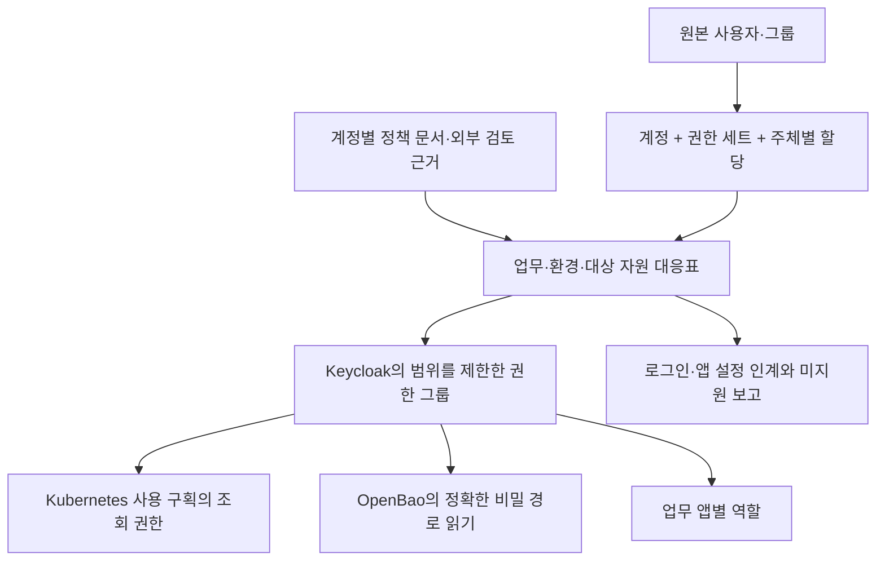

# AWS 계정·권한의 온프레미스 이관

**`python -m migration.identity`는 읽기 전용 수집 → 대응표 → 계획 → 사전검사 → 생성 적용·재개 → 검증·보고를 제공하는 독립 Python 도구입니다.** Keycloak 사전 환경 준비 PR #27의 `migration.keycloak_infra` 결과를 받아 사용합니다. 기존 PostgreSQL 이관 명령·설정·상태에는 연결하지 않습니다.

이 구현은 AWS 전체 권한의 자동 등가 변환기가 아닙니다. 운영자가 원본 정책과 외부 제한을 확인한 대상 권한을 업무·환경별로 재구성합니다. 원본 정책에서 지원하지 못하는 제한을 발견하면 적용을 차단합니다. 실제 환경 검증을 수행하지 않았으므로 운영 이관 완료로 간주하면 안 됩니다.

## 위치와 역할

| 파일 | 역할 |
|---|---|
| `common.py` | 엄격한 설정, 비밀정보 참조, 해시, 권한 0600의 원자적 산출물 저장 |
| `collect.py` | Identity Store·SSO 관리·계정별 IAM 조회와 조사 범위 기록 |
| `plan.py` | 업무·환경별 대응표, 계정 경계 검사, 의존 순서와 외부 인계 자료 |
| `adapters.py` | 실제 Keycloak·OpenBao·Kubernetes 관리 인터페이스 호출 |
| `execute.py` | 읽기 전용 사전검사, 생성·재개·상태 기록, 제한된 접근 회수 |
| `verify.py` | 구성 비교와 실제 사용자 토큰을 사용하는 별도의 접근 시험 |
| `report.py` | 대응표·제외·적용·접근 검증의 Markdown 보고 |
| `__main__.py` | 플랫폼 호출용 독립 명령과 단일 JSON 응답 |

## 구현한 범위

| 영역 | 지원 | 제한 |
|---|---|---|
| Identity Center | 자체 디렉터리 사용자·그룹·구성원, 사용자/그룹 직접 할당, 권한 세트·계정별 정책 문서 | 계정 목록은 명시적 입력이며 비밀번호·다중 인증 정보는 내보내지 않음 |
| 일반 IAM | 계정별 사용자·그룹·역할·연결 및 인라인 정책·역할 신뢰 관계의 읽기 전용 목록 | 사람/프로그램 분류와 실행 신원 변환은 별도 대응 필요로 표시 |
| Keycloak | 전용 업무 realm, 비활성 사용자, 원본 그룹, 계정·업무·환경별 권한 그룹, 공개 OIDC client·전달 속성·앱 역할 | 기존 객체와 차이가 있으면 덮어쓰지 않음. 기존 사용자 자동 병합·비밀번호 복사 없음 |
| OpenBao | 전용 JWT 인증 경로, 발급자·수신 대상·그룹 조건, 정확한 KV v2 경로의 읽기 정책 | KV v2 저장 엔진은 미리 존재해야 함. 비밀 값 복사는 별도 도구의 책임. UI 브라우저 로그인용 OIDC 방식은 미구현 |
| Kubernetes | 기존 전용 네임스페이스의 조회 Role·RoleBinding 적용, 구조화 인증 설정 생성, 사용자 토큰 신원·권한 판단 시험 | 조회 범위만 지원. 제어 서버 설정 파일 배포·기동 인자·재시작은 배포판별 운영 절차로 인계 |
| 업무 앱 | Keycloak client·역할·그룹 연결 및 앱 설정 명세 생성 | 앱이 기존 OIDC 설정으로 소비해야 함. 앱 설정을 직접 변경하는 제품별 적용기와 소스코드 변경은 없음 |
| 정책 의미 | 미검토·미대응·문서 누락·조사 실패·거부·조건·제외 표현·작업 와일드카드·권한 경계 차단 | AWS 자원/조직/세션 정책·현재 실효 권한을 평가하지 않음. `source_access_evidence`에 외부 검토 근거가 필요 |
| 상태·복구 | 프로세스 잠금, SQLite 단계 기록, 응답 유실 재조회, 새 접근 연결만 회수 | 계정·데이터·realm·그룹·client·인증 경로는 자동 삭제하지 않음. 생성 여부가 불명인 항목도 보존 |

OIDC는 표준 인증 연동, JWT는 서명된 토큰, IAM은 신원 및 접근 권한 관리입니다. realm은 Keycloak의 사용자·앱 관리 영역입니다.

## 핵심 대응 관계



원본 디렉터리·사용자 식별자로 대상을 결정하며 이메일이나 표시 이름으로 계정을 합치지 않습니다. 동일 계정·권한 세트·업무·환경의 직접/그룹 할당은 같은 대상 그룹으로 합쳐 중복을 피합니다. 서로 다른 계정 또는 업무·환경을 같은 네임스페이스·비밀 경로·앱 구획에 합치면 차단합니다. 계정 여러 개를 하나로 통합하려면 별도 설계가 필요합니다.

대상 그룹은 원본에서 받은 모든 권한 세트의 합집합으로 사용자에게 연결됩니다. AWS 포털의 계정/역할 선택과 관리자 역할의 일시 활성화 의미를 재현하지 않습니다. 이번 버전은 제한된 조회 접근만 다루며, 관리자 권한·상충 역할 분리·세션별 역할 선택이 필요한 이관은 진행할 수 없습니다.

## 설치·실행

저장소 루트에서 별도 가상환경에 설치합니다.

```bash
python3.12 -m venv .venv-identity
.venv-identity/bin/python -m pip install -e './migration[identity,dev]'
.venv-identity/bin/python -m migration.identity --help
```

AWS용 Boto3와 사전 준비 도구의 현재 Kubernetes Python 접속 라이브러리는 `python-dateutil` 요구 버전이 충돌하므로 **두 실행기를 별도 가상환경/이미지로 운영**합니다. 결과 파일 규약으로 연결합니다. 이관 도구 자체의 Kubernetes 호출은 안정된 관리 인터페이스와 정적 접속 설정을 사용하며 해당 Python 라이브러리에 의존하지 않습니다.

외부 접속 없이 실행할 수 있는 예시입니다. 계정·정책·검토 근거는 모두 가상 자료이며 운영에 재사용하면 안 됩니다.

```bash
python -m migration.identity plan --config migration/identity-examples/config.example.json --inventory migration/identity-examples/inventory.example.json --mapping migration/identity-examples/mapping.example.json --out /tmp/identity-plan.json
python -m migration.identity report --config migration/identity-examples/config.example.json --plan /tmp/identity-plan.json --out /tmp/identity-report.md
```

실환경 입력과 전체 명령은 [운영 안내](../../docs/identity/operations.md), 제외 사유와 후속 작업은 [결정 기록](../../docs/identity/decisions-and-followups.md)을 참고하십시오.

## 검증 기록

- 새 기능 검사 59개와 기존 Python 회귀 검사를 포함해 **310개 통과·33개 생략**했습니다. 생략 항목은 실제 PostgreSQL 8개, OPA 정책 판단 프로그램 16개, 별도 Ansible 환경이 필요한 기존 모듈 9개입니다.
- 사전 준비 전용 환경에서 기존 Keycloak 검사 **53개 통과**, 실제 Ansible을 호출하는 암호화 접속·클러스터 응답 모형 검사 **4개 통과**를 별도로 확인했습니다. 두 실행 환경의 겹치는 검사를 합산하지 않습니다.
- 새 접속 검사는 실제 로컬 HTTPS 서버와 Python 요청 라이브러리로 인증서 신뢰·이동 응답 차단·관리자 자격증명 대체·비밀 원문 미출력·시험 토큰 회수를 확인합니다. 모형 응답 시험이며 실제 제품 설치 시험이 아닙니다.
- AWS 공식 Python 접속 라이브러리의 응답 모형으로 실제 요청 인자·페이지 규약을 확인했습니다. 원본 정책 계정 불일치·조회 누락·반복 페이지·권한 확대 위험도 검사합니다.
- 정적 검사·서식·공백 검사, 예제의 외부 접속 없는 계획·보고 흐름, 소스/배포 패키지의 모듈·문서·예제·검사 포함과 캐시 제외를 확인했습니다.

**실제 AWS·Keycloak·OpenBao·Kubernetes 접속, 사용자 자격증명 등록, 제어 서버/업무 앱 설정 반영, 실제 업무 접근·복구는 미검증입니다.** 현재 계정·환경의 이관이 완료되었다고 판단할 수 없습니다.
