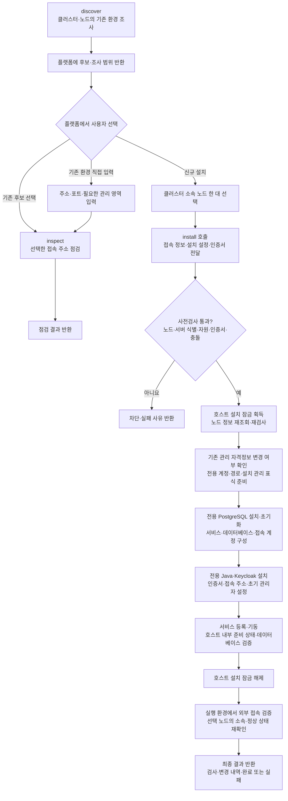
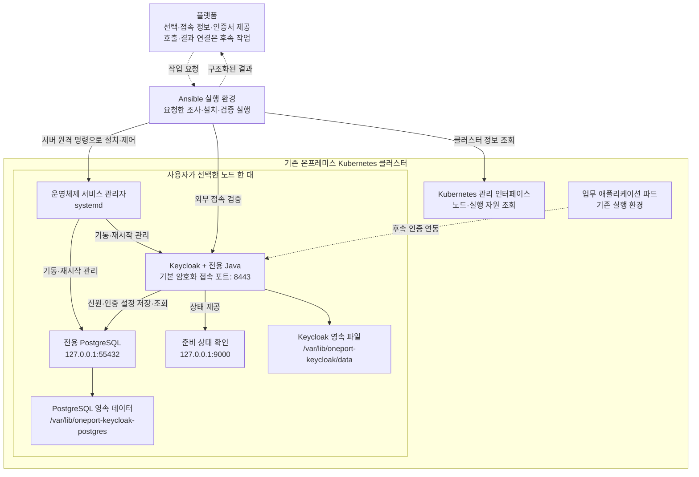

# Keycloak 기반 인프라의 탐색·점검·설치

**이 디렉토리는 기존 Keycloak 환경을 조사하고, 사용자가 선택한 Kubernetes 노드 한 대에 Keycloak과 전용 PostgreSQL을 운영체제 서비스로 설치하는 구현입니다.** 플랫폼은 사용자 선택과 접속 정보 제공을 담당하고, 이 도구는 요청한 작업을 실행해 구조화된 결과를 반환합니다.

이 문서는 구현 이후 논의한 설치 흐름, 설치 후 아키텍처, 기존 환경 조사 방식, 신규 설치 후 확보하는 정보와 반환 한계를 정리합니다. 설명 기준은 현재 코드이며 **실제 서버에서 설치가 완료되었다는 의미가 아닙니다.** 실제 클러스터·Linux 서버의 신규 설치, 중단 후 재개, 재시작 후 영속성은 아직 검증하지 않았습니다.

- [설치 준비와 상세 운영 안내](../../keycloak-infra/README.md)
- [플랫폼 입력 예제](../../keycloak-infra.example.yaml)
- [최종 결과 형식](../../keycloak-infra/result.schema.json)
- [클러스터 조회 권한 예제](../../keycloak-infra/discovery-rbac.example.yaml)

## 1. 구현 위치와 역할

저장소 기준 주요 구현 위치는 `migration/migration/keycloak_infra/`입니다. 기존 PostgreSQL 데이터 이관 도구와 설정·상태를 분리한 독립 명령으로 실행합니다.

| 파일·디렉토리 | 역할 |
| --- | --- |
| [__main__.py](__main__.py) | 명령 선택, 최종 결과 출력과 종료 코드 처리 |
| [config.py](config.py) | 플랫폼 입력과 자격증명 참조 검증 |
| [runner.py](runner.py) | 임시 실행 공간·서버 목록 준비, Ansible 호출, 결과 수집 |
| [discovery.py](discovery.py) | 클러스터 조사 결과 정리, 후보 통합, 최종 응답 조립 |
| [ansible/playbooks/](ansible/playbooks/) | 작업별 Ansible 실행 파일 |
| [ansible/library/](ansible/library/) | 서버 조사·접속 점검·인증서 검사 모듈 |
| [ansible/module_utils/keycloak_common.py](ansible/module_utils/keycloak_common.py) | 서비스·프로세스·서버 상태와 인증 응답 조사 |
| [ansible/roles/install/](ansible/roles/install/) | 전용 서비스·데이터베이스·인증서 설치와 설정 |
| [ansible/versions.yml](ansible/versions.yml) | 설치할 제품 버전·배포 주소·설치물 검증값 |

계정·그룹과 IAM(신원 및 접근 권한 관리) 정책의 수집·변환·적용은 별도 이관 도구의 책임입니다. AWS 우선·GCP 후속 확장에서 공통으로 사용할 인증 기반이며, 이 구현 자체는 클라우드 자격증명을 사용하지 않습니다.

## 2. 실행 명령과 변경 범위

저장소 루트에서 선택 의존성과 Ansible 확장 모음을 설치한 뒤 실행합니다.

```bash
python -m pip install -e './migration[keycloak-infra,dev]'
ansible-galaxy collection install -r migration/migration/keycloak_infra/ansible/requirements.yml
python -m migration.keycloak_infra discover --config /run/platform/keycloak.yaml --result discovery.json
```

`discover` 자리에 아래 명령을 선택합니다. 각 명령은 독립적으로 실행되며, 탐색 결과가 없다고 설치를 자동 시작하지 않습니다.

| 명령 | 실행 내용 | 원격 환경 변경 |
| --- | --- | --- |
| `discover` | Kubernetes와 제공된 노드 접속 정보로 기존 Keycloak 후보 조사 | 없음 |
| `inspect` | 선택한 후보 또는 직접 입력한 기존 주소의 통신·인증 응답 점검 | 없음 |
| `preflight` | 선택 노드·서버 식별·운영체제·자원·인증서·충돌 검사 | 없음 |
| `install` | 사전검사 재실행, 지정 노드의 신규 환경 설치와 검증 | 있음 |
| `verify` | 이 도구로 설치한 환경의 관리 표식·서비스·데이터베이스·접속 상태 확인 | 없음 |

플랫폼은 클러스터 접속 설정, 노드 이름과 현재 고유 식별자, SSH(서버 원격 접속) 정보와 설치 권한을 제공합니다. 신규 설치의 접속 주소와 인증서·개인 키 참조도 플랫폼이 제공합니다. 기존 주소의 `inspect`에는 클러스터·노드 접속 정보가 필요하지 않습니다.

## 3. 설치 흐름

아래 그림의 플랫폼 선택 단계는 후속 연동 대상입니다. 스크립트가 화면을 표시하거나 사용자의 선택을 직접 입력받지는 않습니다.



실제 코드에서 호스트 설치 잠금은 **호스트 내부 설치·검증 후 해제하며, 이후 실행 환경에서 공개 접속 주소를 검증**합니다. 호스트 설치 구간의 일반적인 오류에서는 잠금 해제를 시도하지만, 원격 접속 단절이나 강제 종료로 잠금이 남을 수 있습니다. 실행 제한 시간 초과도 원격 작업 종료를 보장하지 않습니다.

사전검사를 통과한 새 환경에서는 다음 항목을 준비합니다.

1. 전용 운영체제 계정, 설정·데이터 경로와 설치 관리 파일
2. 전용 PostgreSQL 구성, 데이터 영역, 데이터베이스와 접속 계정
3. 시스템 기본 Java와 분리한 실행 환경 및 Keycloak 설치물
4. 플랫폼이 제공한 인증서·개인 키, 접속 주소와 초기 관리자 설정
5. 운영체제 서비스의 등록·기동과 재시작 정책
6. 데이터베이스 연결, Keycloak 준비 상태, 외부 접속과 노드 정상 상태 검증

설치 중 실패하면 일부 변경이 남을 수 있습니다. 데이터베이스나 기존 데이터를 자동 삭제해 되돌리지 않으며, 관리 표식과 실제 상태를 대조한 뒤 재개합니다. 제거·데이터 폐기·기존 환경 업그레이드는 별도 승인 범위입니다.

## 4. 설치 후 인프라 아키텍처

**Keycloak과 PostgreSQL은 Kubernetes 파드가 아니라 선택한 노드의 운영체제 서비스로 실행됩니다.** Ansible 실행 환경의 물리적 배치는 플랫폼이 결정하며, 설치 대상 노드에 상주하는 Ansible 서비스는 구성하지 않습니다.

실선은 구현된 조사·설치·검증 관계, 점선은 후속 플랫폼·앱 연동 관계입니다.



준비 상태 확인은 서버 원격 명령을 통해 노드 내부에서 실행합니다. Ansible 실행 환경에 관리용 포트 9000을 외부 공개하는 구성은 아닙니다.

| 구성 | 코드에서 설정하는 내용 |
| --- | --- |
| Keycloak 서비스 | `oneport-keycloak.service`, 전용 운영체제 계정 `oneport-keycloak` |
| PostgreSQL 서비스 | `oneport-keycloak-postgres.service`, 전용 운영체제 계정 `oneport-kc-db` |
| 데이터베이스·소유 계정 | 데이터베이스 `keycloak`, 데이터베이스 접속 계정 `keycloak` |
| 일반 접속 | HTTPS(인증서를 사용하는 암호화 통신), 기본 포트 8443; 설정 주소와 수신 포트를 일치시킴 |
| 데이터베이스 접속 | 기본 `127.0.0.1:55432`; 외부 직접 접속을 허용하지 않음 |
| 준비 상태 | `127.0.0.1:9000/health/ready` |
| 내부 캐시 통신 | 운영용 `ispn` 캐시, 루프백 주소의 포트 7800·57800 |
| 서비스 재시작 | 운영체제 서비스에 실패 시 재시작 정책과 부팅 시 시작 설정 |
| 초기 관리자 | `bootstrap-admin`; 영구 관리 접근 준비 후 플랫폼의 별도 정리 필요 |

이 구성은 한 노드에 두 서비스를 설치합니다. 다중 서버 장애 전환, 외부 백업·복원 체계, 업무 앱 인증 연결, Kubernetes 로그인 설정, 네트워크 방화벽·이름 해석·역방향 프록시 자동 구성은 포함하지 않습니다.

## 5. 기존 인프라 정보를 얻는 방법

### 5.1 클러스터 조회

[cluster.yml](ansible/tasks/cluster.yml)은 `kubernetes.core.k8s_info` 모듈로 Node, Pod, Service, Deployment, ReplicaSet, StatefulSet, Ingress를 읽습니다. 플랫폼이 지정한 클러스터 접속 설정과 접속 대상을 사용하며, 지정한 네임스페이스 범위에서 조사합니다. 네임스페이스 목록이 비어 있으면 전체 범위를 요청하지만, 실제 조회 가능 범위는 제공된 권한에 따라 달라집니다.

[discovery.py](discovery.py)는 이름·라벨·컨테이너 이미지에서 Keycloak의 특징을 찾고, 상위 배포 자원을 추적해 같은 설치에 속한 여러 파드를 묶습니다. 실행 수가 0인 Deployment·StatefulSet도 후보로 찾으며, Operator와 PostgreSQL 같은 부속 서비스의 기본적인 오탐을 제외합니다.

Service의 선택 조건과 파드 라벨을 비교하고, 연결된 Ingress를 찾아 접속 주소 후보를 구성합니다. **이 단계의 주소는 접속이 검증된 주소가 아닙니다.** Service 정보만 있으면 통신 방식이 `null`일 수 있으며 플랫폼이 주소를 보완한 뒤 `inspect`를 호출해야 합니다.

### 5.2 서버 내부 조사

[discover.yml](ansible/playbooks/discover.yml)은 제공된 노드 이름·고유 식별자가 현재 클러스터에 존재하는지 확인한 후 원격 조사합니다. [keycloak_host_info.py](ansible/library/keycloak_host_info.py)와 공통 조사 모듈은 다음 정보를 읽습니다.

- `systemd` 서비스 목록, 실행 명령의 경로, 서비스 활성 상태
- 실행 중인 네이티브 프로세스의 특징과 소속 정보
- 확인 가능한 Keycloak 설정 파일의 공개 접속 주소
- `/etc/machine-id` 및 시스템 하드웨어 식별값
- 운영체제·프로세서 종류·서비스 관리자, 사용 가능한 메모리와 관련 파일시스템의 여유 공간
- 이 도구의 기존 설치 관리 파일, 전용 서비스·계정·경로와 패키지 저장소 존재 여부

서버 식별값은 클러스터가 보고한 값과 대조합니다. 일치 여부를 확인할 수 없으면 해당 서버 후보를 정상 조사 결과로 사용하지 않습니다. Kubernetes·컨테이너 소속 프로세스는 네이티브 프로세스 조사에서 제외합니다. Kubernetes 밖에서 별도로 실행하는 컨테이너 환경까지 찾아내는 탐색기는 아닙니다.

원격 접속 자격증명은 플랫폼이 제공해야 합니다. 노드 접속 정보가 누락되면 클러스터 조회 결과를 반환하되, 해당 노드의 서버 조사 범위를 미확인으로 표시합니다. 클러스터 밖의 임의 서버나 네트워크 전체를 자동 탐색하지 않습니다.

### 5.3 선택한 기존 주소 점검

[inspect.yml](ansible/playbooks/inspect.yml)은 입력한 주소와 realm(사용자·앱의 관리 영역)을 기준으로 OIDC(OpenID Connect: 표준 인증 연동)의 공개 정보를 조회합니다.

1. 인증서 신뢰를 검증하며 인증 메타데이터 조회
2. 발급자·토큰·공개키 주소가 기대하는 주소와 일치하는지 확인
3. 서명 공개키 응답을 조회하고 기본 형식 확인
4. 관리용 접속 주소가 제공되었을 때 준비 상태 응답 확인

다른 주소로의 응답 이동을 따라가지 않습니다. 이 검사는 실제 사용자 로그인, 토큰 서명 검증, 관리자 권한 검사 또는 자원 접근 권한 시험을 대신하지 않습니다.

### 5.4 후보 반환과 조사 한계

| 결과 | 반환하는 주요 정보 |
| --- | --- |
| `nodes` | 노드 이름·고유 식별자·서버 식별값·주소·정상 상태·운영체제 이미지·프로세서 종류 |
| Kubernetes 후보 | 후보 식별자, 클러스터·네임스페이스·상위 자원 식별자, 노드·파드·이미지·주소 후보 |
| 서버 서비스 후보 | 후보 식별자, 소속 노드, 서비스 이름·활성 상태, 발견 근거·확인 가능한 주소·버전 단서 |
| 서버 프로세스 후보 | 프로세스 기반 식별 정보, 소속 노드, 실행 상태와 발견 근거; 필요 시 주소 입력 안내 |
| `coverage` | 자원 종류·네임스페이스·노드별 조사 완료 또는 미확인 범위 |
| `checks`, `reason_codes` | 서버 일치 여부와 접속 검사, 오류·누락 사유 |

후보 목록은 특징에 기반한 탐색 결과입니다. 사용자 정의 이름·설치 경로의 부재를 보장하지 않습니다. 조회 실패와 권한 부족을 ‘설치되지 않음’으로 처리하지 않습니다.

이미지 태그나 설치 경로에서 얻은 버전 단서는 확정 버전과 구분합니다. 현재 확정 버전 필드는 `null`로 유지하며, 기존 환경의 사용자·그룹·realm 목록·앱 등록 정보·접근 권한 정책은 수집하지 않습니다.

## 6. 신규 설치 후 획득하는 정보와 보관 위치

**최종 응답으로 전달하는 정보, 서버에 기록하는 설치 설정, 검사에만 사용하는 정보를 구분해야 합니다.** 내부에서 읽은 모든 정보를 플랫폼에 그대로 반환하지 않습니다.

| 정보 | 확보·확인 방식 | 최종 응답 또는 보관 위치 |
| --- | --- | --- |
| 대상 노드 | 클러스터 조회와 원격 서버 식별값 대조 | `nodes`; 서버의 설치 관리 파일에는 선택 노드 식별자 기록 |
| 접속 주소·realm·발급자 | 입력 설정과 외부 인증 응답 대조 | `connection.base_url`, `realm`, `issuer` |
| 인증서 상태 | 이름·유효 기간·체인·개인 키 일치 검사 | `checks`의 항목별 통과·실패 |
| 데이터베이스 연결 | 호스트 내부의 전용 데이터베이스 조회 | `checks`의 `database_connectivity` |
| Keycloak 준비 상태 | 호스트 내부 `/health/ready` 응답 | `checks`의 `host_readiness` |
| 외부 접속 | 실행 환경에서 발급자·공개키 주소 점검 | `checks`의 `published_endpoint` 및 관련 검사 |
| 변경·오류·실행 시각 | 실행 작업과 Ansible 결과 수집 | `changes`, `events`, `reason_codes`, `started_at`, `finished_at` |
| 설정한 제품 버전·주소·포트 | 버전 고정 파일과 설치 입력 | 서버의 `/var/lib/oneport-keycloak/install.json` |
| 데이터베이스 이름·계정·전용 서비스·경로 | 설치 역할과 설정 파일 | 서버의 서비스·설정 파일과 데이터베이스; 최종 응답에 전체 목록은 미포함 |
| 메모리·디스크 수치 | 서버 내부에서 읽어 설정한 하한과 비교 | 내부 검사에 사용; 최종 `checks`에는 주로 통과·실패만 전달 |
| 운영체제 세부 값 | 서버에서 배포판·버전·코드명 조사 | 내부 검사에 사용; 최종 `nodes`에는 클러스터가 제공한 운영체제 이미지·프로세서 종류 반환 |

설치 관리 파일은 설치 식별자, 노드 식별자, 접속 주소, 수신 포트, 데이터베이스 포트, Keycloak·Java의 설정 버전과 PostgreSQL의 주 버전을 기록합니다. 비밀번호는 이 관리 파일에 기록하지 않습니다. 이 파일은 설정한 설치의 소유 범위를 확인하는 자료이며, 모든 실행 중인 바이너리의 버전을 다시 조사한 결과는 아닙니다.

신규 설치의 필수 검증이 완료된 경우, 아래는 접속·관리자 인계 부분의 응답 예시입니다. 설명용 발췌이며 실제 서버 실행 결과가 아닙니다.

```json
{
  "connection": {
    "base_url": "https://sso.example.internal:8443",
    "realm": "master",
    "issuer": "https://sso.example.internal:8443/realms/master",
    "version": null,
    "admin_access": "not_checked"
  },
  "admin_handoff": "temporary_admin_requires_platform_handoff"
}
```

현재 신규 설치에서도 `connection.version`은 `null`입니다. 공통 접속 검사기가 제품 버전을 조회하지 않기 때문입니다. PostgreSQL의 정확한 패치 버전, 서비스 전체 설정, 자원 수치까지 최종 응답으로 제공하려면 반환 규약과 수집 기능의 추가 구현이 필요합니다.

`inspect`에 관리용 주소를 제공하지 않으면 `readiness`가 `unknown`입니다. 신규 설치에서는 별도로 수행한 `host_readiness` 검사와 이 항목을 구분해야 합니다. 조사 실행의 `complete`가 관리자 권한 확보나 업무 앱 연동 완료를 의미하지는 않습니다.

## 7. 결과 저장과 민감정보 처리

| 위치 | 저장·반환 내용 |
| --- | --- |
| 표준 출력 | 단일 JSON(구조화된 자료 형식) 최종 결과 |
| `--result`로 지정한 파일 | 같은 최종 결과; 파일 권한 `0600`으로 교체 |
| 실행 환경의 임시 공간 | 단계별 조사 결과와 Ansible 출력; 실행 종료 후 정리 |
| 설치 대상 서버 | 설치 관리 파일, 설정·인증서·보호된 비밀정보 파일, 서비스와 영속 데이터 |
| 플랫폼 데이터베이스 | 자동 저장하지 않음; 플랫폼의 후속 연동 필요 |

설치 비밀번호는 플랫폼이 환경변수로 주입하며 인증서·개인 키는 파일 참조로 제공합니다. 최종 응답에 비밀번호·개인 키·접속 토큰 원문을 포함하지 않습니다. 원격 서버에 설치한 비밀정보 파일과 서비스가 실제로 사용하는 자격증명은 별도로 보호·관리해야 합니다.

| 종료 코드 | 상태 | 해석 |
| --- | --- | --- |
| 0 | `complete` | 요청한 작업을 완료하거나 필수 설치 검증 통과 |
| 1 | `failed` | 실행·접속·검증 실패; 설치 중 일부 변경이 남을 수 있음 |
| 2 | `blocked` | 입력 검증 오류 또는 검사 결과로 확인한 설치 차단 조건 |
| 3 | `partial` | 일부 조사 범위가 미확인 |

플랫폼은 종료 코드뿐 아니라 `coverage`, `checks`, `reason_codes`, `limitations`를 함께 해석해야 합니다. 응답이 없는 주소, 조회할 수 없는 노드, 수집하지 않은 항목을 정상 또는 미설치로 추정해서는 안 됩니다.

설정 파일을 읽지 못하는 경우처럼 실행 준비 단계에서 실패하면, 오류 응답에는 일반 결과의 일부 필드가 생략될 수 있습니다. 플랫폼은 결과 형식의 필수 항목과 선택 항목을 구분해 처리해야 합니다.

## 8. 검증 상태와 후속 작업

구현 시점의 검증 결과는 전체 검사 264개 통과·24개 생략이며, 이 중 새 기능 검사는 57개입니다. Ansible 작업 파일 5개의 문법, 실제 Ansible을 사용하는 격리된 암호화 접속·클러스터 응답 모형, 배포 패키지의 실행 자료 포함 여부를 검사했습니다. 외부 PostgreSQL과 정책 판단 도구가 필요한 기존 통합 검사는 해당 환경이 없어 생략했습니다.

이 기록은 실제 서버 설치·장애 복구 검증을 대체하지 않습니다. 시험 노드에서 신규 설치, 동일 입력 재실행, 실패 후 재개, 재시작 후 영속성, 기존 서비스와의 공존을 확인해야 합니다.

이번 구현 이후의 별도 작업은 다음과 같습니다.

- 플랫폼의 후보 표시·사용자 선택·실행 호출·결과 저장 연결
- 임시 관리자를 안전한 영구 관리 접근으로 전환하고 정리하는 절차
- 업무 애플리케이션과 Kubernetes의 인증 연동
- 실제 계정·그룹·권한 정책의 수집·변환·적용과 허용·거부 검증
- 필요 시 상세 설치 정보 반환, 백업·복원과 다중 서버 운영 설계
