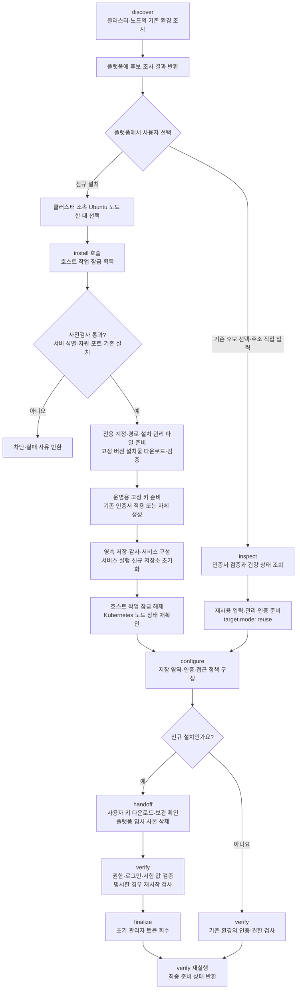
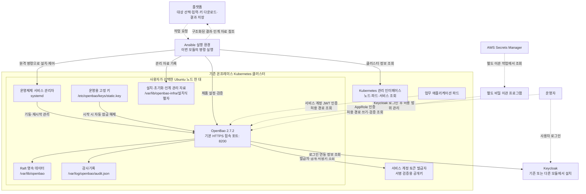

# OpenBao 기반 인프라의 탐색·점검·설치

**이 디렉토리는 기존 OpenBao 환경을 조사하고, 사용자가 선택한 Kubernetes의 Ubuntu 노드 한 대에 OpenBao를 운영체제 서비스로 설치하여 비밀 이관용 저장·인증 환경을 준비하는 구현입니다.** 플랫폼은 대상 선택·접속 정보 제공·키 다운로드 화면을 담당하고, 이 도구는 요청한 작업을 실행해 구조화된 결과를 반환합니다.

이 문서는 구현 이후 논의한 설치 흐름, 설치 후 아키텍처, 기존 환경 조사 방식, 신규 설치 후 확보하는 정보와 반환 한계를 정리합니다. 설명 기준은 현재 코드이며 **실제 운영 서버에 설치가 완료되었다는 의미가 아닙니다.** 로컬 실제 OpenBao 시험과 원격 Ubuntu 설치·실제 인증·플랫폼 연결의 검증 범위를 구분합니다.

- [설치 준비와 상세 운영 안내](../../docs/openbao-infra/README.md)
- [플랫폼 입력 예제](../../config.openbao-infra.example.yaml)
- [검증 기록과 실제 인수 절차](../../docs/openbao-infra/VALIDATION.md)
- [제품 배포 주소와 설치물 검증값](ansible/releases.json)

## 1. 구현 위치와 역할

저장소 기준 주요 구현 위치는 `migration/migration/openbao_infra/`입니다. 기존 데이터베이스 이관 도구와 분리한 독립 명령으로 실행하며, Keycloak 설치는 다른 모듈의 책임입니다.

| 파일·디렉토리 | 역할 |
| --- | --- |
| [__main__.py](__main__.py) | 명령 선택, 최종 결과 출력과 종료 코드 처리 |
| [config.py](config.py) | 플랫폼 입력·대상 선택·자격증명 파일 참조 검증 |
| [runner.py](runner.py) | 임시 실행 공간·서버 목록 준비, Ansible 호출, 결과 수집·반환 |
| [handoff.py](handoff.py) | 다운로드 자료와 사용자·설치 대상 연결, 보관 확인·기한·임시 사본 정리 |
| [ansible/playbooks/](ansible/playbooks/) | 작업별 Ansible 실행 파일 |
| [ansible/library/](ansible/library/) | 클러스터·서버·주소 조사, 키·인증서 준비, OpenBao·Keycloak 제어 모듈 |
| [ansible/module_utils/bao_common.py](ansible/module_utils/bao_common.py) | 인증서 검증 통신, 보호 파일 저장, 제품 호출·오류 처리 |
| [ansible/tasks/](ansible/tasks/) | 클러스터 조회, 서버 사전검사와 신규 설치 순서 |
| [ansible/templates/](ansible/templates/) | OpenBao·운영체제 서비스·감사기록 순환 설정 |
| [ansible/callback_plugins/openbao_events.py](ansible/callback_plugins/openbao_events.py) | 모듈의 보고 항목과 고정 오류 코드 수집 |
| [ansible/releases.json](ansible/releases.json) | 고정한 OpenBao 배포 주소와 설치물 검증값 |

AWS Secrets Manager에서 비밀을 받아올 목적지 준비가 우선 범위입니다. 실제 원본 비밀의 조회·복사·동기화, 클라우드 자격증명 발급, 업무 앱의 비밀 참조 교체는 별도 이관 도구가 담당합니다. GCP Secret Manager 지원은 후속 범위이며, 이 구현 자체는 클라우드 비밀 저장 서비스에 접속하지 않습니다.

## 2. 실행 명령과 변경 범위

저장소 루트에서 Python 3.12 이상을 사용하는 가상환경과 선택 의존성을 준비한 뒤 실행합니다. 외부 Ansible 컬렉션은 사용하지 않습니다.

```bash
python3.12 -m venv .venv
.venv/bin/python -m pip install -e './migration[openbao-infra,dev]'
.venv/bin/python -m migration.openbao_infra discover --config /run/platform/openbao.yaml
```

`discover` 자리에 아래 명령을 선택합니다. 각 명령은 독립적으로 실행되며, 후보가 없다고 신규 설치를 자동으로 시작하지 않습니다.

| 명령 | 실행 내용 | 원격 환경 변경 |
| --- | --- | --- |
| `discover` | Kubernetes와 제공된 노드 접속 정보로 OpenBao 후보 조사 | 없음 |
| `inspect` | 선택한 후보 또는 직접 입력한 HTTPS 주소의 건강 상태 조회 | 없음 |
| `preflight` | 선택 노드·서버 식별·운영체제·자원·포트·기존 설치 충돌 검사 | 없음 |
| `install` | 사전검사 재실행, 단일 서버 설치·키·인증서 준비·신규 초기화 | 있음 |
| `configure` | KV v2 저장 영역, 이관·운영자·앱 인증과 접근 정책 구성 | 있음 |
| `handoff` | 키 인계 자료 준비, 사용자 보관 확인, 임시 사본 정리 | 자료 준비·확인은 있음; `cleanup`은 실행 환경의 자료만 정리 |
| `verify` | 시험 값 기록·조회·정리, 인증·권한 검사, 선택한 경우 서비스 재시작 | 있음 |
| `finalize` | 키 인계와 독립 운영자 인증을 확인한 뒤 초기 관리자 토큰 회수 | 있음 |
| `issue-migration-token` | 이관 프로그램용 단기 토큰 발급과 보호 파일 인계 | 있음 |

플랫폼은 클러스터 접속 설정, 노드 이름·고유 식별자, SSH(암호화 서버 원격 접속) 정보와 필요한 관리자 권한을 제공합니다. 접속 주소·포트·저장 경로 범위, 인증서 모드, Keycloak·앱 인증 정보, 키 인계 자료의 보관 위치도 입력받습니다. 현재 `inspect`에도 공통 입력 검증상 클러스터 접속 설정·파일 참조가 필요하지만, 실제 점검 작업은 Kubernetes에 접속하지 않고 지정한 주소만 조회합니다.

신규 설치는 Ubuntu 22.04·24.04·26.04, `x86_64`·`aarch64`, systemd와 cgroup v2를 입력 검사에서 허용합니다. 이 목록은 실제 모든 조합의 설치 검증을 마쳤다는 뜻이 아닙니다. 대상 서버에는 Python 3가 필요하며 설치 단계에서 Ubuntu 패키지 관리자로 필요한 인증서·암호화·압축 해제 도구를 준비합니다.

## 3. 설치 흐름

아래 그림의 플랫폼 선택·다운로드·보관 확인 화면은 후속 연결 대상입니다. 스크립트는 명령별 제어와 자료 인계 규약을 제공하며 화면을 직접 구현하지 않습니다.



`install`은 호스트 잠금을 획득한 상태에서 사전검사부터 서비스 실행·초기화·공개 신뢰 자료 수집까지 수행합니다. 잠금 해제를 시도한 뒤 Kubernetes 노드를 다시 조회합니다. `configure`, `verify`와 키 인계의 원격 작업도 별도 호출마다 호스트 잠금을 사용합니다. 원격 접속 단절이나 강제 종료로 잠금·일부 파일이 남을 수 있으며, 실행 시간 초과가 원격 작업 종료를 보장하지는 않습니다.

신규 설치에서 준비하는 항목은 다음과 같습니다.

1. 전용 운영체제 계정, 설치 대상·설정 요약값을 기록한 관리 파일, 설정·데이터·감사 경로
2. 검증값을 고정한 OpenBao 2.7.2 설치물과 단일 노드의 Raft 영속 저장
3. 32바이트 고정 키와 보호 파일, 기존 또는 자체 생성 통신 인증서·개인키
4. OpenBao 운영체제 서비스, 부팅 시 시작·실패 시 재시작 정책과 메모리 제한
5. 신규 저장소 초기화, 보호된 초기 관리자·복구 자료와 공개 신뢰 인증서
6. 별도 `configure` 호출을 통한 비밀 저장 영역과 이관·운영자·앱 인증 및 접근 정책
7. 별도 키 인계·검증·초기 관리자 토큰 회수와 최종 준비 상태 확인

키 인계의 `prepare`는 다운로드 자료를 준비하고, `ack`는 사용자의 명시적인 다운로드·보관 확인을 받아 플랫폼의 임시 사본을 삭제합니다. 서버의 운영용 고정 키와 사용자가 내려받은 사본은 유지합니다. `cleanup`은 확인되었거나 기한이 만료된 자료를 정리하며 플랫폼이 이 명령을 호출해야 합니다. 실제 웹 다운로드의 사용자 인증·접근 종료·암호화 보관은 플랫폼이 담당합니다.

기존 환경 재사용에서는 키·인증서를 설치하거나 저장소를 초기화하지 않고, 서비스 재시작과 초기 관리자 토큰 회수도 수행하지 않습니다. `configure`는 지정한 저장 엔진이 없으면 생성하며 기존 엔진은 KV v2인지 확인합니다. 기존 감사 장치와 명시적인 제품 확인·관리 인증이 필요합니다.

설치 중 실패하면 일부 변경이 남을 수 있습니다. 기존 데이터 삭제·새 키 덮어쓰기·재초기화로 되돌리지 않으며, 설치 소유권과 실제 상태를 대조한 뒤 재개합니다. 제거·운영 원본 복원·기존 제품 업그레이드는 별도 승인 범위입니다.

## 4. 설치 후 인프라 아키텍처

**OpenBao는 Kubernetes 파드가 아니라 선택한 Ubuntu 노드의 운영체제 서비스로 실행됩니다.** Ansible 실행 환경의 물리적 배치는 플랫폼이 결정하며, 대상 노드에 상주하는 Ansible 서비스를 구성하지 않습니다.

실선은 코드가 사용하는 조사·제어·제품 내부 관계이며, 점선은 플랫폼·실제 사용자·업무 앱·별도 이관 프로그램을 연결하는 관계입니다. 인증·정책 준비 코드는 포함하지만, 실제 앱 배포 변경과 플랫폼 화면 연결은 별도 작업입니다.



| 구성 | 코드에서 설정하는 내용 |
| --- | --- |
| OpenBao 서비스 | `openbao.service`, 전용 사용자·그룹 `openbao` |
| 실행 파일 | `/opt/openbao/2.7.2/bao`; 프로세서별 공식 설치물 검증값 고정 |
| 일반 접속 | HTTPS, 기본 포트 8200; 접속 주소·수신 포트는 입력으로 지정 |
| 내부 노드 통신 | `127.0.0.1:8201`; 단일 서버의 내부 통신 주소 |
| 영속 저장 | Raft 데이터 `/var/lib/openbao`, KV v2 저장 영역의 이름·경로 범위는 입력으로 지정 |
| 운영용 고정 키 | `/etc/openbao/keys/static.key`, OpenBao 실행 사용자 소유·0400 권한 |
| 통신 인증서 | `/etc/openbao/server.crt`, 개인키 `/etc/openbao/server.key`; 기존 인증서 또는 자체 생성 |
| 공개 신뢰 자료 | 자체 생성 시 서버 인증서, 기존 인증서 모드에서는 `/etc/openbao/trust.pem` |
| 감사·순환 | 설정 파일에 선언한 감사 장치와 `/etc/logrotate.d/openbao` |
| 서비스 제한 | 메모리 상한 1 GiB, 서비스의 추가 스왑 사용 제한, 전용 쓰기 경로·실행 권한 제한 |
| 이관 인증 | `oi-<설치식별자>-migration` 경로의 AppRole과 제한된 비밀 쓰기·조회 정책 |
| 운영자 인증 | `oi-<설치식별자>-operators` 경로의 Keycloak OIDC 연동과 지정 그룹 정책 |
| 앱 인증 | `oi-<설치식별자>-app-<앱이름>` 경로의 JWT 인증과 앱별 조회 정책 |

OpenBao의 새 데이터베이스 서버를 별도로 설치하지 않으며 영속 데이터는 선택한 서버의 파일시스템에 저장합니다. 이 구성에는 다중 서버 장애 전환·외부 백업 저장소·업무 앱 재배포·Kubernetes 로그인 변경·전역 방화벽·이름 해석·역방향 프록시 구성이 포함되지 않습니다.

Keycloak은 사용자 로그인 제공자로 사용합니다. `manage_client: false`에서는 기존 연동 등록 정보를 입력받고, `true`에서는 제공받은 관리 인증으로 기존 관리 영역에 OpenBao 전용 client만 생성·대조합니다. Keycloak 서버·관리 영역·사용자·다른 client를 설치하거나 수정하지 않습니다. 현재 앱 인증은 Kubernetes 서비스 계정 JWT 방식이며, 다른 실행 환경의 앱을 위한 별도 인증 방식은 추가 구현 대상입니다.

## 5. 기존 인프라 정보를 얻는 방법

### 5.1 클러스터 조회

[openbao_cluster_info.py](ansible/library/openbao_cluster_info.py)는 제공받은 클러스터 접속 파일과 접속 대상을 사용하여 Kubernetes Python 클라이언트로 Node, Pod, Service를 조회합니다. Node를 먼저 조회하고, `discover`에서만 전체 네임스페이스의 Pod·Service 조회를 추가합니다. 실제 범위는 제공한 조회 권한에 따라 달라집니다.

노드별로 이름·고유 식별자·machine-id·준비 상태·제어 노드 여부를 반환합니다. 입력한 노드가 클러스터에 존재하는지, 현재 고유 식별자와 등록 주소가 입력한 원격 접속 대상과 일치하는지도 확인합니다. 노드의 등록 주소는 이 대조에 사용하며 현재 최종 노드 보고에는 포함하지 않습니다.

후보 판별은 컨테이너 이미지 이름에 `openbao`가 포함되는지, Service 이름 또는 선택 조건의 문자열에 `openbao`가 포함되는지를 기준으로 합니다. Deployment·StatefulSet·Ingress를 조사하거나 Pod와 Service를 정밀하게 연결하는 구현은 없습니다. 반환한 항목을 검증된 제품·접속 주소로 취급하지 않습니다.

### 5.2 서버 내부 조사

[discover.yml](ansible/playbooks/discover.yml)은 플랫폼이 원격 접속 정보를 제공한 노드에서 [openbao_host_info.py](ansible/library/openbao_host_info.py)를 실행합니다. `discover`가 읽는 정보는 다음과 같습니다.

- `systemctl list-unit-files`에서 이름에 `openbao`가 포함된 서비스 등록 항목
- `/proc`의 실행 파일 이름이 `bao` 또는 `openbao`인 프로세스와 프로세스 번호
- 서버 조사 수행 여부와 서비스 등록 목록 조회 성공 여부

서비스가 등록되어 있다는 사실을 실행 중이라는 증거로 사용하지 않습니다. 프로세스의 수신 포트·제품 버전·설정 파일·접속 주소를 이 단계에서 조사하지 않으며, 해당 프로세스가 컨테이너에 속하는지도 분류하지 않습니다. 서버 원격 접속 자격증명이 없는 노드는 직접 조사하지 않습니다.

운영체제 버전·서버 machine-id·메모리·디스크·포트 충돌·기존 설치 관리 자료는 `preflight`에서 별도로 읽습니다. 이때 원격 서버의 machine-id를 클러스터가 보고한 값과 대조합니다. `discover`의 서버 조사 결과를 이 대조까지 마친 결과로 해석해서는 안 됩니다.

### 5.3 선택한 기존 주소 점검

[inspect.yml](ansible/playbooks/inspect.yml)은 선택한 후보 또는 직접 입력한 HTTPS 주소를 [openbao_endpoint_info.py](ansible/library/openbao_endpoint_info.py)에 전달합니다. 이 모듈은 인증서 체인·서버 이름 검증을 적용한 연결로 `/v1/sys/health`를 호출합니다.

응답에 존재하는 `initialized`, `sealed`, `standby`, `version`, `cluster_id`만 골라 반환합니다. 각각 초기화 여부·잠금 여부·대기 상태·응답 버전·저장소 클러스터 식별자입니다. 초기화 전이나 잠긴 상태도 건강 상태 조회의 정상적인 응답 범위로 해석하며 접속 실패와 구분합니다. 다른 주소로의 응답 이동은 따라가지 않습니다.

이 조회는 관리자 인증 없이 수행합니다. 제품이 같은 응답 형식을 사용한다는 이유만으로 OpenBao라고 확정하지 않으며 `product_confirmed: false`를 반환합니다. 관리자 권한·비밀 조회·실제 로그인과 권한 검증은 별도 단계입니다.

### 5.4 후보 반환과 조사 한계

| 결과 | 반환하는 주요 정보 |
| --- | --- |
| `reports[].nodes` | 노드 이름·고유 식별자·서버 식별값·준비 상태·제어 노드 여부 |
| Kubernetes Pod 후보 | `kind`, 네임스페이스, Pod 이름, 배치 노드, 제품 미확정 표시 |
| Kubernetes Service 후보 | `kind`, 네임스페이스, Service 이름, 서비스 포트 목록, 제품 미확정 표시 |
| 서버 조사 | 서비스 등록 이름, 프로세스 번호, 조사 수행·서비스 목록 조회 성공 여부 |
| 기존 주소 점검 | 응답에 포함된 초기화·잠금·대기 상태, 버전과 저장소 클러스터 식별자 |
| `reason_codes` | Pod·Service 조회 누락, 노드 식별 불일치·접속 실패 등 확인한 사유 |

후보 목록은 이름과 특징을 기반으로 찾은 결과입니다. 사용자 정의 이름·이미지·설치 경로는 놓칠 수 있습니다. 조회 실패와 원격 접속 정보 누락을 제품이 설치되어 있지 않다는 증거로 사용하지 않습니다. 서비스 등록 목록 조회 여부는 `service_scan_complete`도 확인해야 하며, 프로세스 조회의 모든 누락을 별도 범위 보고로 제공하지는 않습니다.

현재 **Service의 실제 접속 주소, 프로세스 수신 포트, 인증서의 상세 정보까지 자동 조합하여 최종 접속 주소를 확정하는 기능은 없습니다.** 후보 중복 통합·상위 배포 자원 추적·네트워크 전체 탐색도 수행하지 않습니다. 플랫폼이 후보를 표시하고 필요한 주소·포트를 보완한 뒤 `inspect`를 호출해야 합니다.

기존 비밀값의 목록·원문, 기존 사용자·전체 권한 정책과 인증 구성은 탐색 단계에서 수집하지 않습니다. 설정 단계는 명시한 관리자 권한으로 필요한 저장 엔진·인증·감사 상태를 확인하지만, 이를 전체 자원 목록으로 반환하지는 않습니다.

## 6. 신규 설치 후 획득하는 정보와 보관 위치

**최종 응답으로 전달하는 정보, 서버에 기록하는 설치 설정, 내부 검사에만 사용하는 정보를 구분해야 합니다.** 주소·포트처럼 플랫폼이 입력한 값과 실제로 조회한 상태도 구분합니다. `install` 한 번으로 뒤에 있는 인증·키 인계·검증 명령의 결과까지 얻는 것은 아닙니다.

| 정보 | 확보·확인 방식 | 최종 응답 또는 보관 위치 |
| --- | --- | --- |
| 대상 노드 | 클러스터 조회·원격 서버 식별값 대조 | `reports`의 노드·사전검사 결과; 서버 설치 관리 파일 |
| 접속 주소·포트 | 플랫폼 입력과 서버 설정 | 입력 설정과 `/etc/openbao/openbao.hcl`; 일반 결과에 독립된 접속 정보 묶음은 없음 |
| 제품 버전·프로세서 종류 | 고정한 설치물과 `uname -m`에 따라 설치 | 실행 경로와 [releases.json](ansible/releases.json); `inspect`를 별도 실행하면 제품 응답의 `version` 반환 |
| 설치·초기화 | 호스트 작업과 제품 상태·초기화 응답 확인 | `status`, `changed`, 단계별 `reports`의 `initialized`, `sealed` |
| 인증서 | 기존 인증서의 주소·기간·키 일치 검사 또는 자체 생성 | 설치 결과의 `trusted_ca_pem`, `trusted_ca_sha256`; 서버의 인증서·개인키 파일 |
| 저장·인증 설정 | `configure`의 제품 조회와 전용 정책·역할 구성 | 해당 보고의 `kv_mount`, `path_prefix`, `migration_auth_mount`, `operator_auth_mount`, 추가 입력 사유 |
| 앱 인증 설정 | 앱별 서비스 계정·발급자·경로 입력과 전용 인증 구성 | 제품의 인증·정책 자원; 전체 앱 역할 목록을 최종 응답으로 별도 반환하지 않음 |
| 키 인계 | `handoff prepare/ack/cleanup`과 사용자·대상·기한 대조 | 자료 참조·수령 기록 참조·기한·요약값 또는 수령·정리 상태 |
| 이관 토큰 | `issue-migration-token`의 전용 역할 로그인 | `credential_ref`의 보호 파일; 관련 보고의 `expires_at` |
| 인증·권한·영속성 | `verify`에서 역할별 인증과 권한, 시험 값, 명시한 재시작 확인 | 검증 보고의 `checks`; 실제 수행한 항목만 통과로 표시 |
| 초기 관리자 정리 | `finalize`에서 독립 운영자 토큰의 발급 경로·정책 확인과 초기 토큰 회수 | `bootstrap_revoked`; 서버의 완료 기록과 초기 토큰을 제거한 초기화 자료 |
| 메모리·디스크·운영체제 | 서버 내부 값을 읽어 지원·자원 조건과 비교 | 내부 검사에 사용; 현재 결과에는 주로 통과·실패와 원인만 반환 |

서버의 설치 관리 자료는 `/var/lib/openbao-infra/<설치식별자>/`에 보관합니다. `installation.json`에는 설치 식별자·노드 고유 식별자·서버 machine-id·설정 요약값을 기록합니다. 주소·포트·인증서 모드를 묶은 설정은 요약값으로 비교하며 이 파일에 모든 설정을 펼쳐 저장하지는 않습니다. `managed.json`은 관리하는 제품 자원과 설정 요약값, `configured.json`은 구성 요약값과 완료 상태를 기록합니다.

`bootstrap.json`은 보호된 초기 관리자 토큰과 복구 자료를 보관하는 민감 파일입니다. 키 인계 묶음에는 초기 관리자 토큰을 제외한 고정 키·복구 자료를 담습니다. `finalize` 후에는 초기 관리자 토큰을 회수하고 해당 파일에서도 토큰 항목을 제거합니다. 복구 자료와 서버의 운영용 키는 별도로 유지합니다.

다음은 `configure` 호출 결과 중 해당 단계 보고의 설명용 발췌입니다. 실제 서버 실행 결과가 아니며 다른 단계의 결과를 하나의 응답으로 합친 예시도 아닙니다.

```json
{
  "status": "configured",
  "reason_codes": [],
  "migration_auth_mount": "oi-onprem-secrets-migration",
  "operator_auth_mount": "oi-onprem-secrets-operators",
  "kv_mount": "kv",
  "path_prefix": "migration"
}
```

`configure`의 완료는 실제 운영자 브라우저 로그인이나 업무 앱 배포의 완료를 뜻하지 않습니다. `verify`의 운영자 검사는 제공받은 OpenBao 토큰의 발급 경로·정책을 확인하며 브라우저를 직접 조작하지 않습니다. 앱 검사는 제공받은 서비스 계정 토큰으로 로그인하고 권한을 조회하는 방식이며 실제 업무 앱 프로세스의 동작을 검증하지는 않습니다.

최종 준비 상태의 `ready`는 필수 검사의 통과 여부로 판정합니다. 신규 환경에는 서비스·이관·앱·운영자·재시작·키 인계·초기 관리자 토큰 회수 검사가 필요하고, 재사용 환경에는 재시작·키 인계·초기 토큰 회수를 적용하지 않습니다. 실제 격리 복원은 수행하지 않아 `recovery_verified`는 `false`로 유지합니다.

현재 결과에는 실행 시작·종료 시각, 단계별 전체 변경 자원 목록, 전체 정책·역할 목록, 서비스의 모든 설정, 자원 수치 전체를 제공하지 않습니다. 입력한 클라우드 원본에 접속해 비밀 이관 성공을 확인하는 기능도 없습니다. 이러한 통합 명세를 플랫폼에 제공하려면 수집·반환 규약을 추가 구현해야 합니다.

## 7. 결과 저장과 민감정보 처리

| 위치 | 저장·반환 내용 |
| --- | --- |
| 표준 출력 | 명령 하나의 단일 JSON 최종 결과; 요청·작업·상태·사유·단계 보고 등 |
| 실행 환경의 임시 공간 | Ansible 입력·결과·원문 출력과 전달 중인 자료; 실행 종료 시 정리 |
| 설정한 키 인계 디렉토리 | 보호된 다운로드 자료와 별도 보관 확인 기록; 수령 확인·만료에 따라 자료 삭제 |
| 설정한 이관 토큰 인계 디렉토리 | 단기 토큰의 보호 파일; 전달과 만료 후 정리는 플랫폼 책임 |
| 설치 대상 서버 | 설치·구성·인계 기록, 인증서·보호된 키와 초기화 자료, 서비스·데이터·감사기록 |
| 플랫폼 데이터베이스 | 자동 저장하지 않음; 플랫폼이 결과를 수신해 저장하는 연결 필요 |

현재 명령에는 `--result` 파일 저장 옵션이 없습니다. 플랫폼이 표준 출력의 결과를 받아 보관해야 합니다. 일반 결과는 `schema_version`, `request_id`, `operation`, `status`, `reason_codes`, `reports`, `changed` 등을 사용하며, 초기 입력 오류나 도구 부재·중단에서는 일부 필드가 생략될 수 있습니다. 전체 변경 내역 대신 `changed`로 수집한 작업의 변경 발생 여부를 반환합니다. 실패한 작업에서 제품 변경 후 보고에 도달하지 못할 수 있으므로, `changed: false`만으로 원격 환경에 변경이 없었다고 판단해서는 안 됩니다.

비밀은 보호된 파일 참조로 입력받고, Ansible의 민감 인자 출력 방지와 제한된 임시 공간을 사용합니다. 일반 결과에 고정 키·인증서 개인키·초기 관리자 토큰·이관 토큰의 원문을 포함하지 않습니다. 공개 신뢰 인증서는 비밀이 아니므로 설치 결과에 포함합니다. 사용자에게 제공할 고정 키·복구 자료와 이관 토큰은 별도의 보호 파일로 전달합니다.

다운로드 자료는 사용자와 설치 대상·노드·접속 주소에 연결합니다. 단순 전송 성공이 아닌 사용자의 명시적 보관 확인을 받아 임시 사본을 지웁니다. 확인 전에 만료된 자료는 재준비할 수 있지만 서버의 키를 바꾸지는 않습니다. 플랫폼은 사용자 인증, 다운로드 요청마다 기한·확인 상태 검사, 접근 권한 종료, 암호화 저장과 정리 명령 호출을 구현해야 합니다. 물리적 완전 삭제나 사용자 보관의 안전성을 이 모듈이 보장하지는 않습니다.

| 종료 코드 | 상태 | 해석 |
| --- | --- | --- |
| 0 | `discovered`, `inspected`, `preflight_passed`, `installed`, `configured` | 요청한 탐색·점검·설치·설정 단계 완료; 전체 인프라 준비 완료와 구분 |
| 0 | `handoff_prepared`, `handoff_acknowledged`, `handoff_cleaned`, `token_issued` | 요청한 자료 준비·확인·정리 또는 토큰 발급 단계 완료 |
| 0 | `ready` | 검증 보고의 필수 준비 항목 통과 |
| 3 | `partially_ready`, `blocked`, `failed` | 추가 입력·미실행 검사·차단·실패; 설치 중 일부 변경이 남을 수 있음 |

위 표는 설정을 읽고 실행한 뒤 모듈이 반환하는 결과 기준입니다. 명령줄 인자 자체가 잘못되면 인자 처리기가 사용법을 출력하고 별도 종료 코드를 반환할 수 있습니다. 플랫폼은 종료 코드와 `status`, `reason_codes`, 단계별 `reports`를 함께 해석해야 합니다. 서버 조사에서는 `service_scan_complete`, 검증에서는 `checks`의 `passed`·`not_run`·`not_applicable`도 확인합니다. 현재 별도의 통합 `coverage` 필드나 최종 결과 스키마 파일은 없습니다.

## 8. 검증 상태와 후속 작업

구현 시점의 로컬 전체 검사는 **239개 통과·24개 생략·실제 OpenBao 시험 1개 제외**입니다. 제외한 실제 제품 시험은 공식 OpenBao 2.7.2 실행 파일로 별도 실행하여 **1개 통과**했습니다. 개발 모드 없이 암호화 접속·Raft·고정 키로 초기화하고, Ansible 주소 점검, 이관 권한 허용·거부, 구성 재실행과 실제 프로세스 재시작 후 자동 해제·값 보존을 확인했습니다.

Ansible 작업 9개의 문법, 신규 모듈의 정적 검사, 배포물의 필수 자료 포함·컴파일 캐시 제외, 새 가상환경에서 소스 폴더 밖의 명령·자료 접근도 확인했습니다. 생략한 24개는 외부 PostgreSQL 접속 정보가 필요한 8개와 OPA 정책 검사 도구가 필요한 16개입니다. 설치 후 Kubernetes 노드 재확인 보강 뒤에는 관련 문법·입력 검사 28개도 통과했습니다.

변경 검토 요청의 [원격 OpenBao 자동 검사](https://github.com/SoftBankHackathon2026/Hackathon/actions/runs/42206762418)와 [기존 이관 이미지 빌드](https://github.com/SoftBankHackathon2026/Hackathon/actions/runs/42206762238)는 구현 당시 성공을 확인했습니다. 원격 OpenBao 검사에는 Linux 실행 파일을 사용한 같은 제품 시험과 배포물 확인이 포함됩니다. 이 기록은 실제 Ubuntu 원격 설치·운영 인증·플랫폼 연결·복원 검증을 대체하지 않습니다.

이번 구현 이후의 별도 작업은 다음과 같습니다.

- 플랫폼의 후보 표시·사용자 선택·명령 호출·결과 저장과 다운로드의 사용자 인증·기한 정리 연결
- 실제 Ubuntu·Kubernetes에서 신규 설치, 동일 입력 재실행, 중단 후 재개, 노드 정상 상태와 기존 서비스 공존 확인
- 실제 인증서 신뢰 배포·Keycloak 전용 client와 브라우저 로그인·Kubernetes 앱 신원·권한 검사
- 독립 운영자 로그인과 키 인계 이후 초기 관리자 토큰 회수, 이후 관리·이관 토큰 전달 절차 확인
- 필요 시 후보 접속 주소 조합·중복 통합·상세 조사 범위·통합 설치 정보 반환 규약 추가
- 별도 비밀 이관 도구의 AWS Secrets Manager 연결과 실제 복사·앱 전환 검증, 후속 GCP Secret Manager 지원
- 외부 백업·격리 복원, 인증서 갱신과 신뢰 자료 배포, 다중 서버와 추가 앱 인증 방식 설계

용어: SSH는 암호화 원격 접속, HTTPS·TLS는 서버 신원 확인과 통신 암호화, JSON은 구조화된 자료 형식, IP는 네트워크 주소, SHA-256은 파일 무결성 요약값, KV v2는 버전을 관리하는 키·값 저장 기능, OIDC는 사용자 로그인 연동 표준, JWT는 서명된 신원 토큰, AppRole은 프로그램용 OpenBao 인증 역할입니다. Pod·파드는 Kubernetes의 컨테이너 실행 단위, Service는 해당 실행 단위에 접속하는 서비스 자원, namespace·네임스페이스는 자원 구획, client는 인증 연동 등록 단위, systemd는 Linux 서비스 관리자, cgroup v2는 프로세스 자원 제한 기능, GiB는 이진 단위의 메모리 용량, Raft는 OpenBao의 영속 저장 방식, OPA는 정책 검사 도구입니다. AWS와 GCP는 각각 Amazon Web Services와 Google Cloud Platform이며, PR은 변경 검토 요청입니다.
