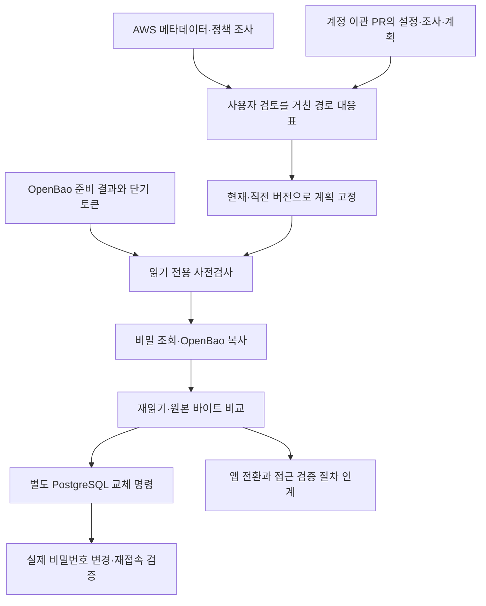

# AWS 비밀값의 온프레미스 OpenBao 이관

`python -m migration.secrets`는 AWS Secrets Manager의 현재·직전 값을 준비된 OpenBao에 복사하고 검증합니다. 별도 명령으로 PostgreSQL 일반 접속 계정의 비밀번호를 교체합니다. **앱 설정·배포·재시작과 원본 삭제는 수행하지 않습니다.**

## 1. 구현 위치와 책임

| 파일 | 역할 |
|---|---|
| `common.py` | 엄격한 설정, 비밀 참조, 보호된 파일, 계획 요약값 |
| `source.py` | AWS 계정 확인, 읽기 전용 조사와 비밀 조회, 정책 근거 수집 |
| `plan.py` | OpenBao 준비·계정 PR 결과 연결, 버전 선택, 안정된 신원·경로 대응 |
| `target.py` | 인증서 검증 통신, 제한된 토큰 사전검사, 버전이 있는 키·값 저장 |
| `engine.py`, `state.py` | 복사·비교·응답 유실 대조·재개, 원문 없는 실행 기록과 잠금 |
| `access.py` | 계정 도구의 구성·정확한 경로·동일 사용자 허용/거부 시험 결과 대조 |
| `rotation.py`, `operations/postgres.py` | PostgreSQL 비밀번호 교체·재접속·같은 후보로 재개 |

기존 로컬 `migration/secrets-foundation`의 비밀 모델·실행 기록·PostgreSQL 적용기를 재사용하고, 승인된 AWS→OpenBao 범위의 계획·실행기를 구성했습니다. 기존 데이터베이스 이관과 인프라 준비 명령의 동작은 유지합니다. 다른 클라우드나 14방향 이관을 이 명령의 지원 기능으로 주장하지 않습니다.

## 2. 설치와 실행 환경

Python 3.12 이상에서 저장소 루트 기준으로 설치합니다.

```sh
python3.12 -m venv .venv-secrets
.venv-secrets/bin/python -m pip install './migration[secrets]'
.venv-secrets/bin/python -m migration.secrets --help
```

실행기는 원본 AWS와 대상 OpenBao에 연결할 수 있어야 합니다. 계정·리전 한 쌍을 설정 하나로 처리하고, 여러 계정·리전은 별도 설정과 기록으로 실행합니다. 같은 호스트·운영체제 사용자에서는 목적지 저장 영역 잠금을 공유합니다. 서로 다른 호스트·사용자·격리 컨테이너의 분산 잠금은 제공하지 않으므로 플랫폼이 동일 목적지 실행을 직렬화해야 합니다.

인프라 준비·계정 이관 도구와는 **파일 규약으로 연결하는 별도 실행 환경**을 사용합니다. 원격 서버를 설치·재초기화·잠금 해제하거나 관리자 권한을 자동 확대하지 않습니다.

## 3. 입력과 실행 흐름

운영 예시와 전체 명령은 [운영 안내](../../docs/secrets/operations.md), 판단과 후속 작업은 [결정 기록](../../docs/secrets/decisions-and-followups.md)에 있습니다. 모든 설정·정책·결과 입력은 실행 사용자 소유의 일반 파일, 권한 0600 이하가 필요합니다. 토큰은 환경변수 또는 보호 파일 참조로만 전달합니다. 심볼릭 링크·중복 키·알 수 없는 설정 필드는 거부합니다.



계획·사전검사는 비밀 원문을 조회하거나 목적지를 변경하지 않습니다. 현재는 `AWSCURRENT`, 직전은 `AWSPREVIOUS`를 선택합니다. 직전이 없으면 `not_present`, 나머지 과거 버전은 `omitted_versions`로 보고합니다. 진행 중 교체인 `AWSPENDING`, 원본 삭제 예약, 관리 서비스 소유 관계, 보존하지 못하는 자원 정책 제한, 필수 정책 근거 누락은 차단합니다.

## 4. 대상 저장 형식

각 비밀을 OpenBao 경로 하나의 전용 문서로 저장합니다. 최초 쓰기는 `cas: 0`으로 기존 자원을 덮어쓰지 않습니다. 문서에는 `schema`, 원본 계정·리전·비밀 고유 식별자, 소유 연결 식별자, 복사 작업 식별자, `values`, `current`, `previous`, `pending`, `rotation`이 있습니다.

`values[원본 버전].payload`는 원래 바이트의 Base64 표현이고 `kind`는 문자열/바이너리를 구분합니다. **Base64는 암호화가 아닙니다. 저장소 암호화는 OpenBao가 담당합니다.** 현재·직전은 AWS 버전 식별자에서 문서 내부 항목으로 연결되며 OpenBao 물리 버전 번호와 같지 않습니다. JSON 문자열도 최초 복사에서는 공백·문자 인코딩을 포함한 원래 바이트를 유지합니다.

앱은 `OpenBao.read_value(path, "current")`와 같은 읽기 규약을 구현해야 합니다. 일반 OpenBao 문서의 최상위 `password`를 읽던 앱에는 설정 또는 코드 변경이 필요합니다. 한 경로의 읽기 권한으로 그 문서에 보관한 현재·직전 값을 모두 읽을 수 있으므로 경로 검토에 이를 포함합니다. 앱 연동 수정은 이번 구현 대상이 아닙니다.

## 5. 접근 권한과 암호화

Secrets Manager가 AWS 키 관리 서비스인 KMS로 복호화한 값을 받아 OpenBao 내부 암호화 체계로 저장합니다. KMS 키 원문·식별자·정책을 대상 암호화 키로 복제하지 않습니다. 설명·태그·키 정보와 정책은 근거 자료로 보관하며 원본 제품의 운영 기능을 원형 복제했다고 표시하지 않습니다.

OpenBao 준비 도구의 `configure`와 `verify` 결과를 받고 서비스·이관 검사 통과를 확인합니다. 실제 통신에서는 서버 클러스터·버전, 저장 엔진 식별자, 인증서 신뢰, 비루트 단기 토큰, 데이터 경로의 생성·수정·조회 권한, 범위 밖·정책 관리 접근 거부를 확인합니다. 저장 엔진 확인은 개별 경로의 내부 조회 경로를 이용하며, 검증한 2.7.2 외 버전은 실제 호환 시험이 필요합니다. 전역 `sys/mounts` 조회나 메타데이터 변경 권한을 추가하지 않습니다.

계정 이관 PR #51의 `config`, `identity_inventory`, `identity_plan`을 해시·계정·업무·환경·정확한 경로 기준으로 대조합니다. 정책 생성·신원 등록은 계정 도구가 소유합니다. `access-report`는 해당 도구의 적용·검증 결과와 원래 시험 입력을 받아 동일 사용자에 대한 정확한 비밀 경로 허용·범위 밖 거부 증거를 확인합니다. 공급된 과거 결과 대조이며 새 사용자 토큰 시험을 대신하지 않습니다. 계획 요약값은 전자서명이나 승인자 인증이 아니므로 입력 파일의 전달·보관은 플랫폼이 통제해야 합니다.

계정 대응이 아직 준비되지 않았거나 프로그램 신원을 별도로 연결해야 하는 환경에서는 설정의 `identity`를 생략하거나 null로 두고, 대응표에서 `access_mode: deferred`, `identity_assignments: []`를 명시할 수 있습니다. 값 복사는 가능하지만 사용자·앱 접근 권한을 자동 생성하지 않고 신원·접근 검증을 미완료로 남깁니다. 기본 `access_mode: identity`에서는 검토된 계정 계획과 할당을 반드시 요구합니다. 계정 계획을 제공한 상태로 일부 비밀의 권한 연결만 유보하는 것도 명시해야 합니다.

원본 정책 내용·주체·대상 자원·조건·조사 시점과 수집 누락을 보관합니다. 대응표는 조회·생성·수정·삭제·복원·영구 파기·관리를 구분하지만, **향후 작업 필드를 기록한다고 권한을 부여하지 않습니다.** 원본 주체 고유 식별자와 대상 그룹을 함께 유지합니다. 조건·거부의 보존을 확인하지 못하면 자동 허용으로 바꾸지 않습니다. 조직·세션·외부 제한을 포함한 AWS 실효 권한 전체 평가는 제공하지 않습니다.

목록·메타데이터 조사 실패는 비밀 부재로 처리하지 않고 범위별 `unknown`과 부분 조사 상태로 보관합니다. 부분 조사는 실행을 차단하고 재검사 때 새 누락이 생겨도 중단합니다. KMS의 별도 권한 위임 내역과 조직·세션 제한은 외부 검토가 필요하며 전부 수집했다고 표시하지 않습니다.

## 6. PostgreSQL 교체와 복구

일반 접속 역할의 단일 비밀번호 문자열 또는 명시한 JSON Pointer 필드만 교체합니다. 사용자·권한·데이터베이스 생성, 특권 계정 교체, 다른 제품의 키 재발급은 하지 않습니다. JSON Pointer는 객체의 기존 문자열 필드만 허용하고 배열·추측·새 필드 생성은 거부합니다. 최초 JSON 복사는 원문 바이트를 보존하며 교체 후 JSON은 동일한 필드 구조를 유지해 직렬화합니다.

교체 전에 복사·검증 완료, 서버 고유 식별자, 실제 관리 신원, 비특권 역할, 지원하는 암호 인증, 유효한 담당자 준비 확인을 검사합니다. 새 후보를 먼저 OpenBao에 보관한 후 데이터베이스를 변경하고 재접속에 성공해야 현재 참조를 바꿉니다. 비밀번호 원문 대신 클라이언트에서 계산한 인증 검증값을 변경문에 사용합니다. 실제 서버·프록시·감사 확장의 로그 설정 검증은 운영 담당자가 수행해야 합니다.

교체는 복사 후 자동 실행되지 않습니다. 앱 담당자는 새 자격증명 사용과 기존 연결 처리, 실패 시 운영 대응을 준비하고 원본 자동 교체를 중지해야 합니다. 최대 30분의 준비 확인은 담당자 진술이며 자동 차단 장치나 실제 앱 시험 증명이 아닙니다.

응답 유실·외부 변경 중단 후 같은 작업 식별자와 같은 후보로 재개합니다. 후보를 찾을 수 없는 불명 쓰기는 새 후보로 재시도하지 않습니다. 데이터베이스 변경 후 실패했다고 옛 비밀번호나 앱 참조를 자동 복구하지 않습니다. 실제 교체 후 AWS에 남은 옛 자격증명은 더 이상 유효하지 않을 수 있습니다. 원본 비밀값은 자동 갱신하지 않습니다.

## 7. 결과와 검증

값 복사, 접근 증거, 자격증명 교체, 앱 전환 인계 상태를 분리합니다. `migration_complete`는 앱 전환을 검증하지 않은 이 도구 단독 결과에서 거짓으로 유지합니다. `status/report`는 현재 원격 상태가 아니라 과거 기록입니다. 새 `verify`가 실패하면 복사 상태를 복구 필요로 낮춥니다.

검증 명령·실제 결과·생략 항목은 [검증 기록](../../docs/secrets/validation.md)에 기록합니다. 실제 AWS와 운영 온프레미스 설치·사용자 로그인·업무 앱 전환은 별도의 인수 시험입니다.

## 8. 한계와 후속 작업

업무 앱 변경, MySQL·외부 서비스 호출용 키 교체, 쓰기·삭제·관리 권한 자동 이관, 과거 전체 버전·삭제 이력·자동 교체 일정 복제, 원본 자동 폐기, 상시 동기화, 무중단 보장, 업무 암호문 변환·전자서명 전환·암호 연산 키 가져오기, 구글 클라우드 지원은 후속 범위입니다. 실제 인수 전에는 운영 이관 완료라고 판단할 수 없습니다.

용어: PR은 코드 변경 검토 요청, JSON은 이름과 값으로 구성한 자료 형식, JSON Pointer는 그 안의 필드를 지정하는 경로, KMS는 키 관리 서비스, TLS는 서버 확인과 통신 암호화, CAS는 기존 버전을 비교해 충돌 시 쓰기를 거부하는 방식, Base64는 바이트를 문자로 표현하는 인코딩입니다.
