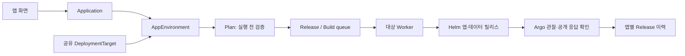

# 앱·배포 환경·릴리즈 관리

앱은 서비스의 지속적인 식별자다. 같은 AWS·GCP·온프렘 대상에 앱 여러 개를 연결할 수 있으며, 배포할 때마다 앱을 새로 만들지 않는다. Blue/Green과 Canary는 앱의 배포 설정이고 환경 목록의 별도 항목이 아니다.

## 화면과 저장 시점

| 사용자 동작 | 저장/실행 |
|---|---|
| 앱 → 앱 만들기 → 앱 저장하기 | `applications`에 앱 메타데이터만 저장. 앱 목록에 즉시 표시 |
| 앱 상세 → 환경 연결하기 | `app_environments`에 앱·대상 연결, 고유 runtime ID·hostname·비밀값 없는 설정 스냅샷 저장 |
| 배포하기 → 이미지/GitHub·전략·DB 설정 | 브라우저의 입력 상태. 아직 실행하지 않음 |
| 배포 계획 확인하기 | 입력 검증과 단계·fingerprint 반환. Release/클라우드 리소스 생성 없음 |
| 이 계획으로 배포 | 같은 입력의 fingerprint를 재검증하고 기존 durable queue에 Release 접수 |
| 이 계획으로 빌드하고 배포 | Build 접수 → 고정한 소스 커밋 빌드 → 공개 amd64 digest 확인 → Release 접수 |
| 다음 버전 배포 | 같은 앱·환경 안에 새 Release 추가. 최근 성공 요청을 기본값으로 사용 |

## 데이터와 호환성

- `applications`: UUID와 유사한 서버 생성 ID, 앱 이름, 팀, 생성 요청 키. 팀 내 이름 중복을 막는다. 생성 재시도는 동일 앱을 반환한다.
- `deployment_targets`: 운영자가 등록한 Provider 기반 실행 환경. `creation_enabled`가 켜진 대상에만 새 앱을 연결할 수 있다.
- `app_environments`: 앱마다 하나의 대상에 하나만 연결한다. ID는 기존 API의 `environment_id`로 전달해 Worker·Build·Release 계약을 유지한다.
- `releases`: 기존 durable journal을 재사용한다. 앱 런타임 ID와 binding ID로 작업 및 이전 정상 revision을 구분한다.
- 기존 등록 환경은 시작 시 메타데이터만 가져온다. 기존 실행 ID·Helm release·hostname·Secret·PVC·Release 이력을 변경하지 않는다. 숨긴 검증용 환경은 앱 목록에 가져오지 않는다.
- 기존 `environment_teams` claim은 조회 때 반영한다. 새 앱은 `applications.team`으로 접근을 제한하며, 새 앱을 배포한다고 공유 대상 전체를 한 팀이 차지하지 않는다.
- 기존 `/api/v1/environments`는 호환성을 위해 앱·환경 binding 목록이다. 새 `/api/v1/targets`가 실제 공유 대상 목록이다.
- 새 API는 `GET/POST /api/v1/applications`, `POST /api/v1/applications/{id}/environments`다. UI는 `#app/<application-id>`로 이동하며, 기존 binding ID 링크도 해석한다.

## 온프렘 실행

운영 설정 `catalog_target_id: onprem-main`이 등록된 Helm Worker는 DB의 새 binding을 매 tick 조회한다. 별도 Worker 프로세스나 설정 파일을 앱마다 만들 필요가 없다. 새 binding마다 기존 `HelmRuntime`과 `HelmWorker`를 구성하며, 기존 작업 잠금·저널·응답 유실 대조·실패 복구 경로를 재사용한다.

hostname은 앱 이름과 `(application-id,target-id)` 해시로 만들어 충돌을 막는다. 차트 버전·SHA와 비밀값 없는 환경 스냅샷은 연결 시 고정한다. kubeconfig·DB DSN·Helm 실행 경로는 실행 시 운영 설정에서 가져온다. 다른 앱의 Secret 참조나 샘플 앱의 필수 DB 설정을 복사하지 않는다.

새 앱의 이미지 기본값은 실행용 이미지가 아니다. 사용자가 검증 가능한 공개 Docker Hub digest 이미지를 지정하거나 GitHub 빌드를 선택해야 한다. Worker는 실제 쓰기 전 공개 pull 가능 여부·digest·amd64를 다시 검사한다.

첫 배포는 Blue/Green 또는 Canary를 선택할 수 있다. 기존 차트의 전략 종류 변경 금지는 유지한다. Canary 첫 배포는 후보 검사 후 공개하고, 기존 정상 버전이 있는 다음 배포부터 트래픽 비율을 나눈다. DB·Redis는 같은 앱의 재배포에서 재사용한다.

## 범위와 제한

- AWS ECS·GCP Cloud Run·온프렘 Helm의 새 앱 연결을 지원한다. 운영 설정의 `catalog_target_id`가 없으면 해당 대상은 비활성화하며 화면에 이유를 표시한다. 기존 앱 배포는 그대로 사용할 수 있다.
- 앱 등록과 온프렘 환경 연결에는 개수 제한을 두지 않는다. 기존 설정·저장된 binding의 `catalog_max_apps`는 호환성을 위해 읽지만 제한에 사용하지 않는다. 배포 요청별 CPU·메모리·replica 검증은 유지한다.
- 앱 이름 변경·앱 영구 삭제·차트 스냅샷 일괄 업그레이드·기존 전략 종류 변경은 별도 작업이다. 실행 중 데이터를 자동 삭제하거나 기존 리소스를 강제로 인수하지 않는다.
- 과거 성공 Release를 직접 선택하는 롤백 UI/API는 후속 범위다. 기존 배포 실패 시 이전 정상 revision 복구는 유지한다.
- 승인한 계획 fingerprint는 입력 일치 검사다. 인증 토큰이 아니며, 모든 실행에서 기존 인증/앱 소유권 검사를 수행한다. 기존 API 클라이언트 호환을 위해 이 필드는 선택 사항이다.

## AWS·GCP 새 앱 (2026-10-04)

새 앱 화면은 AWS / GCP / 온프렘 버튼을 항상 표시한다. 같은 Provider의 실제 대상이 여러 개이면 활성화한 대상만 추가로 선택한다. 앱별 binding을 Provider별 기본 설정에서 만들되, 기존 앱의 Secret 참조·DB 식별자는 복제하지 않는다. AWS 앱 ID는 24자, GCP는 실행 계정·DB·캐시 제한에 맞춰 19자 이내이며 충돌 방지 해시를 포함한다.

- AWS: `aws-runtime.json`에 `catalog_target_id: aws-main`을 설정한다. 기존 AWS Worker 명령이 새 binding을 자동 발견한다. 앱 설정 저장 → 선택한 RDS/Redis 준비 → 기존 ECS 생성·배포 경로를 사용한다. 새 앱의 DB 기본 방식은 전용 DB다. `.env`와 AWS 인증 정보는 운영 설정 파일에서만 읽는다.
- GCP: `gcp-runtime.json`에 `catalog_target_id: gcp-main`을 설정한다. 프로젝트·리전·네트워크·이미지 정책을 공유하고 서비스·계정·DB·캐시 ID는 앱별로 발급한다. 기존 `oneport-app-provisioning` Workflow가 실행 계정과 제한된 권한을 준비한다. 배포 계정에는 Workflow `executions.create/get`, Cloud Run 생성·수정 및 앱 실행 계정 `actAs` 권한이 필요하다. 관련 인프라 계약은 [GCP 인프라 문서](../../infra/gcp/README.md#앱-실행-계정-준비)를 따른다.
- GCP 첫 배포: 실행 계정 → 선택한 DB/Redis 및 REDIS_URL·TLS CA 준비 → 요청한 DB 마이그레이션 → Cloud Run 서비스 생성 → 상태 확인과 Release 헤더 검사. 마이그레이션이 실패하면 앱 서비스를 생성하지 않는다. 이전 버전이 없으므로 첫 버전은 100% 트래픽으로 기동하며, 이후부터 기존 블루그린·카나리·복귀 경로를 사용한다. 최초 버전 실패 시 이전 버전 복구는 불가능하며 실패 상태를 기록하고 같은 서비스에 재시도할 수 있다.
- GCP 생성 의도·Workflow 실행 이름·실제 서비스 UID/URL은 `009_gcp_apps.sql`의 별도 저널에 저장한다. 비밀번호나 키를 저장하지 않는다. 응답 유실 시 이름·소유 토큰·UID·설정·트래픽을 대조한 뒤 이어서 처리한다. 같은 이름의 외부 서비스를 자동 인수하지 않는다.
- 서비스 UID가 발급돼도 이미 승인한 계획과 릴리즈 fingerprint는 바뀌지 않는다. 기존 등록 앱은 종전 UID 검사와 fingerprint를 유지한다. 동적 앱의 DB/캐시 소유권은 생성 전부터 존재하는 앱 소유 토큰으로 고정한다.
- AWS/GCP의 새 앱 생성을 비활성화해도 이미 연결된 앱의 Worker 처리는 계속한다. API와 Worker는 같은 버전으로 업데이트해야 하며 기존 Worker 실행 명령은 바뀌지 않는다.
- GCP 삭제 정책은 유지한다. 서비스·리비전 삭제 후에는 같은 binding으로 자동 재생성하지 않는다. 앱 실행 계정과 캐시는 기존 정책대로 별도 관리 대상이다. 이번 변경은 DB 역방향 마이그레이션이나 새 삭제 정책을 추가하지 않는다.

운영 활성화 스크립트는 AWS `aws-main`, GCP `gcp-main`, Helm `onprem-main`을 사용한다. 실제 클라우드 리소스 생성은 메타데이터 연결 시점이 아니라 Worker가 배포 요청을 처리할 때 시작한다.

검증: 실제 PostgreSQL 저널과 SDK 대역으로 앱 간 격리, 중복 연결, 동적 Worker 발견, 새 ECS 서비스 배포, 첫 Cloud Run 생성, 응답 유실·재시작, 외부 서비스 거부, DB/캐시 연결 순서, 최초 상태 확인 실패 후 재시도, 두 번째 카나리 및 이전 버전 복귀를 확인했다. 백엔드 전체 641개, 프런트엔드 16개 테스트와 TypeScript/Vite 빌드가 통과했다. 실제 GCP 검증은 격리 스키마 `catalog_live_8aa596`에서 API 앱 생성 → 환경 연결 → 계획 → 배포 → 공개 `/health`의 Release 헤더 확인까지 성공했다(릴리즈 `9dcf0387c0ffff524c42adc4`). AWS 새 앱과 신규 GCP DB/캐시의 실클라우드 검증은 이번 결과에 포함하지 않는다.

## 검증

2026-10-03, 분리한 플랫폼 DB 스키마와 기존 제한된 deployer 계정으로 검증했다.

- 앱 생성/환경 연결/계획 확인은 Release와 Kubernetes 리소스를 생성하지 않음.
- 중복 생성·중복 배포 요청, 다른 팀 접근 거부, 기존 claim 유지, target 한도, 재시작 후 binding 유지 회귀 테스트.
- 로컬 React 화면에서 `catalog-proof` 생성 → 온프렘 연결 → Canary 계획 → 실행. Release `f415a6b2c051bd0e4683b186` 성공.
- 같은 Worker가 새 `catalog-second` binding을 재시작 없이 발견하고 Blue/Green 최초 배포. Release `6c811e76a619e562c998005b` 성공.
- 두 앱은 서로 다른 Helm 릴리스와 공개 hostname 사용. 공개 응답의 정확한 Release 헤더 확인.
- 백엔드 전체 449개 테스트 통과, React TypeScript/Vite build 통과. 실검증은 AWS/GCP 새 앱 생성의 증거가 아니다.

- 공개 서버 CD는 API 재시작 후 운영 환경 설정을 활성화할 수 있다. 먼저 가져온 target ID는 그대로 유지하고, Worker는 target의 운영자 binding ID로 새 앱을 찾는다. 활성화 전후 ID 차이 때문에 앱 연결이 거부되거나 큐가 처리되지 않는 회귀를 테스트한다.
- Canary 재배포 `14a9c1e6142dfa1e7b737b12`도 Worker 재시작 후 10% → 50% → 100% 전환과 최종 공개 응답 검증까지 성공했다. 격리 검증 앱 두 개는 소유 UID를 확인해 리소스와 Helm 기록을 정리했고 기존 Notes 앱은 유지했다.
