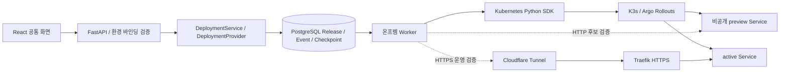

# 플랫폼 구조와 팀별 연결 지점

## 책임 구분

Terraform과 클러스터 설치는 인프라 담당자가 관리합니다. HTTP 요청 처리 중 클라우드 작업 완료를 기다리지 않습니다. API는 의도 검증·접수, Worker는 실제 SDK 호출·상태 재조회·복구를 담당합니다. Argo Rollouts는 온프렘 배포 제어기이며 Argo CD/GitOps 서버는 요구하지 않습니다.

## 코드 읽는 순서

백엔드 패키지는 `backend/src/controlplane` 아래에서 계층별로 나뉩니다.

| 위치 | 역할 |
|---|---|
| `main.py` | `create_app` 팩토리, lifespan(DB 풀·마이그레이션), CORS·TrustedHost 미들웨어, 라우터 등록 |
| `container.py` | 설정·Provider 레지스트리·서비스를 한 번 조립하는 의존성 컨테이너 (`app.state.container`) |
| `core/` | `config.py`(pydantic-settings 환경 설정), `errors.py`(HTTP 상태를 가진 도메인 예외), `locks.py`(advisory lock 번호), `db.py`, `secrets.py`, `security.py` |
| `api/` | `deps.py`(인증·권한 의존성), `errors.py`(예외 → 응답 변환), `routes/*.py`(리소스별 라우터) |
| `schemas/` | HTTP 요청·응답 Pydantic 모델 |
| `services/` | 배포·환경·카탈로그·모니터링·인증·빌드·다중 배포 유스케이스. FastAPI를 import하지 않습니다 |
| `repositories/` | PostgreSQL 저널(Release, 계정, 카탈로그, 삭제, 복원) |
| `domain/` | 공통 배포 요청 모델, 자원 조합, 계측 프로필 |
| `providers/` | 공통 Provider Protocol(`interface.py`), 영속 접수 기반(`durable.py`), 레지스트리, 설정 파일 → Adapter 생성(`factory.py`, `loader.py`), 클라우드별 Adapter |
| `execution/` | 클라우드별 Worker와 공통 재시도·삭제 단계 |

읽는 순서:

1. `main.py`, `api/routes/releases.py`: Release 접수/조회 HTTP 경로.
2. `services/deployments.py`, `providers/interface.py`, `sdk.py`: 클라우드별 분기가 없는 배포 서비스와 공통 입력·작업·상태.
3. `providers/registry.py`, `providers/factory.py`, 각 `adapter.py`: 환경 등록 및 Provider 내부 요청 변환.
4. `repositories/releases.py`, `migrations/`: 중복 요청 방지, 작업/상태/체크포인트 저장, 작업 잠금.
5. `execution/onprem/worker.py`: 배포 단계와 실패 복구 흐름.
6. `providers/onprem/provider.py`, `manifests.py`: Kubernetes SDK 호출과 Argo 매니페스트.

라우트는 서비스 메서드만 호출하고 예외를 직접 HTTP 응답으로 바꾸지 않습니다. 서비스는 `core/errors.py`의 예외(`RequestConflict` 409, `OperationNotFound` 404, `InvalidRequest` 422, `NotConfigured` 503 등)를 던지고 `api/errors.py`가 한 곳에서 응답으로 변환합니다.

공개 입력은 `providers/interface.py`의 `DeploymentSpec`입니다. 기존 `models.py`의 `DeploymentRequest`와 GCP의 내부 요청 모델은 각 Worker 호환 계층으로 유지합니다. 일반 환경변수는 `env`, 비밀값은 `secret_bindings`로 전달합니다. `providers/contracts.py`의 오류/ReleaseKey와 `execution/reconciler.py`의 재시도 경계는 Provider가 공유할 수 있습니다. 각 Worker의 단계는 Provider가 소유합니다.

## Provider 연결

- AWS SDK/Worker: `oneport_aws/`. 공통 `AwsAdapter`가 기존 boto3 기반 코드를 감쌉니다.
- GCP native: `providers/gcp/`, `execution/gcp/`. Google SDK로 기존 Cloud Run 서비스의 이미지 배포·블루그린·카나리를 실행합니다. `engine=cloud_run`으로 선택합니다.
- GCP bridge: `providers/gcp_bridge/`, `execution/gcp_bridge/`. 팀 GCP 빌드 API를 로컬 HTTP로 연결하고 원격 작업 ID를 저장합니다. 두 GCP 경로는 같은 runtime이지만 지원 계약이 다르므로 한 플랫폼 설정에서는 하나를 선택합니다.
- 온프렘: `providers/onprem/`, `execution/onprem/`. Kubernetes SDK·Argo Rollouts 실행입니다.
- 세 Adapter는 `DeploymentProvider`의 `validate / plan / submit / observe`를 구현합니다. [공통 인터페이스와 사용 예제](DEPLOYMENT-PROVIDER-INTERFACE.md)를 참고하세요.
- `providers/loader.py`는 `ONEPORT_CONFIG`의 Provider 목록을 등록합니다. 기존 `ONEPORT_RUNTIME_CONFIG` 온프렘 및 native Cloud Run 설정도 호환합니다.
- 공통 UI는 `/providers`의 source_kinds·configurable_fields·features를 읽어 지원 범위를 표시합니다.

한 환경 ID는 한 Provider만 소유합니다. 같은 runtime의 capabilities는 일치해야 하며 실제 환경별 이미지/자원 상한은 별도 정책으로 제한합니다. AWS는 `aws_ecs`, GCP는 `gcp_cloud_run`, 온프렘은 `onprem_argo` runtime을 씁니다. 새 Worker는 자기 runtime/app/environment 큐만 가져와야 합니다.

공통 요청의 CPU/메모리/이미지 제약은 현재 MVP 범위입니다. 담당 Provider가 더 넓은 사양을 제공하려면 공통 스키마·capabilities·프론트 입력·검증 테스트를 함께 변경합니다. 현재 AWS/온프렘 공통 실행은 digest 이미지, GCP native는 digest 이미지, GCP bridge는 공개 GitHub 기본 브랜치 빌드를 받습니다. 커밋 고정 Git 입력은 모델에 있지만 공통 실행 진입점의 현재 Provider는 지원하지 않습니다.

## HTTP 계약

| 요청 | 결과 |
|---|---|
| `GET /healthz` | preview/operator 모드와 실행 설정 유무. 클러스터 health를 의미하지 않음 |
| `GET /api/v1/providers` | Provider 지원 범위. SDK 구현과 실행 환경 등록은 별도 |
| `GET /api/v1/access` | 인증 모드(`operator`·`demo`·`login`)와, login 모드에서 로그인한 사용자(`email`, `team`) |
| `POST /api/v1/auth/signup`·`login`·`logout` | login 모드 전용. 가입(이메일·비밀번호·팀)과 로그인은 세션 쿠키를 발급. 로그인 실패는 이메일당 5분에 5회로 제한 |
| `GET /api/v1/team`, `POST /api/v1/team/role` | login 모드 전용. 팀원과 역할(`owner`·`member`·`viewer`) 조회, 관리자의 역할 변경. 앱을 바꾸는 요청(앱 등록, 릴리즈, 수동 전환, 빌드)은 `viewer`에게 403 |
| `GET /api/v1/environments` | 공개 환경 메타데이터, 등록 여부, allowlist·자원 상한. credential 제외. login 모드에서는 로그인이 필요하고, 다른 팀이 소유한 환경은 앱 정보 없이 표시 |
| `POST /api/v1/plans` | 공통 요청의 검증/계획만 생성. 외부 변경 없음. login 모드에서는 로그인이 필요하고 다른 팀이 소유한 환경은 409 |
| `POST /api/v1/environments/{id}/application` | 지원하는 Provider의 앱 등록. 미지원 Provider는 409 |
| `GET /api/v1/environments/{id}/logs` | 앱 컨테이너의 최근 로그(`minutes` 1~360, 검색어 `q`, `limit` 최대 1000). Bearer 필수. Provider 로그 저장소에서 읽기만 하고 DB에 저장하지 않음. 미지원 Provider는 409 |
| `GET /api/v1/environments/{id}/traffic` | blue/green target group별 요청 수·5xx·4xx·p95·정상 대상 수(`minutes` 5~360, 3시간 이하는 1분·그보다 길면 5분 단위), 운영 릴리즈·task 수. ALB 지표를 읽기만 함. 미지원 Provider는 409 |
| `GET /api/v1/environments/{id}/traces` | X-Ray trace 목록(`kind` = `all`·`errors`·`slow`). 앱 서비스 이름으로 범위를 좁히고, URL은 경로만 반환. 수집이 꺼진 환경은 `tracing_enabled=false` |
| `GET /api/v1/environments/{id}/traces/{trace_id}` | 스팬 트리(구간 시작·소요 시간, HTTP·SQL·예외)와 같은 trace ID가 기록된 앱 로그. 다른 앱의 trace는 404 |
| `POST /api/v1/releases` | `{request, idempotency_key}` → 202 + Release. Bearer 필수 |
| `GET /api/v1/releases` | 등록된 app/env/runtime 소속 이력. Bearer 필수 |
| `POST /api/v1/releases/{id}/actions` | 지원하는 Provider의 promote/rollback 접수. Bearer 필수, 단계별 가능 여부 검사 |
| `GET /api/v1/releases/{id}` | 같은 Release의 상태·이벤트·성공 URL. Bearer 필수 |

`status`는 queued/running/succeeded/failed/uncertain, `phase`는 Worker의 세부 상태입니다. 현재 UI는 polling합니다. 같은 idempotency key+요청은 기존 작업을 반환하고, 다른 요청에 key를 재사용하면 409입니다. 한 앱/환경에 진행 또는 uncertain 작업이 있으면 새 실행을 막습니다. 환경 바인딩 변경도 fingerprint로 검출합니다.

현재 Worker 잠금은 DB 전역 advisory lock으로 보수적으로 직렬화합니다. 동시 Worker 확장에는 환경별 잠금/lease, 처리량·복구 테스트가 추가로 필요합니다. 프로세스 재시작 후 저장한 단계/외부 UID를 재조회하며, 외부 변경과 DB 저장 사이의 원자성이 있다고 가정하지 않습니다.

## 온프렘 실행

`queued → 환경·권한 확인 → [Migration Job] → 후보 생성 → preview 응답 확인 → 승격 → 운영 HTTPS 응답 확인 → succeeded`

Rollout/ReplicaSet UID·세대·리비전과 HTTP의 Release 헤더를 대조합니다. 최초 배포는 Argo가 바로 active로 만들 수 있으므로 preview 검증 전 공개 Ingress를 생성하지 않습니다. 후속 배포는 BlueGreenPause에서 후보를 검증하고 Argo 상태를 통해 승격합니다. Service selector를 플랫폼이 직접 바꾸지 않습니다.

기존 성공 릴리즈가 있으면 실패 시 해당 요청을 복원하고 다시 검증합니다. 복원 성공은 새 배포 성공이 아니므로 새 Release는 failed로 기록합니다. 첫 배포 공개 검증 실패는 확인된 Ingress만 제거하고 uncertain으로 남깁니다. DB migration의 부작용을 되돌리는 기능은 없습니다.

## 운영 전 필요한 기능

현재 로컬 운영자 토큰은 SSO/사용자별 인가를 대체하지 않습니다. 공유 서비스로 공개하기 전 팀/프로젝트 권한, 감사 주체, Secret 관리, DB 백업, 큐 복구·취소, 리소스 정리, 환경별 동시성, hostname 예약/UNIQUE, API 크기·속도 제한과 운영 배포 구성이 필요합니다. UI의 환경 등록을 실환경 검증 완료로 표시하지 않습니다.

통합 작업의 현재 상태: [AWS·GCP·온프렘 통합](CLOUD-PROVIDER-INTEGRATION.md). 시연 DB 정책: [Shared DB 공통 계약](SHARED-DATABASE-CONTRACT.md).

## GCP rollout 연결

[설정형 rollout](GCP-ROLLOUTS.md)은 등록 서비스 UID와 고정 이미지 digest를 기준으로 후보를 생성하고, `RolloutPolicy`의 비율·유지 시간·수동/자동 승격·bake·자동 복귀를 실행합니다. 공통 API는 `ReleaseActionProvider`를 통해 작업을 위임하며 GCP SDK를 직접 호출하지 않습니다. 이 동작은 기존 성공 릴리즈를 임의 선택해 복원하는 기능과 다릅니다.
