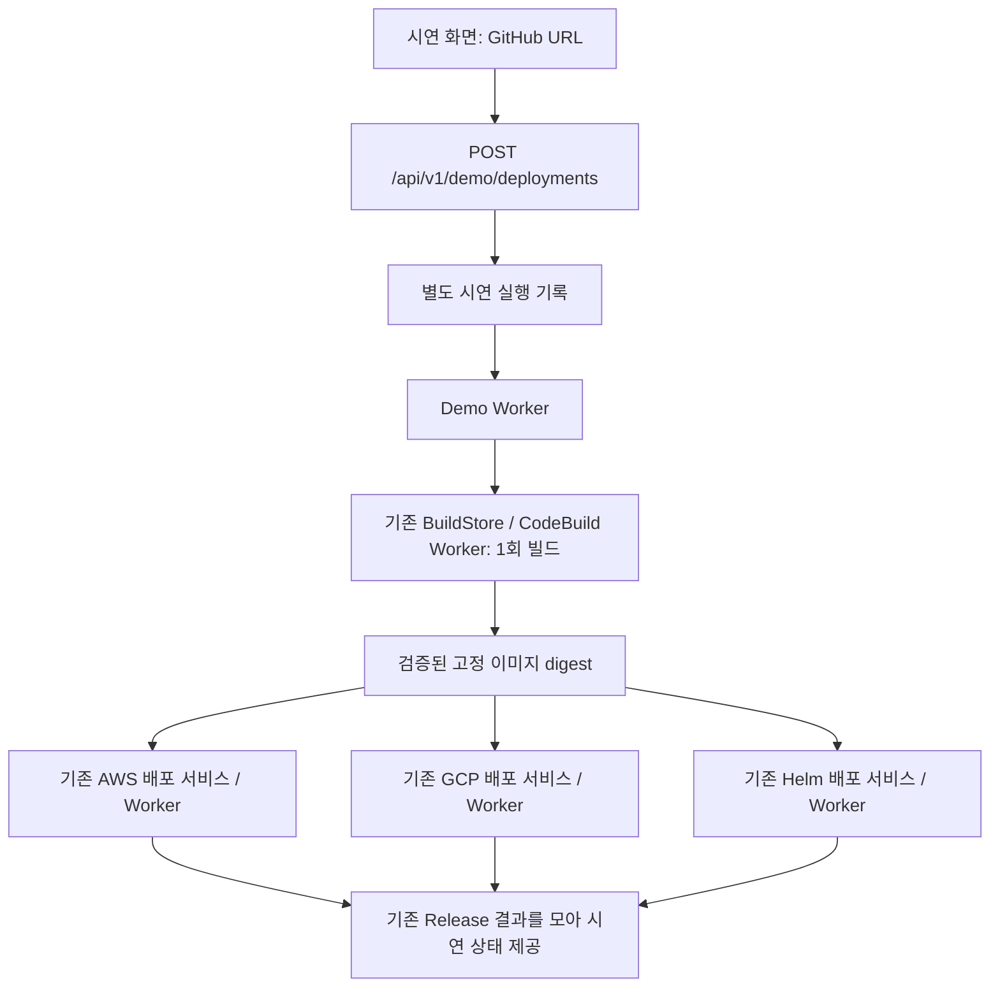

# GitHub URL → 세 환경 배포: 시연 전용 래퍼

이 기능은 기존 빌드와 배포 서비스를 호출하는 선택적 래퍼다. 앱 카탈로그나
AWS·GCP·Helm 실행기를 교체하지 않는다. 운영자가 미리 등록한 시연용 환경 세 곳을
기본 대상으로 사용한다. 매 실행마다 새 앱이나 클라우드 인프라를 만들지 않는다.
AWS·GCP·온프렘의 앱 이름은 서로 달라도 된다.



## 기존 기능과의 경계

- `controlplane/demo_deployments/`: 설정, API, 실행 기록, 재시도, 결과 취합.
- 기존 `BuildInput(deploy_after_build=false)`로 한 번 빌드한다. 빌드 실행은 기존 Worker가 담당한다.
- `DeploymentService.plan/submit`을 그대로 호출한다. 세 환경은 각자의 Worker에서 독립적으로 진행한다.
- 등록 환경의 `request_template`을 기본값으로 사용한다. 전략, DB, migration, Secret 참조,
  CPU·메모리·추적 설정을 유지한다. 시연에서 수동 클릭 없이 진행하도록 promotion만 automatic으로 지정한다.
- 전체 배포의 새 앱은 세 환경 모두 PostgreSQL과 Redis를 기본으로 사용한다.
  온프렘은 `database_mode: container`, GCP와 AWS는 `dedicated`를 사용한다.
  화면은 AWS의 미등록 앱을 전용 PostgreSQL과 Redis로 등록한다. AWS는 기존 등록 Worker의
  DB·캐시 준비가 모두 끝난 뒤 사전 확인/배포가 가능하며, 준비 중과 실패 상태를 따로 표시한다.
  API 직접 호출 시에도 먼저 AWS 앱 등록 API에 PostgreSQL·dedicated·`redis: true`를 지정해야 한다.
  첫 배포에 실패했어도 성공 이력과 생성된 데이터 구성이 없으면 새 실행에 이 기본값을 적용한다.
  이미 성공한 앱과 생성된 DB·캐시 구성, AWS의 기존 등록값은 유지한다.
  개별 배포의 기본값은 바꾸지 않는다.
  이전 실행의 재시도는 저장된 설정을 재사용하므로, 바뀐 기본값을 적용하려면 새 사전 확인/실행이 필요하다.
- 세 프로바이더의 배포 알고리즘, 헬스체크, 전환, 복구 코드는 변경하지 않는다.
- 기존 코드 연결부는 API의 선택적 라우터/초기화와 이미지 승인 함수의 좁은 확장뿐이다.
  승인 확장은 검증된 빌드와 해당 실행에 기록된 정확한 앱·환경·소유 팀을 대조한다.
  운영자 요청도 접수 당시 대상 소유 팀을 고정하며, 소유권이 바뀌면 기존 승인을 재사용하지 않는다.
  이미지 허용 목록을 전역으로 열거나 빌드 기록을 세 개 복제하지 않는다.
- `demo_*` 테이블은 기능을 설정했을 때만 생성한다. 기존 전역 마이그레이션은 변경하지 않는다.
- 프론트엔드 변경과 운영 배포 활성화는 포함하지 않는다.

## 실행 설정

기존 로컬 실행용 `ONEPORT_CONFIG`, `ONEPORT_BUILD_CONFIG`, 인증 방식과 자격 증명을 그대로 사용한다.
새 AWS 키, GCP JSON, kubeconfig는 필요하지 않다. 시연 대상 환경 ID를 지정하는 파일만 추가한다.

[예제 설정](../examples/demo-deployments/settings.json)의 세 ID를 실제 등록된 **environment ID**로
바꾼다. catalog target ID가 아니다. 현재 운영 앱을 추측해서 자동 선택하지 않는다.

```sh
export ONEPORT_DEMO_DEPLOY_CONFIG=/absolute/path/demo-settings.json
```

운영 서버에서는 소스 빌드 활성화(`ops/build/activate.py`)가 `deployment/demo-deploy.json`을
`/etc/oneport/demo-deploy.json`으로 설치하고, API에 이 환경변수를 주고,
`oneport-demo-worker` 서비스를 함께 켠다.

API와 Demo Worker가 동일한 설정·플랫폼 DB를 사용해야 한다. 기존 API, CodeBuild Worker,
세 프로바이더 Worker를 실행한 상태에서 시연 Worker를 추가한다.

```sh
uv run --frozen --project platform/backend --extra aws python -m controlplane.demo_deployments.worker
```

이 Worker는 AWS/GCP/Helm SDK로 직접 배포하지 않는다. 등록된 기존 실행기에게 요청을 전달한다.
`ONEPORT_DEMO_DEPLOY_CONFIG`가 없으면 시연 API는 503이며 별도 테이블을 생성하지 않는다.
기능을 끌 때는 시연 Worker도 중지한다. 이미 접수한 기존 Release는 기존 Worker에서 계속 진행한다.
기록과 빌드 승인 근거는 보존되어야 하므로 테이블 삭제를 비활성화 절차로 사용하지 않는다.

## 화면 연결 계약

기존 API와 동일한 인증·Origin·역할 규칙을 사용한다. 로그인 모드에서는 배포 권한이 필요하고,
다른 팀의 환경과 실행 기록에 접근할 수 없다. 프론트엔드가 호출마다 키를 새로 만들면 중복 방지가
되지 않으므로 같은 클릭의 네트워크 재전송에는 같은 `idempotency_key`를 사용한다.

### 한 번의 실행 요청

`POST /api/v1/demo/deployments` → `202`

```json
{
  "repository": "https://github.com/example/demo-app",
  "idempotency_key": "demo-click-20261004-0001"
}
```

필요할 때만 `revision`, `dockerfile`, `context`, `port`, `health_path`를 추가한다.
revision 생략 시 GitHub 기본 브랜치를 조회하고 commit을 고정한다. Dockerfile은 `Dockerfile`,
context는 `.`가 기본이다. port와 health_path 생략 시 각 환경의 기존 기본값을 사용한다.
모노레포는 Dockerfile/context를 지정해야 한다. 대상·클라우드 키는 HTTP 입력으로 받지 않는다.

`application_id`에 카탈로그 앱 ID를 넣으면 고정된 시연 대상 대신 그 앱이 프로바이더마다
연결한 환경에 배포한다. 호출자는 그 앱의 소유 팀이어야 한다. 앱이 연결하지 않은 프로바이더는
`target_not_configured`로 차단된다. 이 경우 설정 파일의 `targets`는 비워 둘 수 있다.
화면의 "전체 배포"는 앱 하나를 만들고 세 환경에 연결한 뒤 이 방식으로 실행한다.

환경 하나만 기본값과 다르게 배포하려면 `overrides`에 런타임별로 바꿀 값만 넣는다.
바꿀 수 있는 값은 `strategy`, `cpu`, `memory_mib`, `port`, `health_path`다. 넣지 않은 값은
해당 환경의 기본 설정을 쓴다. 결과 요청은 기존 프로바이더가 그대로 검증하며, 허용하지 않는
값이면 그 환경만 `deployment_defaults_rejected`로 차단된다.

```json
{
  "repository": "https://github.com/example/demo-app",
  "overrides": { "gcp_cloud_run": { "port": 9100, "health_path": "/up" } },
  "idempotency_key": "demo-click-20261004-0002"
}
```

응답에는 `id`, `state`, `repository`, `commit`, `build_id`, `image`, `targets`,
`created_at`, `updated_at`, `error_code`가 있다. 접수 당시 build_id/image/release_id는 null일 수 있다.
`202`는 접수이며 세 곳의 배포 성공을 의미하지 않는다.

### 상태 조회

`GET /api/v1/demo/deployment-runs/{id}`

| 필드 | 의미 |
|---|---|
| state | queued, building, deploying, succeeded, partial, failed, uncertain |
| build_id | 기존 `/api/v1/builds`의 빌드 ID. 기존 로그 API 재사용 가능 |
| image | 세 환경에서 공유하는 검증된 digest 이미지 |
| targets[].runtime | aws_ecs, gcp_cloud_run, onprem_helm |
| targets[].application / environment_id | 실제로 사용한 기존 앱·환경 |
| targets[].state | pending, queued, running, succeeded, failed, skipped, uncertain |
| targets[].release_id | 기존 배포 이력·상세 화면으로 연결할 Release ID |
| targets[].service_url | 기존 Release가 보고한 접속 URL |
| targets[].attempt / attempts | 현재 시도 번호와 이전 시도의 Release ID 목록 |

빌드 성공만으로 전체 성공이 되지 않는다. 세 기존 Release가 모두 succeeded여야 전체 succeeded다.
일부 성공·일부 실패는 partial, 확인되지 않은 결과는 uncertain이다. 한 환경 실패 시 성공한
다른 환경을 자동으로 롤백하지 않는다. 각 프로바이더의 기존 자동 복구 정책은 그대로 적용된다.

### 실패한 환경 재시도

`POST /api/v1/demo/deployment-runs/{id}/retry` → `202`

```json
{
  "runtimes": ["gcp_cloud_run"],
  "idempotency_key": "demo-retry-20261004-0001"
}
```

종료된 실행의 실패 환경만 재시도한다. 같은 commit·digest를 사용하고 재빌드하지 않는다.
성공한 환경의 Release ID는 유지한다. 재시도 이력은 기존 Release와 함께 남긴다.
불확실한 실행은 새 작업으로 재전송하지 않는다. 기존 프로바이더/빌드의 확인 절차로 결과가
확정되면 래퍼가 다시 읽는다. 이후 별도 배포가 진행된 환경에는 오래된 실행을 재시도할 수 없다.
빌드 자체가 실패했다면 원인을 해결한 후 새 실행 키로 다시 시작한다.

### 선택적 사전 확인

`POST /api/v1/demo/deployment-previews`에 실행 요청에서 idempotency_key를 뺀 JSON을 전달한다.
`ready`, `blockers`, 환경별 `targets[].blockers`, 고정 commit, 적용할 spec을 반환한다.
클라우드 쓰기나 빌드는 발생하지 않는다. 유효기간은 15분이다.
사전 확인 뒤 다른 배포가 생겼다면 빌드 전에 차단한다. 재시작 시에는 빌드의 저장소·commit·요청과
프로바이더가 정규화한 전체 배포 요청까지 대조한 후 기존 기록을 연결한다.

사전 확인 화면을 쓰는 경우 `POST /api/v1/demo/deployment-runs`에
`{"preview_id":"...", "idempotency_key":"..."}`를 전달하면 같은 snapshot을 실행한다.
단일 호출 화면에서는 이 두 단계를 따로 호출할 필요가 없다.

공개 GitHub 저장소는 개별 허용 목록 등록 없이 사용할 수 있습니다.
대표 차단 코드: `invalid_repository_url`, `repository_not_found`, `github_unavailable`,
`target_not_configured`, `target_image_deploy_unsupported`, `deployment_defaults_rejected`,
`target_release_in_progress`, `target_data_preparing`, `target_data_failed`.
별도의 저장소 빌드 서비스를 호출하는 GCP bridge는 공통 이미지 배포 대상에서 제외하며, native Cloud Run을 사용한다.
인증 실패는 401, 배포 역할 부족은 403, 없는/타 팀 실행은 404, 중복 충돌·현재 상태 충돌은 409,
입력 오류는 422, 시연 설정 비활성은 503이다.

## 시연 전 확인할 사항과 범위

- 저장소는 기존 CodeBuild 설정의 허용 목록에 있어야 한다. 현재 빌드/이미지는 공개 저장소·Docker Hub·amd64 계약이다.
- 앱은 각 환경의 port·health path, `LAUNCHPAD_RELEASE_ID`에 맞는 `X-Launchpad-Release` 응답 헤더를 지원해야 한다.
- 기존 GCP 서비스, AWS 앱 등록, Helm 환경은 준비되어 있어야 한다. 신규 앱·Cloud Run 서비스 자동 생성은 이 래퍼의 범위가 아니다.
- 원래 프로바이더가 지원하지 않는 DB migration·복구 기능을 래퍼가 추가로 제공하지 않는다.
  각 기본 템플릿과 소스 앱의 데이터 요구사항이 맞아야 한다.
- 환경별 서로 다른 URL을 반환한다. 전역 도메인 라우팅·DB 동기화는 추가하지 않는다.
- 자동 테스트는 실제 PostgreSQL의 격리 스키마와 가짜 클라우드 경계를 사용한다.
  실제 CodeBuild·AWS·GCP·Helm 성공 검증을 대신하지 않는다.

검증 명령:

```sh
uv run --frozen --project platform/backend --extra aws pytest -q platform/backend/tests/test_demo_deployments.py
```
