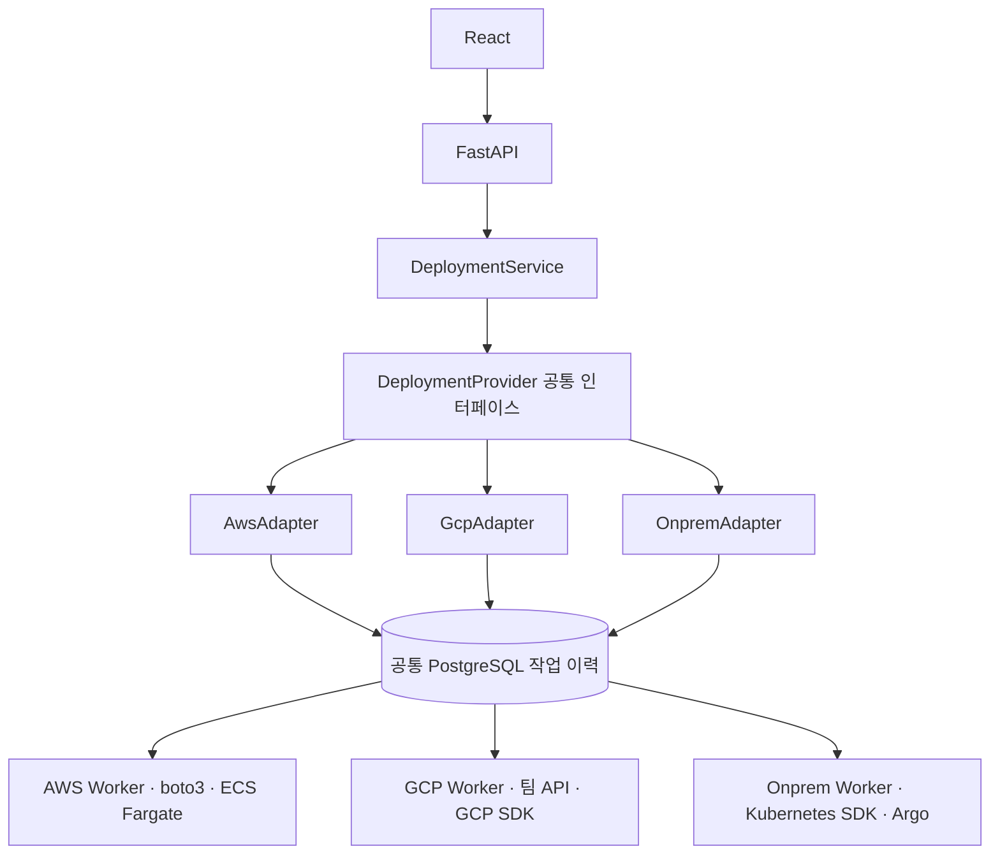

# 공통 DeploymentProvider 인터페이스

## 플랫폼 개발자가 보는 호출

```python
from controlplane.sdk import DeploymentProvider, DeploymentSpec

# Registry는 운영자 설정에 따라 AWS/GCP/온프렘 Adapter를 등록해 둡니다.
provider: DeploymentProvider = registry.get(environment_id)
if provider is None:
    raise ValueError("환경을 먼저 등록하세요")

spec = DeploymentSpec.model_validate(payload)
provider.validate(spec)                     # 지원 기능·환경·요청 검사
plan = provider.plan(spec)                  # 읽기 전용 계획, 리소스 생성 없음
operation = provider.submit(spec, operation_key="deployment-request-001")
status = provider.observe(operation)        # queued / running / succeeded / failed / uncertain
```

이 호출 코드는 Provider가 바뀌어도 같습니다. `operation_key`는 논리 요청마다 생성해 보관하고, 통신 오류 재시도에서는 같은 키와 같은 요청을 사용합니다. 다른 내용으로 같은 키를 사용하면 거부합니다.

`submit()`은 영속 큐에 요청을 기록하고 `DeploymentOperation`을 반환합니다. 실제 클라우드 작업 완료까지 기다리지 않습니다. 별도 Worker가 실행하고, `observe()`는 Worker가 기록한 상태를 읽습니다. Worker가 실행되지 않으면 배포는 진행되지 않습니다. `queued`는 배포 성공이 아닙니다.

## 구조



공통화하는 것은 애플리케이션의 배포 의도, 접수/조회 방식, 결과의 의미입니다. 내부 Worker의 단계나 각 클라우드의 리소스 모델까지 억지로 같게 만들지 않습니다. 예를 들어 ECS의 트래픽 전환과 Argo의 수동 승격은 각 구현에 남습니다.

## 공통 입력·응답

- `DeploymentSpec`: application, environment_id, source와 선택 설정. 포트·자원·전략을 생략하면 Provider의 기본값 또는 기존 설정 유지 정책을 사용합니다. `spec.requested()`는 사용자가 지정한 필드만 직렬화합니다.
- source: `image`(digest 고정), `git`(커밋 고정), `repository`(기본 브랜치 빌드)를 구분합니다. 모든 Provider가 세 방식을 지원하는 것은 아닙니다. 현재 공통 실행 진입점은 AWS/온프렘=image, GCP=repository입니다.
- 일반 환경변수는 `env`, 비밀 값은 `secret_bindings`의 논리 참조로 전달합니다. DB는 `resources.database_mode=shared`만 지원합니다.
- `DeploymentOperation`: id, application, environment_id, runtime. 다른 환경이나 앱으로 위조한 작업 ID 참조는 거부합니다.
- `DeploymentStatus`: 공통 status, Provider 상세 phase, image/repository, service_url, error_code, events, 시각. 내부 checkpoint나 자격 증명은 반환하지 않습니다.
- `capabilities()`: source_kinds, configurable_fields, 지원 전략·리소스·기능. API는 미지원 입력을 접수 전에 거부하고 화면은 지원 범위만 표시합니다.

GCP 현재 API는 신규 자원·env·Secret·전략 변경을 받지 않으므로 공통 Spec으로 그런 설정을 지정해도 거부합니다. 인터페이스 통일은 미구현 기능을 구현된 것처럼 표시하는 것이 아닙니다. GCP의 기존 제한은 Adapter 내부 변환과 capabilities로 드러냅니다.

`register_application()`은 등록 기능을 가진 Provider만 구현하고, 나머지는 `UnsupportedOperation`을 반환합니다. API에 `if AWS ...` 분기는 없습니다.

## 코드 읽는 순서

1. `backend/src/controlplane/sdk.py`: 플랫폼이 import하는 공개 진입점.
2. `backend/src/controlplane/providers/interface.py`: Protocol, Spec, 작업 ID, 상태 모델.
3. `backend/src/controlplane/services/deployments.py`: 클라우드별 분기가 없는 배포 서비스.
4. `backend/src/controlplane/providers/durable.py`: 공통 검증·영속 접수·조회 구현.
5. `backend/src/oneport_aws/adapter.py`, `providers/gcp/adapter.py`, `providers/onprem/adapter.py`: 각 Adapter의 내부 요청 변환·계획·설정.
6. `backend/tests/aws/test_common_port.py`: 세 Adapter에 동일한 테스트를 적용한 계약 검증.

기존 `parse_request()`는 내부 Worker 계약으로 변환하는 호환 계층입니다. API와 배포 서비스는 이 메서드를 직접 호출하지 않습니다. 기존 Worker CLI는 유지하며, 신규 플랫폼 코드는 공통 SDK 진입점을 사용합니다.

## 검증과 남은 범위

실제 PostgreSQL journal과 SDK/HTTP 전송 더블로 세 Provider 모두 동일한 `validate → plan → submit → observe` 흐름, 완료 상태, 같은 요청 키의 중복 방지, 환경 소유권, 미지원 입력의 사전 거부를 검증합니다. 기존 장애·재시도·복구 테스트도 유지합니다.

실제 AWS·GCP·팀 온프렘 클러스터 종단 배포는 이번 리팩터링에서 실행하지 않습니다. Provider별 새 기능 구현, 공통 수동 promote/rollback API, Shared DB 자동 발급, SSO/RBAC, 운영 HA는 별도 범위입니다. 공통 인터페이스만으로 이 기능들이 생기지는 않습니다.
