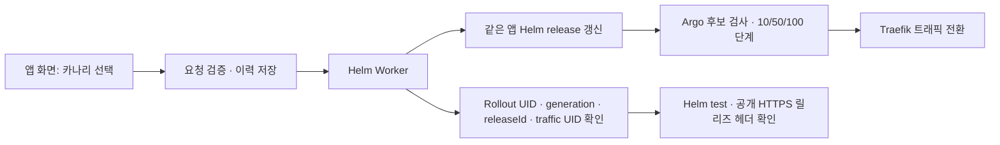

# 온프렘 자동 카나리

플랫폼은 고정된 Helm 앱 차트에 `strategy.type=canary`, `promotion=automatic`을 전달한다. Argo Rollouts가 후보 검사와 단계 진행을 담당하며, TraefikService 가중치로 실제 트래픽을 나눈다. 플랫폼이 직접 Service hash나 트래픽 weight를 수정하지 않는다.

- 첫 배포: 공개 경로 없이 설치 → 후보 검사 → 공개 → HTTP 200과 정확한 릴리즈 헤더를 연속 확인한다. 비교할 기존 버전이 없어 비율 분배 데모는 두 번째 배포부터 가능하다.
- 재배포: 기본 10% → 50% → 100%, 단계당 30초 대기와 차트의 후보 검사를 사용한다. UI에서 초기 비율 1~99%, 대기 5~120초를 설정할 수 있다. 초기 비율이 50% 이상이면 중간 50% 단계를 생략한다.
- 실패: 이전에 공개 검증을 통과한 앱 Helm revision으로 복원하고 다시 확인한다. 복원된 Argo 단계가 완료될 때까지 HTTP 검사 횟수를 소모하지 않는다. 전체 작업에는 기한이 있다.
- 기록: 차트 SHA, Helm revision, Rollout UID/generation, TraefikService UID와 관측된 가중치·단계를 기록한다. 새 Worker도 저널을 재조회하며, 이미 적용한 Helm 변경을 반복하지 않는다.
- 카나리는 온프렘 환경에서 선택하는 배포 전략이다. 환경 목록에는 별도의 카나리 환경을 만들지 않는다. 배포하기·배포 계획 모두 블루그린/카나리를 표시한다.
- 아직 배포하지 않은 앱은 같은 환경에서 두 전략 중 하나를 선택할 수 있다. 첫 카나리 배포는 비교할 이전 버전이 없어 검사 후 공개하며, 이를 화면에서 안내한다.
- 현재 차트는 생성 후 전략 종류 변경을 지원하지 않는다. 이미 블루그린으로 배포된 앱에서는 카나리를 비활성화하고 이유를 표시한다. API도 전략 변경을 거부한다. 기존 앱을 삭제하거나 DB를 다시 만들며 우회하지 않는다.
- 이전 검증용 `onprem-canary-demo`는 일반 환경 목록에서 제외한다. 진행 중 작업·이력 복구를 위해 내부 바인딩과 Worker는 유지한다. 이 항목이 사용자에게 카나리 선택 경로가 되어서는 안 된다.
- DB·Redis는 별도 데이터 릴리스다. 구·신 앱이 같은 데이터 서비스를 쓰며 앱 롤백은 데이터를 되돌리지 않는다.

## 지원 범위

자동 블루그린과 자동 카나리를 연결했다. **수동 승인, 중간 단계 사용자 중단, 사용자 선택 과거 릴리즈 롤백, 데이터 완전 삭제는 이 변경의 구현 범위가 아니다.** 차트의 지원 범위와 플랫폼에 연결된 범위를 구분한다. 기존 자동 실패 복구는 지원한다.

카나리 전용 데모는 앱 차트 0.1.1을 사용한다. Notes의 0.2.0 모니터링 설정은 유지한다. 리소스 생성은 제한된 deployer 계정으로 수행한다.

## 검증 (2026-10-03)

전용 테스트 앱 `canary-proof`에서 동일 Worker를 실행했다.

- 최초 배포 `9449b651a888abc0c6dc17bd`: 비공개 설치·검사·공개 성공.
- 재배포 `8d073c287fcf9ec95b83fc79`: 실제 Traefik 가중치 10%, 50%, 100%를 Worker 이벤트로 확인. 최종 공개 HTTPS 200 및 `X-Launchpad-Release` 일치.
- 실패 후보 `7ff8c6bff6a5e35a0a5f76d1`: `/healthz`에 503을 반환하는 후보는 `release_failed_restored`로 종료. 이전 릴리즈 `8d073c287fcf9ec95b83fc79`의 공개 HTTPS 200·헤더 일치를 다시 확인했다.
- 회귀 테스트: Worker 재시작 후 진행 상태 유지, 트래픽 리소스 UID 교체 거부, 기존 앱 전략 변경 거부, 수동/자동 복구 해제 정책 거부, 복구 대기 중 HTTP 검사 예산 보존.

공식 동작 참고: [Argo Canary](https://argo-rollouts.readthedocs.io/en/stable/features/canary/), [Traefik 연동](https://argo-rollouts.readthedocs.io/en/stable/features/traffic-management/traefik/).
